PRD – Hệ thống thuyết minh tự động đa ngôn ngữ tại khuôn viên Đại học Sài Gòn

## Mục lục

1. Giới thiệu và phạm vi

1.1 Mục đích của tài liệu

1.2 Phạm vi

1.3 Phiên bản mã nguồn được mô tả

1.4 Quy ước trình bày

1.5 Thuật ngữ

2. Tổng quan hệ thống

2.1 Bài toán và giá trị

2.2 Kiến trúc

2.3 Công nghệ

2.4 Cấu trúc thư mục

2.5 Triển khai

3. Tác nhân và vai trò

4. Quy trình nghiệp vụ

4.1 BP-01 Chuẩn bị nội dung địa điểm

4.2 BP-02 Tham quan có thuyết minh tự động

4.3 BP-03 Theo dõi hiệu quả sử dụng

4.4 BP-04 Quản trị tài khoản

5. Quy tắc nghiệp vụ

5.1 Nhóm A: Ngôn ngữ và nội dung

5.2 Nhóm B: Địa điểm

5.3 Nhóm C: Vùng và tự động phát

5.4 Nhóm D: Vị trí, giả lập và bản đồ

5.5 Nhóm E: Dữ liệu và thống kê

5.6 Nhóm F: Mã QR

5.7 Nhóm G: Tài khoản, đăng nhập và phân quyền

5.8 Nhóm H: Giọng đọc thuyết minh

5.9 Nhóm I: PWA

6. Mô hình use case

6.1 Use Case Diagram

6.2 Danh sách use case

6.3 Phân quyền theo use case

7. Đặc tả Focused Use Case

7.1 UC01 Chọn ngôn ngữ

7.2 UC02 Tải dữ liệu địa điểm

7.3 UC03 Xem bản đồ và vị trí hiện tại

7.4 UC04 Xem danh sách và chi tiết địa điểm

7.5 UC05 Nghe thuyết minh thủ công

7.6 UC06 Tự động phát thuyết minh khi vào vùng

7.7 UC07 Giả lập vị trí

7.8 UC08 Mở địa điểm bằng mã QR

7.9 UC09 Ghi nhận sự kiện thống kê

7.10 UC10 Hiển thị mã QR mở web

7.11 UC11 Đăng nhập

7.12 UC12 Đăng xuất

7.13 UC13 Đổi mật khẩu

7.14 UC14 Xem thống kê

7.15 UC15 Xem danh sách địa điểm

7.16 UC16 Thêm địa điểm

7.17 UC17 Sửa địa điểm

7.18 UC18 Xóa địa điểm

7.19 UC19 Tạo và tải mã QR

7.20 UC20 Tạo tài khoản admin

7.21 UC21 Cập nhật tài khoản admin

8. Mô hình dữ liệu

8.1 ERD

8.2 Từ điển dữ liệu

8.3 Chỉ mục, bộ đếm và ràng buộc kiểm tra

8.4 Dữ liệu khởi tạo (seed.sql)

8.5 Hình dạng JSON của địa điểm

9. Đặc tả API

9.1 Quy ước chung

9.2 Tổng hợp các API

9.3 Chi tiết từng API

10. Đặc tả giao diện

10.1 Web – màn hình W-01 (trang chính, đường dẫn “/”)

10.2 Dashboard – các màn hình

10.3 Hệ thống thiết kế

11. Thuật toán và máy trạng thái

11.1 Khoảng cách Haversine (BR-C1)

11.2 Bộ theo dõi vùng (BR-C2 đến BR-C6)

11.3 Luồng xử lý mỗi lần có vị trí (UC06)

11.4 Trạng thái phát thuyết minh

11.5 Vẽ vùng tròn trên bản đồ

11.6 Tách mã từ nội dung QR (BR-F1)

11.7 Tổng hợp thống kê (BR-E5)

12. Yêu cầu phi chức năng, cấu hình và vận hành

12.1 Yêu cầu phi chức năng

12.2 Biến môi trường

12.3 Lệnh và quy trình khởi tạo lần đầu

13. Tiêu chí chấp nhận và kiểm thử

13.1 Tiêu chí chấp nhận theo use case

13.2 Các kiểm thử đã chạy

13.3 Chưa được kiểm tra

14. Ma trận truy vết

15. Giới hạn kiểm chứng và việc còn lại

Phụ lục A. schema.sql (cơ sở dữ liệu)

Phụ lục B. pois.json (dữ liệu dự phòng và dữ liệu mẫu)

Phụ lục C. Chuỗi giao diện của web (ba ngôn ngữ)

Phụ lục D. globals.css của web

Phụ lục E. globals.css của dashboard

# 1. Giới thiệu và phạm vi

## 1.1 Mục đích của tài liệu

Tài liệu này mô tả hệ thống thuyết minh tự động đa ngôn ngữ tại khuôn viên Đại học Sài Gòn theo đúng những gì mã nguồn hiện có thực hiện (viết ngược từ sản phẩm). Mục tiêu là một người, hoặc một công cụ AI, chỉ cần đọc tài liệu này cũng dựng lại được hệ thống với cùng hành vi: các quy trình và quy tắc nghiệp vụ, use case, sơ đồ hoạt động, mô hình dữ liệu, hợp đồng API và giao diện.

Nghiệp vụ và quy trình nghiệp vụ được ưu tiên mô tả chặt chẽ: mỗi quy tắc có mã BR-xx, mỗi use case tham chiếu quy tắc, API, bảng dữ liệu, và có tiêu chí chấp nhận kèm kiểm thử (chương 13, 14).

## 1.2 Phạm vi

### Thuộc phạm vi

Web dành cho người dùng (PWA, Next.js): xem bản đồ, chọn ngôn ngữ, nghe thuyết minh thủ công hoặc tự động khi vào vùng, mở địa điểm bằng mã QR, hiển thị QR để mở web/PWA trên thiết bị khác, giả lập vị trí.

Server API và cơ sở dữ liệu (Express, PostgreSQL): lưu địa điểm, bản dịch, tài khoản, sự kiện thống kê; đăng nhập và phân quyền.

Dashboard quản trị (Next.js): quản lý địa điểm và bản dịch (hỗ trợ chọn trực tiếp tọa độ và xem trước vùng kích hoạt trên bản đồ tương tác MapPicker), mã QR, thống kê, tài khoản admin.

### Ngoài phạm vi

Ứng dụng di động React Native (Expo) có trong repository nhưng không thuộc tài liệu này.

Tải trực tiếp tệp audio lên máy chủ (hiện cung cấp URL ngoại vi hoặc CDN qua trường `audioUrl`).

Xóa tài khoản admin (chỉ khóa), thu hồi token phía server, hoạt động offline đầy đủ.

## 1.3 Phiên bản mã nguồn được mô tả

Tài liệu mô tả mã nguồn hiện có trong thư mục campus-guide-repos (các phần web, server, dashboard). Quy tắc, API, bảng dữ liệu và giao diện được đối chiếu với các phần mã nguồn này; các giới hạn kiểm chứng và việc chưa thể xác nhận được liệt kê tại chương 15.

## 1.4 Quy ước trình bày

| Ký hiệu | Ý nghĩa |
| --- | --- |
| UCnn | Use case, mô tả theo mẫu Focused Use Case (chương 7) |
| BR-Xn | Quy tắc nghiệp vụ (chương 5), X là nhóm quy tắc |
| BP-nn | Quy trình nghiệp vụ (chương 4) |
| A1, A2… | Alternative Path: nhánh phụ vẫn dẫn đến kết quả thành công |
| E1, E2… | Exception Path: tình huống lỗi hoặc bất thường |
| {Tên} | Extension Point: đoạn xử lý được mô tả riêng ở mục Extension Points |
| W-xx, D-xx | Màn hình của web (W) và của dashboard (D), chương 10 |
| T-xxx | Kiểm thử, chương 13 |

## 1.5 Thuật ngữ

| Thuật ngữ | Giải thích |
| --- | --- |
| Địa điểm (POI) | Một điểm trong khuôn viên có tọa độ, bán kính vùng và thuyết minh ba ngôn ngữ |
| Vùng (geofence) | Hình tròn tâm tại địa điểm, bán kính radiusMeters; vào vùng là điều kiện để tự động phát |
| Thuyết minh | Nội dung âm thanh của địa điểm, được phát từ file audio riêng (nếu có audioUrl) hoặc đọc văn bản “<tên>. <mô tả>” bằng giọng đọc của trình duyệt |
| Tự động phát | Chế độ bật/tắt; khi bật, vào vùng của địa điểm thì tự phát thuyết minh |
| Thời gian nghỉ | Khoảng 60 giây sau một lần tự phát, trong đó địa điểm đó không được tự phát lại |
| Giả lập vị trí | Chế độ đặt vị trí giả thay cho GPS để thử mà không cần đi bộ |
| Mã QR của địa điểm | Chuỗi dạng DHSG-POI-001, định danh địa điểm trong mã QR |
| Mã QR mở web | QR trên bản đồ chứa URL gốc của web; không gắn với một địa điểm cụ thể |
| PWA | Web ứng dụng cài được lên điện thoại, có manifest và service worker |
| Quản trị, Biên tập | Hai vai trò của dashboard (admin, editor) |
| Dữ liệu dự phòng | File pois.json đi kèm web, dùng khi không lấy được dữ liệu từ API |

# 2. Tổng quan hệ thống

## 2.1 Bài toán và giá trị

Người đến khuôn viên cần được giới thiệu về từng địa điểm bằng ngôn ngữ của họ mà không cần hướng dẫn viên. Hệ thống xác định vị trí người dùng, và khi họ đi vào vùng của một địa điểm thì tự đọc thuyết minh bằng Tiếng Việt, Tiếng Anh hoặc Tiếng Trung. Nhóm quản trị nhập nội dung qua dashboard, in mã QR đặt tại địa điểm, và xem thống kê sử dụng.

## 2.2 Kiến trúc

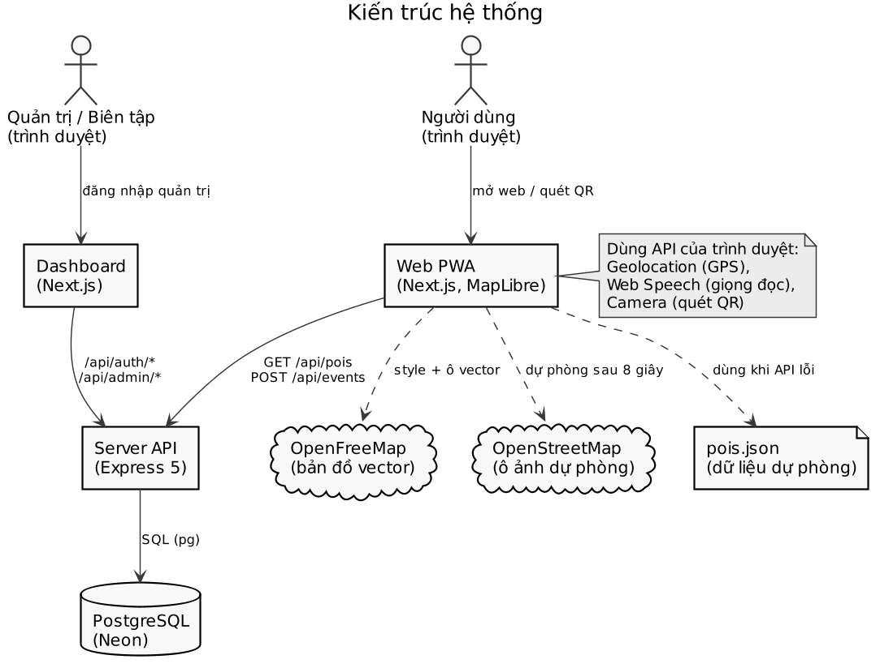

Hình 1. Kiến trúc hệ thống

| Thành phần | Vai trò | Giao tiếp |
| --- | --- | --- |
| Web (web/) | Giao diện người dùng, PWA. Chạy hoàn toàn trên trình duyệt (xuất tĩnh, không cần máy chủ Node) | GET /api/pois, POST /api/events; Geolocation, Web Speech, Camera của trình duyệt; OpenFreeMap/OpenStreetMap |
| Dashboard (dashboard/) | Giao diện quản trị. Next.js chạy phía trình duyệt | Các API /api/auth/* và /api/admin/* |
| Server (server/) | API REST JSON, đăng nhập, phân quyền, kiểm tra dữ liệu, thống kê | PostgreSQL qua thư viện pg (SQL thuần) |
| PostgreSQL | Lưu địa điểm, bản dịch, tài khoản, sự kiện | Kết nối bằng DATABASE_URL |
| pois.json | Dữ liệu dự phòng trong web | Đọc khi API không dùng được |

## 2.3 Công nghệ

| Phần | Công nghệ chính (phiên bản trong package.json) |
| --- | --- |
| web | Next.js 16.4.2 (App Router, xuất tĩnh), React 19.3.0, MapLibre GL JS ^5.24.0, html5-qrcode ^2.3.8, JavaScript |
| dashboard | Next.js 16.4.3 (App Router), React 19.3.0, qrcode ^1.5.4, JavaScript |
| server | Node.js ≥ 20 (ES module), express ^5.3.0, pg ^8.23.1, bcryptjs ^3.0.3, jsonwebtoken ^9.0.3, cors ^2.8.6, zod ^4.6.7, dotenv ^18.0.9; kiểm thử bằng @electric-sql/pglite ^0.5.11 |
| CSDL | PostgreSQL (nhà cung cấp dự kiến: Neon) |
| Bản đồ | OpenFreeMap (style liberty), dự phòng ô ảnh OpenStreetMap; dùng MapLibre 5.x vì bản 6 chỉ còn dạng ES module |

## 2.4 Cấu trúc thư mục

campus-guide-repos/  
├─ web/                    Web PWA (Next.js)  
│  ├─ app/                 page.js, layout.js, manifest.js, globals.css, ServiceWorkerRegister.js  
│  ├─ components/          MapView, PoiList, PoiDetail, QrScanner, SimulationPanel  
│  ├─ hooks/               useGeolocation, useNarration, usePois  
│  ├─ lib/                 geofence.js, circle.js, qr.js, poiSource.js, mapConfig.js, i18n.js  
│  ├─ data/pois.json       dữ liệu dự phòng  
│  └─ public/              sw.js, icon-192.png, icon-512.png  
├─ dashboard/              Dashboard (Next.js)  
│  ├─ app/                 layout.js, login/, (admin)/ {page, pois/, qr/, users/, account/}  
│  ├─ components/          Shell.js, PoiForm.js  
│  └─ lib/                 api.js, auth.js, permissions.js  
├─ server/                 API (Express)  
│  ├─ src/                 index.js, app.js, config.js, db.js, permissions.js, validation.js,  
│  │                       poiRepo.js, errors.js, rateLimit.js, middleware/auth.js,  
│  │                       routes/{public,auth,admin}.js  
│  ├─ sql/                 schema.sql, seed.sql  
│  ├─ scripts/             run-sql.js, create-admin.js  
│  └─ tests/               api.test.js, helpers.js  
└─ qr-samples/             6 ảnh QR mẫu tương ứng các POI DHSG-POI-001–006

## 2.5 Triển khai

Mỗi phần là một project Vercel riêng: web (Root Directory campus-guide-repos/web), server (campus-guide-repos/server), dashboard (campus-guide-repos/dashboard). Cơ sở dữ liệu PostgreSQL ở Neon. Server nhận DATABASE_URL, JWT_SECRET, CORS_ORIGINS; web và dashboard nhận NEXT_PUBLIC_API_URL (và dashboard thêm NEXT_PUBLIC_WEB_URL). Các biến NEXT_PUBLIC_* được gắn vào lúc build nên đổi xong phải triển khai lại. Lệnh khởi tạo cơ sở dữ liệu chạy từ máy quản trị (chương 12).

# 3. Tác nhân và vai trò

| Tác nhân | Loại | Mô tả | Có thể làm |
| --- | --- | --- | --- |
| Người dùng | Chính | Khách tham quan, không cần đăng nhập, dùng web trên trình duyệt (thường là điện thoại) | UC01–UC10 |
| Biên tập (editor) | Chính | Thành viên nhóm quản trị nội dung | UC11–UC17, UC19 (không xóa địa điểm, không quản lý tài khoản) |
| Quản trị (admin) | Chính | Có mọi quyền của Biên tập, thêm xóa địa điểm và quản lý tài khoản | UC11–UC21 |
| Người vận hành | Phụ | Người chạy lệnh khởi tạo cơ sở dữ liệu và tạo admin đầu tiên (npm run db:schema, db:seed, admin:create) | Ngoài giao diện |
| Trình duyệt | Hệ thống | Cung cấp Geolocation (GPS), Web Speech (giọng đọc), Camera (quét QR), localStorage | Được web và dashboard gọi |
| OpenFreeMap / OpenStreetMap | Hệ thống ngoài | Cung cấp style và ô bản đồ | Được web gọi |
| PostgreSQL (Neon) | Hệ thống | Lưu trữ dữ liệu | Được server gọi |

Quản trị kế thừa mọi quyền của Biên tập (sơ đồ ở chương 6).

# 4. Quy trình nghiệp vụ

Bốn quy trình nghiệp vụ mô tả cách hệ thống tạo giá trị từ đầu đến cuối. Mỗi bước tham chiếu use case ở chương 7.

## 4.1 BP-01 Chuẩn bị nội dung địa điểm

| Mục | Nội dung |
| --- | --- |
| Tác nhân | Quản trị hoặc Biên tập |
| Đầu vào | Dữ liệu địa điểm (tọa độ, bán kính, tên và mô tả 3 ngôn ngữ) |
| Kết quả | Địa điểm đang hoạt động kèm mã QR đã tải để in |
| Use case liên quan | UC11, UC16, UC17, UC19 |
| Quy tắc liên quan | BR-A2, BR-B1, BR-B2, BR-B3, BR-F3 |

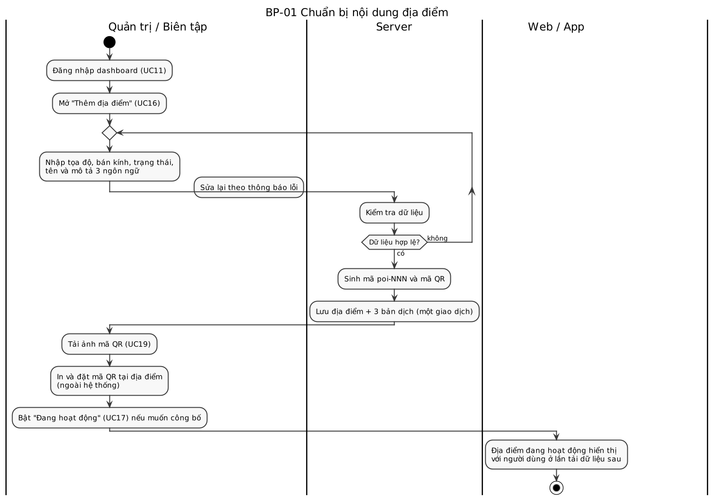

Hình 2. Sơ đồ hoạt động BP-01 Chuẩn bị nội dung địa điểm

## 4.2 BP-02 Tham quan có thuyết minh tự động

| Mục | Nội dung |
| --- | --- |
| Tác nhân | Người dùng, Web, Server |
| Đầu vào | Vị trí người dùng, ngôn ngữ chọn, dữ liệu địa điểm |
| Kết quả | Thuyết minh được phát đúng lúc; sự kiện lượt nghe được ghi |
| Use case liên quan | UC01–UC09 |
| Quy tắc liên quan | BR-C1–BR-C8, BR-E1, BR-E3 |

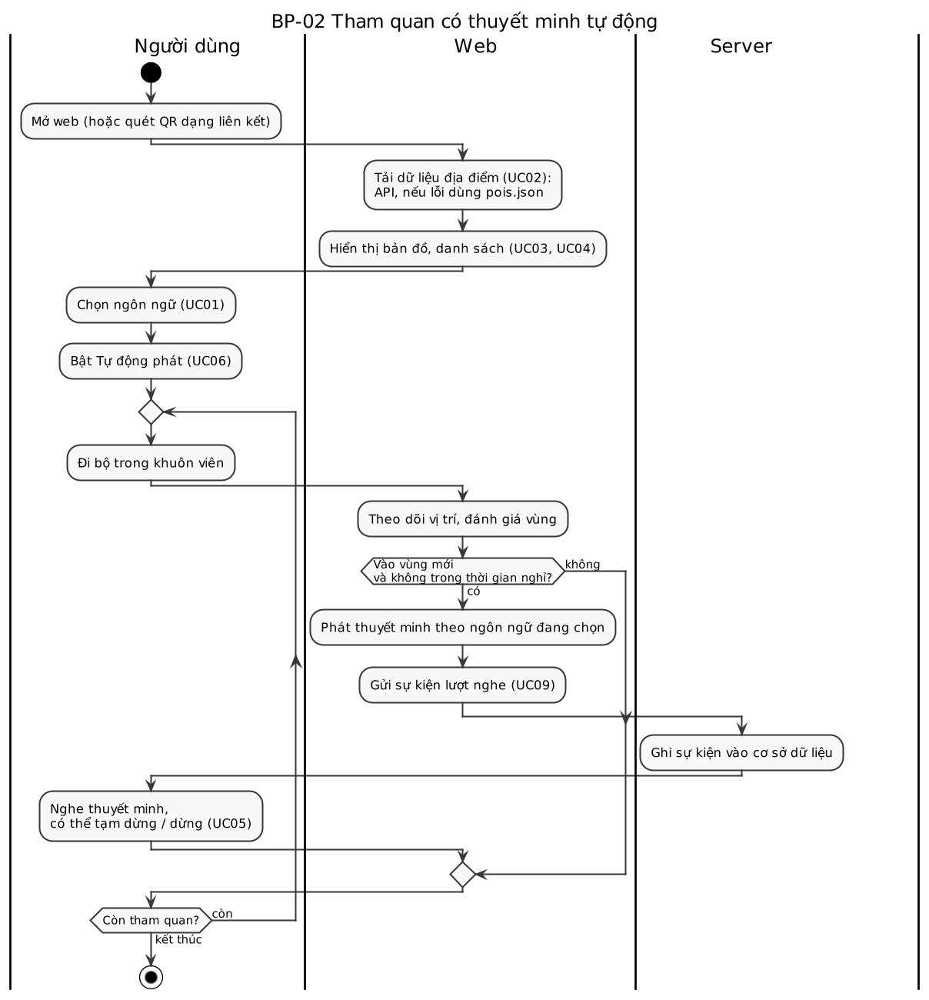

Hình 3. Sơ đồ hoạt động BP-02 Tham quan có thuyết minh tự động

## 4.3 BP-03 Theo dõi hiệu quả sử dụng

| Mục | Nội dung |
| --- | --- |
| Tác nhân | Người dùng, Web, Server, Quản trị hoặc Biên tập |
| Đầu vào | Sự kiện lượt nghe và lượt quét QR |
| Kết quả | Báo cáo thống kê theo địa điểm, ngôn ngữ, cách phát, ngày |
| Use case liên quan | UC09, UC14, UC17 |
| Quy tắc liên quan | BR-E3, BR-E4, BR-E5 |

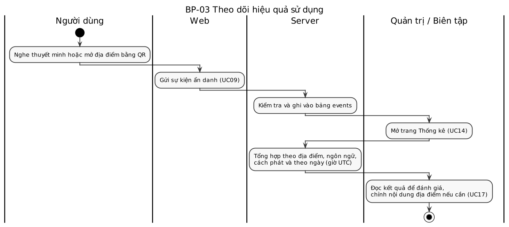

Hình 4. Sơ đồ hoạt động BP-03 Theo dõi hiệu quả sử dụng

## 4.4 BP-04 Quản trị tài khoản

| Mục | Nội dung |
| --- | --- |
| Tác nhân | Quản trị, Biên tập, Server |
| Đầu vào | Thông tin tài khoản mới |
| Kết quả | Tài khoản được cấp, đổi vai trò, khóa hoặc đặt lại mật khẩu |
| Use case liên quan | UC11, UC13, UC20, UC21 |
| Quy tắc liên quan | BR-G1–BR-G6 |

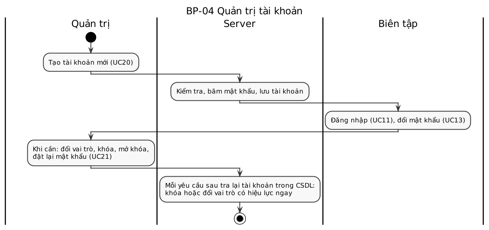

Hình 5. Sơ đồ hoạt động BP-04 Quản trị tài khoản

# 5. Quy tắc nghiệp vụ

Các quy tắc dưới đây là nguồn chính cho hành vi của hệ thống. Cột “Nguồn” chỉ nơi quy tắc được hiện thực trong mã nguồn.

## 5.1 Nhóm A: Ngôn ngữ và nội dung

| Mã | Quy tắc | Nội dung | Nguồn |
| --- | --- | --- | --- |
| BR-A1 | Ngôn ngữ hỗ trợ | Hệ thống hỗ trợ đúng ba ngôn ngữ: vi (Tiếng Việt), en (English), zh (中文). Mã ngôn ngữ của giọng đọc tương ứng là vi-VN, en-US, zh-CN. Khi mở web, ngôn ngữ mặc định là vi. | web/lib/i18n.js; web/app/page.js |
| BR-A2 | Bản dịch bắt buộc | Mỗi địa điểm phải có đủ ba bản dịch (vi, en, zh). Mỗi bản dịch có tên (1–200 ký tự) và mô tả (1–5000 ký tự) sau khi cắt khoảng trắng đầu cuối; đường dẫn audio là tùy chọn (URL hợp lệ, tối đa 2000 ký tự; chuỗi rỗng được hiểu là không có). | server/src/validation.js; server/sql/schema.sql |
| BR-A3 | Đổi ngôn ngữ | Đổi ngôn ngữ có hiệu lực ngay cho giao diện, tên và mô tả địa điểm, và cho lần bắt đầu phát tiếp theo. Thuyết minh đang phát không bị ngắt. Ngôn ngữ chỉ lưu trong phiên làm việc (tải lại trang thì về vi). | web/app/page.js |
| BR-A4 | Nội dung đọc | Nội dung đọc lên là chuỗi “<tên>. <mô tả>” theo ngôn ngữ đang chọn tại thời điểm bắt đầu phát. | web/hooks/useNarration.js |

## 5.2 Nhóm B: Địa điểm

| Mã | Quy tắc | Nội dung | Nguồn |
| --- | --- | --- | --- |
| BR-B1 | Mã địa điểm và mã QR | Mã địa điểm do server sinh, dạng poi-NNN (NNN là số từ bộ đếm tăng dần, tối thiểu 3 chữ số, không dùng lại sau khi xóa). Mã QR = “DHSG-” + mã địa điểm viết hoa (ví dụ DHSG-POI-004). Cả hai không đổi khi sửa địa điểm để mã QR đã in vẫn dùng được. | server/src/poiRepo.js |
| BR-B2 | Giới hạn tọa độ và vùng | Vĩ độ trong [-90, 90]; kinh độ trong [-180, 180]; bán kính vùng là số nguyên từ 1 đến 1000 mét (cơ sở dữ liệu cũng ràng buộc như vậy). | server/src/validation.js; server/sql/schema.sql |
| BR-B3 | Cờ hoạt động | Địa điểm có cờ active (mặc định true). Địa điểm active = false không xuất hiện trong API công khai, không nhận sự kiện thống kê, nhưng vẫn hiện trong dashboard. | server/src/routes/public.js; server/src/poiRepo.js |
| BR-B4 | Xóa địa điểm | Xóa địa điểm xóa vĩnh viễn các bản dịch và mọi sự kiện thống kê của nó (xóa dây chuyền). Không hoàn tác được. | server/sql/schema.sql (ON DELETE CASCADE) |
| BR-B5 | Thứ tự danh sách | Danh sách địa điểm (API công khai, API quản trị, web, dashboard) được sắp xếp theo mã địa điểm tăng dần. | server/src/poiRepo.js |

## 5.3 Nhóm C: Vùng và tự động phát

| Mã | Quy tắc | Nội dung | Nguồn |
| --- | --- | --- | --- |
| BR-C1 | Khoảng cách và “trong vùng” | Khoảng cách giữa hai tọa độ tính bằng công thức Haversine với bán kính Trái Đất 6.371.000 m. Vị trí nằm “trong vùng” của địa điểm khi khoảng cách ≤ bán kính vùng (bao gồm đúng bằng). | web/lib/geofence.js |
| BR-C2 | Sự kiện vào vùng | Sự kiện “vào vùng” chỉ xảy ra khi một địa điểm chuyển từ ngoài vùng sang trong vùng giữa hai lần cập nhật vị trí liên tiếp. Ở lại trong vùng không tạo sự kiện mới. | web/lib/geofence.js |
| BR-C3 | Thời gian nghỉ | Sau mỗi lần tự động phát một địa điểm, địa điểm đó phải chờ 60.000 ms (hằng số COOLDOWN_MS) mới được tự động phát lại. Thời gian nghỉ tính từ lần phát tự động gần nhất; phát thủ công không ảnh hưởng thời gian nghỉ. | web/app/page.js; web/lib/geofence.js |
| BR-C4 | Nhiều vùng chồng nhau | Nếu trong cùng một lần cập nhật có nhiều địa điểm cùng vào vùng, chỉ phát địa điểm gần vị trí người dùng nhất. Các địa điểm còn lại được coi là đã ở trong vùng, nên không tự phát cho đến khi người dùng rời vùng rồi vào lại. | web/lib/geofence.js |
| BR-C5 | Bật/tắt tự động phát | Mặc định “Tự động phát” là TẮT mỗi lần mở web. Khi bật: xóa trạng thái “đang trong vùng” và thời gian nghỉ của mọi địa điểm, và nếu đã có vị trí thì đánh giá ngay (đang đứng trong vùng thì phát ngay). Khi tắt: không tự phát, nhưng trạng thái vùng vẫn được cập nhật mỗi khi vị trí đổi. | web/app/page.js |
| BR-C6 | Mất vị trí | Khi vị trí trở thành rỗng, xóa trạng thái “đang trong vùng” của mọi địa điểm nhưng giữ nguyên thời gian nghỉ. | web/app/page.js; web/lib/geofence.js |
| BR-C7 | Hiển thị khi tự phát | Khi tự động phát một địa điểm, hệ thống chọn địa điểm đó và chuyển sang tab “Địa điểm” hiển thị chi tiết. | web/app/page.js |
| BR-C8 | Một thuyết minh mỗi lúc | Mỗi lúc chỉ có một thuyết minh được phát: bắt đầu phát một thuyết minh mới thì thuyết minh cũ bị dừng. | web/hooks/useNarration.js |

## 5.4 Nhóm D: Vị trí, giả lập và bản đồ

| Mã | Quy tắc | Nội dung | Nguồn |
| --- | --- | --- | --- |
| BR-D1 | GPS thật | Ở chế độ GPS thật, web theo dõi liên tục vị trí với độ chính xác cao, tuổi dữ liệu tối đa 2 giây, chờ tối đa 20 giây. Trạng thái: idle (không theo dõi), waiting (đang chờ), ok (có tọa độ), denied (từ chối quyền), unsupported (không hỗ trợ). Lỗi khác từ chối quyền được coi là waiting. Chỉ theo dõi GPS khi ở chế độ GPS thật. | web/hooks/useGeolocation.js |
| BR-D2 | Giả lập vị trí | Có ba cách đặt vị trí giả: đứng tại tâm một địa điểm; “ngoài vùng” = (trung bình vĩ độ các địa điểm cộng 0,002°, trung bình kinh độ các địa điểm); hoặc chạm vào chỗ trống trên bản đồ khi đang giả lập. Chọn “Dùng GPS thật” để thoát giả lập. | web/components/SimulationPanel.js; web/app/page.js |
| BR-D3 | Nguồn bản đồ | Mặc định dùng bản đồ vector OpenFreeMap (style liberty). Cấu hình theo thứ tự ưu tiên: NEXT_PUBLIC_MAP_STYLE_URL; rồi NEXT_PUBLIC_MAP_PROVIDER = osm (ô ảnh OpenStreetMap); ngược lại OpenFreeMap. Nếu style không tải được trong 8 giây hoặc lỗi trước khi tải xong thì tự chuyển một lần sang ô ảnh OpenStreetMap. | web/lib/mapConfig.js; web/components/MapView.js |
| BR-D4 | Cách vẽ bản đồ | Mỗi địa điểm vẽ một vùng tròn (đa giác 48 cạnh theo bán kính, màu xanh dương #2563eb, độ phủ 0,13; đổi sang xanh lá #16a34a, độ phủ 0,3 khi vị trí người dùng đang trong vùng; viền dày 3 thay vì 1,5 khi được chọn) và một chấm bán kính 9 px (xanh dương, xanh lá nếu trong vùng, xanh đậm #1d4ed8 nếu được chọn, viền trắng 2 px). Vị trí người dùng là chấm đỏ #dc2626 bán kính 9 px viền trắng 3 px. Khung nhìn ban đầu ôm vừa tất cả địa điểm (đệm 80 px, thu phóng tối đa 18). Có nút thu phóng +/−, không có la bàn. | web/components/MapView.js; web/lib/circle.js |
| BR-D5 | Tương tác bản đồ | Bấm vào chấm địa điểm: chọn địa điểm đó. Bấm vào chỗ trống: đặt vị trí giả lập nếu đang giả lập, ngược lại không làm gì. | web/components/MapView.js; web/app/page.js |

## 5.5 Nhóm E: Dữ liệu và thống kê

| Mã | Quy tắc | Nội dung | Nguồn |
| --- | --- | --- | --- |
| BR-E1 | Nguồn dữ liệu địa điểm | Nếu có biến NEXT_PUBLIC_API_URL: gọi GET /api/pois với thời gian chờ 6 giây; kết quả hợp lệ khi là mảng và mọi phần tử có id, qrCode (chuỗi), latitude, longitude, radiusMeters (số), name, description. Lỗi bất kỳ: dùng pois.json. Chưa có biến: dùng pois.json. Trong lúc chờ API, tạm hiển thị pois.json. Giao diện hiển thị nguồn: api, loading, fallback hoặc local. | web/lib/poiSource.js; web/hooks/usePois.js |
| BR-E2 | Dữ liệu dự phòng | File pois.json có hình dạng giống phản hồi của GET /api/pois (được kiểm thử đối chiếu). | web/data/pois.json; server/tests/api.test.js |
| BR-E3 | Sự kiện thống kê | Sự kiện lượt nghe (listen) được gửi khi bắt đầu phát thuyết minh, tự động (auto) hoặc bấm Phát (manual); tiếp tục sau tạm dừng không tính. Sự kiện quét QR (qr_scan) được gửi khi mở địa điểm bằng QR (quét, nhập mã, hoặc mở web bằng link có ?qr=/?poi=). Gửi ở chế độ nền, lỗi bỏ qua, chỉ khi đã cấu hình API. Nội dung gồm mã địa điểm, ngôn ngữ đang chọn, nguồn và client (web). Không gửi vị trí hay định danh người dùng. | web/app/page.js; web/lib/poiSource.js |
| BR-E4 | Kiểm tra sự kiện | Server chỉ nhận sự kiện hợp lệ: type thuộc {listen, qr_scan}; lang thuộc {vi, en, zh}; listen có source auto hoặc manual; qr_scan có source qr hoặc để trống (mặc định qr); client (nếu có) thuộc {web, mobile}; địa điểm phải tồn tại và đang hoạt động. Sai dữ liệu: 400; không có địa điểm: 404. | server/src/validation.js; server/src/routes/public.js |
| BR-E5 | Cách tính thống kê | Thống kê tính theo ngày UTC trong N ngày gần nhất (N từ 1 đến 365, mặc định 30, bao gồm hôm nay). Mọi địa điểm, mọi ngôn ngữ và mọi ngày trong khoảng đều có dòng, giá trị 0 nếu chưa có sự kiện. Gồm: tổng; theo địa điểm; theo ngôn ngữ; theo địa điểm và ngôn ngữ (chỉ cặp có sự kiện); theo cách phát (chỉ lượt nghe); theo ngày. | server/src/routes/admin.js |

## 5.6 Nhóm F: Mã QR

| Mã | Quy tắc | Nội dung | Nguồn |
| --- | --- | --- | --- |
| BR-F1 | Nội dung QR chấp nhận | Chấp nhận mã thuần (ví dụ DHSG-POI-001) hoặc đường link có tham số qr= hoặc poi=. Tìm địa điểm theo qrCode hoặc id, không phân biệt hoa thường, bỏ khoảng trắng đầu cuối. Không tìm thấy: hiển thị “Không tìm thấy địa điểm cho mã này.”. | web/lib/qr.js |
| BR-F2 | Mở web bằng link QR | Khi web tải với ?poi= hoặc ?qr= (ưu tiên poi nếu có cả hai), hệ thống mở địa điểm tương ứng đúng một lần và gửi sự kiện qr_scan. Nếu chưa khớp và dữ liệu API còn đang tải thì chờ dữ liệu về rồi thử lại; nếu sau đó vẫn không khớp thì bỏ qua. | web/app/page.js |
| BR-F3 | Ảnh QR ở dashboard | Mỗi địa điểm có hai kiểu QR: “mã” (chuỗi mã QR) và “liên kết” (<NEXT_PUBLIC_WEB_URL>/?qr=<mã QR mã hóa URL>). Không có NEXT_PUBLIC_WEB_URL thì chỉ có kiểu “mã”. Ảnh PNG rộng 512 px, lề 2, mức sửa lỗi M; tên file tải về <mã QR>.png và <mã QR>-lien-ket.png. | dashboard/app/(admin)/qr/page.js |

## 5.7 Nhóm G: Tài khoản, đăng nhập và phân quyền

| Mã | Quy tắc | Nội dung | Nguồn |
| --- | --- | --- | --- |
| BR-G1 | Vai trò và quyền | Có hai vai trò: admin (Quản trị) và editor (Biên tập). Quyền: xem, thêm, sửa địa điểm và xem thống kê: cả hai; xóa địa điểm và quản lý tài khoản: chỉ Quản trị. Bảng quyền nằm ở một chỗ duy nhất (server/src/permissions.js); dashboard có bản sao chỉ để ẩn/hiện nút, server mới quyết định. | server/src/permissions.js; dashboard/lib/permissions.js |
| BR-G2 | Tài khoản và mật khẩu | Email duy nhất, không phân biệt hoa thường, định dạng hợp lệ, tối đa 200 ký tự. Mật khẩu từ 8 đến 200 ký tự, lưu băm bcrypt (cost 10). Họ tên 1–200 ký tự. | server/src/validation.js; server/sql/schema.sql |
| BR-G3 | Đăng nhập | Email không tồn tại, mật khẩu sai và tài khoản bị khóa đều trả cùng một thông báo “Email hoặc mật khẩu không đúng” (HTTP 401); mật khẩu luôn được so sánh kể cả khi không có tài khoản để thời gian phản hồi không lộ email. Sau khi cùng một cặp (địa chỉ IP, email) đã đăng nhập sai 10 lần trong 15 phút, các lần thử tiếp theo bị từ chối với HTTP 429 “Đăng nhập sai quá nhiều lần, vui lòng thử lại sau”; đăng nhập đúng thì xóa bộ đếm. Bộ đếm lưu trong bộ nhớ của tiến trình server. | server/src/routes/auth.js; server/src/rateLimit.js |
| BR-G4 | Token và phiên | Token JWT thuật toán HS256, hiệu lực 8 giờ, chứa mã tài khoản và vai trò. Mỗi yêu cầu có token đều tra lại tài khoản trong cơ sở dữ liệu: không tồn tại hoặc bị khóa thì HTTP 401; vai trò dùng để kiểm quyền là vai trò hiện tại trong cơ sở dữ liệu. Không có thu hồi token phía server. | server/src/middleware/auth.js |
| BR-G5 | Bảo vệ tài khoản | Không được tự hạ vai trò khỏi admin hoặc tự khóa chính mình (HTTP 400). Không có chức năng xóa tài khoản, chỉ khóa. Tài khoản admin đầu tiên tạo bằng lệnh npm run admin:create từ biến môi trường ADMIN_EMAIL, ADMIN_PASSWORD, ADMIN_NAME; lệnh không ghi đè tài khoản đã tồn tại. | server/src/routes/admin.js; server/scripts/create-admin.js |
| BR-G6 | Đổi mật khẩu | Phải nhập đúng mật khẩu hiện tại; mật khẩu mới từ 8 ký tự. Đổi mật khẩu không làm token đã cấp mất hiệu lực. | server/src/routes/auth.js |
| BR-G7 | Phiên ở dashboard | Token lưu trong localStorage (khóa tm_token). Gặp HTTP 401 khi đang có token: xóa token và về /login. Chưa đăng nhập mà vào trang quản trị: chuyển về /login. Đã đăng nhập mà vào /login: chuyển về “/”. Nút và menu ẩn theo vai trò (chỉ về giao diện). | dashboard/lib/api.js; dashboard/lib/auth.js; dashboard/app |
| BR-G8 | CORS | Nếu biến CORS_ORIGINS có giá trị: chỉ cho phép các Origin trong danh sách (và các yêu cầu không có Origin). Để trống: cho phép tất cả. | server/src/app.js |

## 5.8 Nhóm H: Giọng đọc thuyết minh

| Mã | Quy tắc | Nội dung | Nguồn |
| --- | --- | --- | --- |
| BR-H1 | Nguồn âm thanh | Ưu tiên phát file âm thanh nếu địa điểm có trường audioUrl cho ngôn ngữ đang chọn; nếu không có hoặc phát lỗi (mất mạng, URL không hợp lệ), tự động chuyển sang đọc văn bản bằng giọng đọc của trình duyệt (Web Speech API). Hỗ trợ đầy đủ các thao tác Phát, Tạm dừng, Tiếp tục, Dừng. | web/hooks/useNarration.js |
| BR-H2 | Chọn giọng | Khi phát bằng Web Speech API, chọn giọng đầu tiên có mã ngôn ngữ bắt đầu bằng mã (vi, en hoặc zh, không phân biệt hoa thường). Nếu danh sách giọng không rỗng mà không có giọng khớp thì hiển thị cảnh báo “Thiết bị có thể chưa có giọng đọc cho ngôn ngữ này.” và vẫn đọc với mã ngôn ngữ tương ứng. Khi phát file audio thì không cần chọn giọng. | web/hooks/useNarration.js |
| BR-H3 | Không hỗ trợ giọng đọc | Nếu trình duyệt không hỗ trợ Web Speech API và địa điểm không có file audio: hiển thị cảnh báo và vô hiệu nút “Phát”. | web/components/PoiDetail.js |
| BR-H4 | Điều khiển phát | Nút hiển thị theo trạng thái của địa điểm đang xem: không phát địa điểm này thì “▶ Phát”; đang phát thì “⏸ Tạm dừng” và “⏹ Dừng”; đang tạm dừng thì “▶ Tiếp tục” và “⏹ Dừng”. Phát xong hoặc gặp lỗi thì về trạng thái nghỉ. Rời khỏi trang thì dừng phát. | web/components/PoiDetail.js; web/hooks/useNarration.js |

## 5.9 Nhóm I: PWA

| Mã | Quy tắc | Nội dung | Nguồn |
| --- | --- | --- | --- |
| BR-I1 | Web ứng dụng cài được (PWA) | Web có manifest (tên “Thuyết minh tự động – ĐHSG”, tên ngắn “Thuyết minh”, chế độ standalone, màu nền #ffffff, màu chủ đạo #1d4ed8, biểu tượng 192×192 và 512×512) và service worker chỉ đăng ký ở bản production: ưu tiên mạng, mất mạng dùng bản đã lưu; chỉ lưu các tệp cùng nguồn gốc, không lưu dữ liệu bản đồ. | web/app/manifest.js; web/public/sw.js; web/app/ServiceWorkerRegister.js |
| BR-I2 | QR mở web người dùng | Trên bản đồ, nút có nhãn trợ năng “Mở mã QR tải ứng dụng” (theo ngôn ngữ hiện chọn) mở/đóng thẻ QR. Khi mở thẻ, web tạo mã QR ở trình duyệt cho URL cố định `https://se-2026-psi.vercel.app/`, dùng mức sửa lỗi M, lề 2 và chiều rộng 220 px; thẻ hiển thị URL đích. Lỗi tạo mã được thông báo trên giao diện. QR mở trang web trong trình duyệt, không cài ứng dụng trực tiếp; khả năng cài PWA phụ thuộc trình duyệt và thiết bị. | web/components/AppQrBubble.js; web/app/page.js; web/lib/i18n.js |

# 6. Mô hình use case

## 6.1 Use Case Diagram

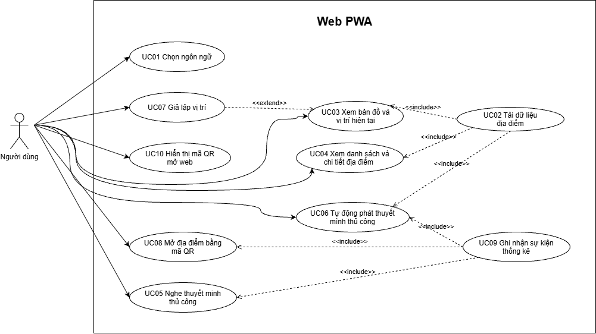

Hình 6. Use Case Diagram của web (người dùng)

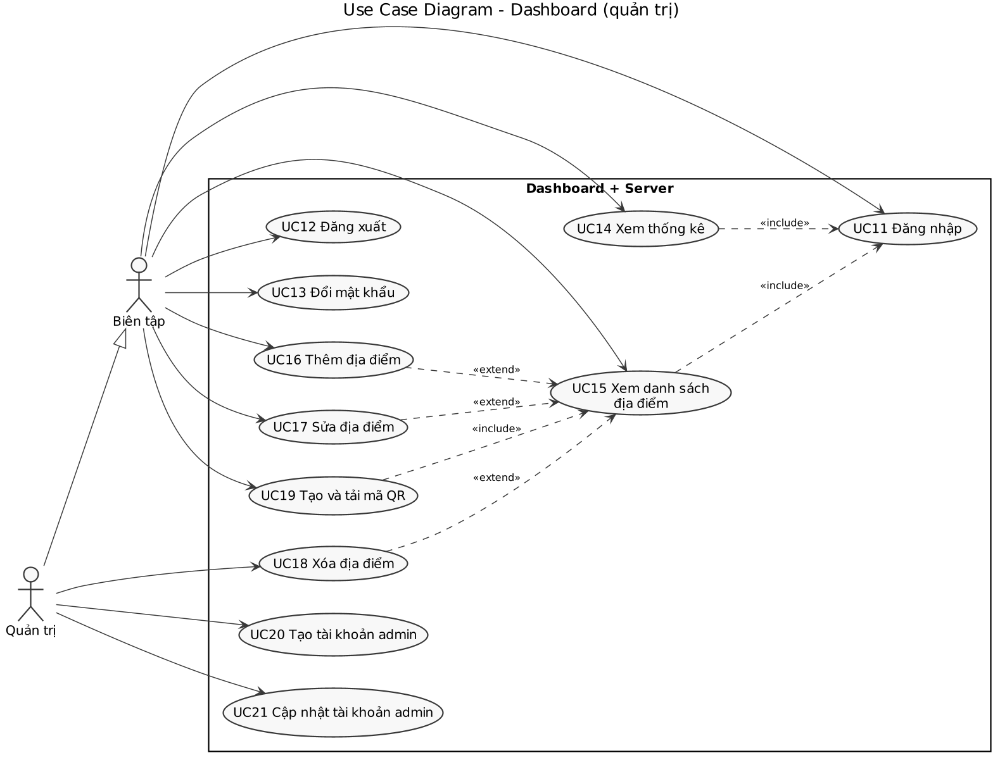

Hình 7. Use Case Diagram của dashboard (quản trị)

## 6.2 Danh sách use case

| Mã | Tên use case | Tác nhân | Quan hệ |
| --- | --- | --- | --- |
| UC01 | Chọn ngôn ngữ | Người dùng |  |
| UC02 | Tải dữ liệu địa điểm | Người dùng (gián tiếp), Server API |  |
| UC03 | Xem bản đồ và vị trí hiện tại | Người dùng | include UC02; extended by UC07 |
| UC04 | Xem danh sách và chi tiết địa điểm | Người dùng | include UC02 |
| UC05 | Nghe thuyết minh thủ công | Người dùng | include UC09 |
| UC06 | Tự động phát thuyết minh khi vào vùng | Người dùng | include UC02, UC09 |
| UC07 | Giả lập vị trí | Người dùng | extend UC03 |
| UC08 | Mở địa điểm bằng mã QR | Người dùng | include UC09 |
| UC09 | Ghi nhận sự kiện thống kê | Web (hệ thống), Server API |  |
| UC10 | Hiển thị mã QR mở web | Người dùng |  |
| UC11 | Đăng nhập | Quản trị, Biên tập |  |
| UC12 | Đăng xuất | Quản trị, Biên tập |  |
| UC13 | Đổi mật khẩu | Quản trị, Biên tập |  |
| UC14 | Xem thống kê | Quản trị, Biên tập |  |
| UC15 | Xem danh sách địa điểm | Quản trị, Biên tập |  |
| UC16 | Thêm địa điểm | Quản trị, Biên tập |  |
| UC17 | Sửa địa điểm | Quản trị, Biên tập |  |
| UC18 | Xóa địa điểm | Quản trị |  |
| UC19 | Tạo và tải mã QR | Quản trị, Biên tập |  |
| UC20 | Tạo tài khoản admin | Quản trị |  |
| UC21 | Cập nhật tài khoản admin | Quản trị |  |

## 6.3 Phân quyền theo use case

| Use case | Người dùng | Biên tập | Quản trị |
| --- | --- | --- | --- |
| UC01–UC10 (web) | Có | Có (web mở công khai) | Có (web mở công khai) |
| UC11 Đăng nhập, UC12 Đăng xuất, UC13 Đổi mật khẩu | Không | Có | Có |
| UC14 Thống kê, UC15 Danh sách, UC16 Thêm, UC17 Sửa, UC19 Mã QR | Không | Có | Có |
| UC18 Xóa địa điểm | Không | Không | Có |
| UC20 Tạo tài khoản, UC21 Cập nhật tài khoản | Không | Không | Có |

# 7. Đặc tả Focused Use Case

Mỗi use case theo mẫu Focused Use Case của môn học: Use Case Number, Name, Actor(s), Maturity, Summary, Basic Course of Events (cột Actor Action và System Response), Alternative Paths, Exception Paths, Extension Points, Triggers, Assumptions, Preconditions, Post Conditions, Reference (Business Rules) và Activity Diagram. Mã A1, E1 trong cột bước chỉ đến nhánh tương ứng; {Tên} chỉ đến Extension Point.

## 7.1 UC01 Chọn ngôn ngữ

| Trường | Nội dung |
| --- | --- |
| Use Case Number | UC01 |
| Use Case Name | Chọn ngôn ngữ |
| Actor(s) | Người dùng |
| Maturity | Focused |
| Summary | Người dùng chọn một trong ba ngôn ngữ (Việt, Anh, Trung) cho giao diện, tên, mô tả địa điểm và giọng đọc thuyết minh. |
| Extension Points | Không có. |
| Triggers | Người dùng muốn đổi ngôn ngữ. |
| Assumptions | Không có. |
| Preconditions | Web đã mở. Ngôn ngữ mặc định khi mở web là Tiếng Việt (vi). |
| Post Conditions | Ngôn ngữ hiện hành đã đổi. Ngôn ngữ không được lưu lâu dài: mở lại web thì về Tiếng Việt. |
| Reference: Business Rules | BR-A1, BR-A3, BR-A4 |
| Reference: API | Không có |
| Reference: bảng dữ liệu | Không có |
| Reference: màn hình | W-01 |

Basic Course of Events

| # | Actor Action | System Response |
| --- | --- | --- |
| 1 | Người dùng mở danh sách “Ngôn ngữ” ở góc phải thanh tiêu đề. | Hiển thị ba lựa chọn: Tiếng Việt, English, 中文; mục đang chọn được đánh dấu. |
| 2 | Người dùng chọn một ngôn ngữ. A1 | Cập nhật ngay toàn bộ chuỗi giao diện, tên và mô tả của mọi địa điểm theo ngôn ngữ mới. Các lần phát thuyết minh sau đó dùng ngôn ngữ mới; thuyết minh đang phát không bị ngắt (BR-A3). Use case kết thúc. |

Alternative Paths

A1. Người dùng chọn lại đúng ngôn ngữ đang dùng: không có thay đổi gì.

Exception Paths

Không có.

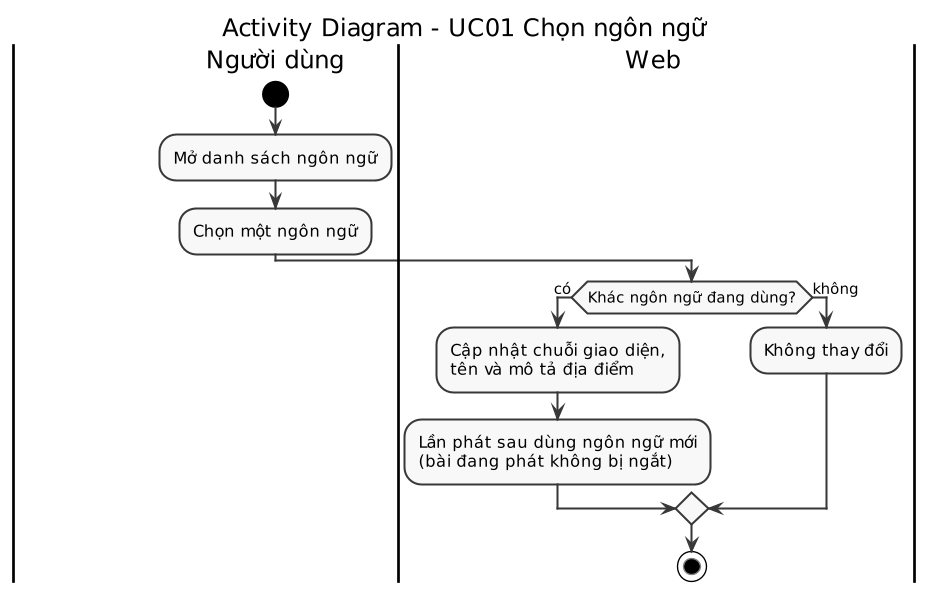

Hình 8. Activity Diagram UC01 Chọn ngôn ngữ

## 7.2 UC02 Tải dữ liệu địa điểm

| Trường | Nội dung |
| --- | --- |
| Use Case Number | UC02 |
| Use Case Name | Tải dữ liệu địa điểm |
| Actor(s) | Người dùng (gián tiếp), Server API |
| Maturity | Focused |
| Summary | Khi web mở, hệ thống nạp danh sách địa điểm từ API; nếu chưa cấu hình, API lỗi hoặc mất mạng thì dùng file pois.json dự phòng đi kèm web. |
| Extension Points | {Kiểm tra dữ liệu địa điểm}: mảng; mỗi phần tử có id, qrCode (chuỗi), latitude, longitude, radiusMeters (số), name, description (BR-E1). |
| Triggers | Web được mở. |
| Assumptions | pois.json có cùng hình dạng với phản hồi của GET /api/pois (BR-E2). |
| Preconditions | Không có. |
| Post Conditions | Danh sách địa điểm hiện hành sẵn sàng; dòng “Dữ liệu: …” cho biết nguồn: server, đang tải, dự phòng hoặc pois.json. |
| Reference: Business Rules | BR-E1, BR-E2 |
| Reference: API | GET /api/pois |
| Reference: bảng dữ liệu | pois, poi_translations |
| Reference: màn hình | W-01 |

Basic Course of Events

| # | Actor Action | System Response |
| --- | --- | --- |
| 1 | Người dùng mở web. | Hiển thị ngay danh sách địa điểm từ pois.json dự phòng. Nếu chưa đặt biến NEXT_PUBLIC_API_URL: đặt nguồn dữ liệu là “local” và kết thúc. A1 |
| 2 | — | Nếu đã đặt NEXT_PUBLIC_API_URL: đặt nguồn là “loading” và gọi GET {API_URL}/api/pois với thời gian chờ tối đa 6 giây. |
| 3 | — | Kiểm tra phản hồi: mã HTTP thành công, nội dung là một mảng, và mọi phần tử hợp lệ {Kiểm tra dữ liệu địa điểm}. E1 |
| 4 | — | Thay danh sách địa điểm bằng dữ liệu từ API, đặt nguồn là “api”. Bản đồ, danh sách và chi tiết cập nhật theo. Use case kết thúc. |

Alternative Paths

A1. Chưa cấu hình NEXT_PUBLIC_API_URL: chỉ dùng pois.json, nguồn “local”, không gọi API và không ghi thống kê.

Exception Paths

E1. Ở bước 3 hoặc khi gọi API gặp lỗi mạng, hết thời gian chờ 6 giây, mã HTTP lỗi, hoặc dữ liệu sai định dạng: giữ nguyên dữ liệu pois.json, đặt nguồn là “fallback”. Không hiển thị thông báo lỗi, chỉ đổi dòng “Dữ liệu: …” ở bảng điều khiển.

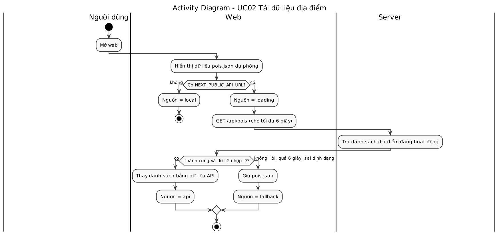

Hình 9. Activity Diagram UC02 Tải dữ liệu địa điểm

## 7.3 UC03 Xem bản đồ và vị trí hiện tại

| Trường | Nội dung |
| --- | --- |
| Use Case Number | UC03 |
| Use Case Name | Xem bản đồ và vị trí hiện tại |
| Actor(s) | Người dùng |
| Maturity | Focused |
| Summary | Người dùng xem bản đồ khuôn viên với vùng tự động phát của từng địa điểm và vị trí hiện tại của mình (GPS thật). |
| Extension Points | {Chọn nguồn bản đồ}: theo NEXT_PUBLIC_MAP_STYLE_URL (ưu tiên cao nhất), rồi NEXT_PUBLIC_MAP_PROVIDER = osm, ngược lại mặc định OpenFreeMap (BR-D3). |
| Triggers | Người dùng mở web. |
| Assumptions | Trình duyệt có WebGL và truy cập được mạng để tải dữ liệu bản đồ; GPS chỉ hoạt động trên HTTPS hoặc localhost. |
| Preconditions | Dữ liệu địa điểm đã có (UC02). |
| Post Conditions | Bản đồ được hiển thị (hoặc báo lỗi) và vị trí người dùng được cập nhật liên tục. |
| Reference: Business Rules | BR-D1, BR-D3, BR-D4, BR-D5 |
| Reference: API | Không có |
| Reference: bảng dữ liệu | Không có |
| Reference: màn hình | W-01 |

Basic Course of Events

| # | Actor Action | System Response |
| --- | --- | --- |
| 1 | Người dùng mở web. | Khởi tạo bản đồ MapLibre với style theo cấu hình {Chọn nguồn bản đồ}. Vẽ vùng tròn và chấm của mọi địa điểm; khung nhìn ôm vừa tất cả địa điểm. A1 E4 |
| 2 | — | Bật theo dõi GPS (chế độ GPS thật), hiển thị trạng thái “Đang chờ GPS…”; trình duyệt hỏi quyền vị trí. |
| 3 | Người dùng cho phép truy cập vị trí. E1 E2 E3 | Mỗi khi có tọa độ mới: cập nhật chấm đỏ vị trí người dùng, trạng thái “Đang dùng GPS thật” kèm tọa độ (5 chữ số thập phân), cập nhật khoảng cách trong danh sách và đánh giá vùng (UC06). |
| 4 | Người dùng kéo bản đồ hoặc bấm nút +/−. | Bản đồ di chuyển hoặc thay đổi mức thu phóng. |
| 5 | Người dùng bấm vào chấm một địa điểm. | Chọn địa điểm đó và chuyển sang tab “Địa điểm” hiển thị chi tiết (UC04). Use case kết thúc. |

Alternative Paths

A1. Style bản đồ chính không tải được trong 8 giây (hoặc lỗi trước khi tải xong): tự chuyển một lần sang ô ảnh OpenStreetMap; các vùng và chấm vẫn được vẽ.

A2. Người dùng đang ở chế độ giả lập (UC07): vị trí lấy theo giả lập, không dùng GPS.

Exception Paths

E1. Người dùng từ chối quyền vị trí: trạng thái hiển thị “Chưa được cấp quyền vị trí. Hãy cho phép trong trình duyệt hoặc dùng giả lập vị trí.”; không có chấm vị trí; vẫn dùng được bản đồ, danh sách, giả lập.

E2. Thiết bị không hỗ trợ định vị: trạng thái “Thiết bị không hỗ trợ định vị. Hãy dùng giả lập vị trí.”.

E3. Lỗi khác khi lấy vị trí (hết thời gian chờ 20 giây, vị trí không khả dụng): trạng thái vẫn là “Đang chờ GPS…”; hệ thống tiếp tục theo dõi.

E4. Trình duyệt không tạo được bản đồ (không có WebGL): vùng bản đồ hiển thị “Không hiển thị được bản đồ. Trình duyệt cần hỗ trợ WebGL.”; các chức năng khác vẫn dùng được.

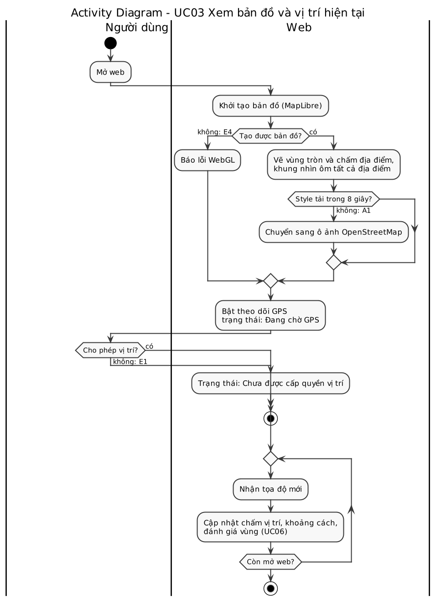

Hình 10. Activity Diagram UC03 Xem bản đồ và vị trí hiện tại

## 7.4 UC04 Xem danh sách và chi tiết địa điểm

| Trường | Nội dung |
| --- | --- |
| Use Case Number | UC04 |
| Use Case Name | Xem danh sách và chi tiết địa điểm |
| Actor(s) | Người dùng |
| Maturity | Focused |
| Summary | Người dùng xem danh sách địa điểm (kèm khoảng cách) và mở trang chi tiết của một địa điểm. |
| Extension Points | Không có. |
| Triggers | Người dùng muốn xem hoặc chọn địa điểm. |
| Assumptions | Không có. |
| Preconditions | Dữ liệu địa điểm đã có (UC02). |
| Post Conditions | Chi tiết của địa điểm được chọn đang hiển thị, hoặc danh sách đang hiển thị. |
| Reference: Business Rules | BR-B5, BR-C7 |
| Reference: API | Không có |
| Reference: bảng dữ liệu | Không có |
| Reference: màn hình | W-01 (tab Địa điểm) |

Basic Course of Events

| # | Actor Action | System Response |
| --- | --- | --- |
| 1 | Người dùng ở tab “Địa điểm”. | Hiển thị danh sách địa điểm theo thứ tự mã. Mỗi mục có tên theo ngôn ngữ hiện tại và dòng “Cách bạn: N m” (N làm tròn đến mét) hoặc “Chưa có vị trí” nếu chưa có vị trí; mục đang trong vùng được tô nổi bật. |
| 2 | Người dùng chọn một địa điểm. A1 | Hiển thị chi tiết: nút “← Quay lại danh sách”, tên, mô tả, dòng “Bán kính vùng: R m · Mã QR: DHSG-POI-xxx”, các nút điều khiển thuyết minh (UC05) và cảnh báo giọng đọc nếu có. |
| 3 | Người dùng bấm “← Quay lại danh sách”. | Bỏ chọn địa điểm và hiển thị lại danh sách. Use case kết thúc. |

Alternative Paths

A1. Địa điểm được chọn từ nơi khác: bấm chấm trên bản đồ (UC03), mở bằng QR (UC08) hoặc tự động khi vào vùng (UC06). Hệ thống chuyển thẳng đến tab “Địa điểm” ở bước 2.

Exception Paths

E1. Danh sách địa điểm rỗng: không hiển thị mục nào (không có thông báo riêng).

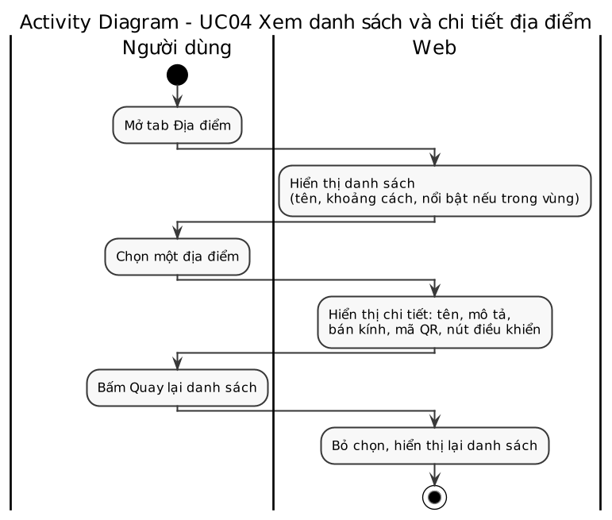

Hình 11. Activity Diagram UC04 Xem danh sách và chi tiết địa điểm

## 7.5 UC05 Nghe thuyết minh thủ công

| Trường | Nội dung |
| --- | --- |
| Use Case Number | UC05 |
| Use Case Name | Nghe thuyết minh thủ công |
| Actor(s) | Người dùng |
| Maturity | Focused |
| Summary | Người dùng bấm nút để phát, tạm dừng, tiếp tục hoặc dừng thuyết minh của địa điểm đang xem; ưu tiên phát file âm thanh (audioUrl) nếu có, hoặc dùng giọng đọc của trình duyệt (Web Speech API). |
| Extension Points | {Phát thuyết minh}: nếu địa điểm có trường audioUrl cho ngôn ngữ hiện tại thì phát file audio; nếu không có hoặc phát lỗi thì chọn giọng theo BR-H2, đặt mã ngôn ngữ giọng (vi-VN, en-US, zh-CN), đọc bằng Web Speech API và theo dõi trạng thái phát (BR-H1, BR-H4). |
| Triggers | Người dùng muốn nghe thuyết minh của địa điểm đang xem. |
| Assumptions | Không có. |
| Preconditions | Đang ở trang chi tiết của một địa điểm (UC04). |
| Post Conditions | Trạng thái phát phản ánh thao tác cuối cùng của người dùng; mỗi lần bấm Phát ghi một lượt nghe. |
| Reference: Business Rules | BR-A4, BR-C8, BR-E3, BR-H1, BR-H2, BR-H3, BR-H4 |
| Reference: API | POST /api/events |
| Reference: bảng dữ liệu | events |
| Reference: màn hình | W-01 (trang chi tiết) |

Basic Course of Events

| # | Actor Action | System Response |
| --- | --- | --- |
| 1 | Người dùng bấm “▶ Phát” ở trang chi tiết. E1 E2 E4 | Dừng thuyết minh khác nếu đang phát (BR-C8), phát thuyết minh theo ngôn ngữ hiện tại {Phát thuyết minh}, hiển thị “Đang phát…” cùng nút “⏸ Tạm dừng” và “⏹ Dừng”, gửi sự kiện lượt nghe (UC09, nguồn manual). A2 |
| 2 | Người dùng bấm “⏸ Tạm dừng”. | Tạm dừng đọc; hiển thị nút “▶ Tiếp tục” và “⏹ Dừng”. |
| 3 | Người dùng bấm “▶ Tiếp tục”. | Đọc tiếp từ chỗ đã dừng; không ghi thêm sự kiện lượt nghe. |
| 4 | Người dùng bấm “⏹ Dừng”. | Dừng đọc và hiển thị lại nút “▶ Phát”. Use case kết thúc. |

Alternative Paths

A1. Đọc xong: hệ thống tự về trạng thái nghỉ, hiển thị lại nút “▶ Phát”.

A2. Đang phát địa điểm khác: ở trang địa điểm này nút vẫn là “▶ Phát”; bấm sẽ dừng bài cũ và đọc bài mới.

A3. Người dùng đổi ngôn ngữ khi đang phát: bài đang đọc vẫn tiếp tục bằng ngôn ngữ cũ; muốn nghe ngôn ngữ mới phải “Dừng” rồi “Phát” lại (BR-A3).

Exception Paths

E1. Trình duyệt không hỗ trợ Web Speech API và địa điểm không có file audio: hiển thị “Trình duyệt không hỗ trợ đọc giọng nói.” và nút “Phát” bị vô hiệu.

E2. Thiết bị có danh sách giọng nhưng không có giọng khớp ngôn ngữ: hiển thị “Thiết bị có thể chưa có giọng đọc cho ngôn ngữ này.”; hệ thống vẫn thử đọc với mã ngôn ngữ tương ứng.

E3. Việc đọc gặp lỗi: hệ thống trở về trạng thái nghỉ.

E4. File audio bị lỗi (link hỏng, mất mạng): hệ thống tự động fallback sang đọc văn bản bằng Web Speech API.

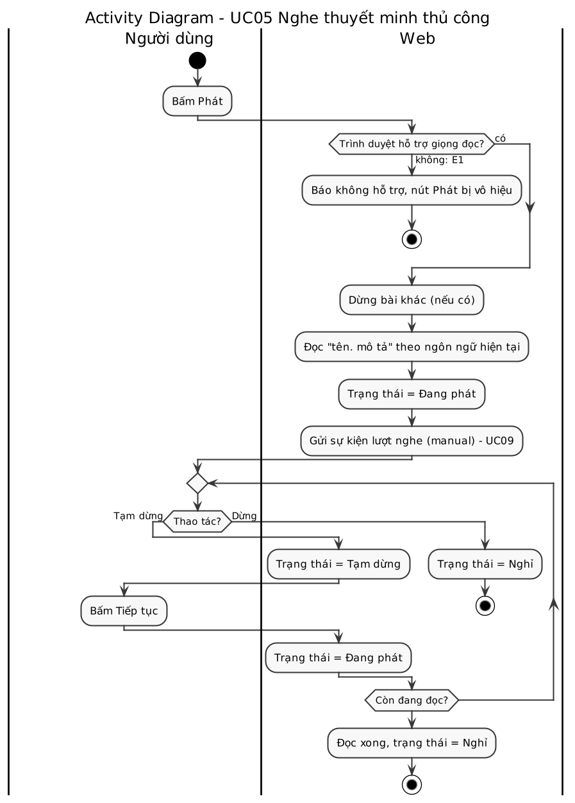

Hình 12. Activity Diagram UC05 Nghe thuyết minh thủ công

## 7.6 UC06 Tự động phát thuyết minh khi vào vùng

| Trường | Nội dung |
| --- | --- |
| Use Case Number | UC06 |
| Use Case Name | Tự động phát thuyết minh khi vào vùng |
| Actor(s) | Người dùng |
| Maturity | Focused |
| Summary | Khi người dùng bật “Tự động phát” và đi vào vùng tròn của một địa điểm, hệ thống tự phát thuyết minh của địa điểm đó theo ngôn ngữ đang chọn. Đây là chức năng cốt lõi. |
| Extension Points | {Đánh giá vùng}: khoảng cách Haversine, bán kính Trái Đất 6.371.000 m, “trong vùng” khi khoảng cách ≤ bán kính (BR-C1). |
| Triggers | Người dùng bật “Tự động phát” và vị trí của họ vào vùng của một địa điểm. |
| Assumptions | Có vị trí (GPS thật hoặc giả lập); trình duyệt có giọng đọc; người dùng đã tương tác với trang ít nhất một lần (bấm nút bật) để trình duyệt cho phép phát giọng. |
| Preconditions | Dữ liệu địa điểm đã có (UC02). Mặc định “Tự động phát” là TẮT mỗi lần mở web. |
| Post Conditions | Thuyết minh của địa điểm vừa vào vùng được phát; địa điểm đó bước vào thời gian nghỉ 60 giây; một sự kiện lượt nghe (auto) được gửi. |
| Reference: Business Rules | BR-C1, BR-C2, BR-C3, BR-C4, BR-C5, BR-C6, BR-C7, BR-C8, BR-A4, BR-E3 |
| Reference: API | POST /api/events |
| Reference: bảng dữ liệu | events |
| Reference: màn hình | W-01 |

Basic Course of Events

| # | Actor Action | System Response |
| --- | --- | --- |
| 1 | Người dùng bấm nút “Tự động phát: TẮT”. A2 | Chuyển sang “Tự động phát: BẬT” (nút màu xanh lá), ẩn dòng gợi ý; xóa trạng thái “đang trong vùng” và thời gian nghỉ của mọi địa điểm (BR-C5). Nếu đã có vị trí thì đánh giá vùng ngay ở bước 3. |
| 2 | Vị trí người dùng thay đổi (đi bộ hoặc giả lập, UC07). | Với mỗi vị trí mới: tính khoảng cách tới từng địa điểm bằng công thức Haversine và xác định các địa điểm đang trong vùng (khoảng cách ≤ bán kính) {Đánh giá vùng}. E1 |
| 3 | — | Cập nhật hiển thị: vùng và chấm đổi sang màu xanh lá trên bản đồ, mục tương ứng nổi bật trong danh sách. |
| 4 | — | Xác định ứng viên: các địa điểm vừa chuyển từ ngoài vào trong vùng và không còn trong thời gian nghỉ 60 giây; nếu có nhiều ứng viên chọn địa điểm gần nhất (BR-C4). A1 A3 A4 |
| 5 | — | Nếu có ứng viên và “Tự động phát” đang BẬT: ghi thời điểm phát (bắt đầu thời gian nghỉ), dừng thuyết minh đang phát (nếu có), phát thuyết minh của ứng viên theo ngôn ngữ hiện tại (ưu tiên file audio nếu có, ngược lại đọc bằng Web Speech API), chọn địa điểm, chuyển sang tab “Địa điểm” hiển thị chi tiết, gửi sự kiện lượt nghe (UC09, nguồn auto). E2 |
| 6 | Người dùng nghe và có thể điều khiển như UC05. Use case kết thúc. | Hệ thống tiếp tục đánh giá vùng ở các lần cập nhật vị trí sau. |

Alternative Paths

A1. Địa điểm đã ở trong vùng từ lần trước: không tạo sự kiện vào vùng mới, không phát lại (BR-C2).

A2. Người dùng bấm lại để TẮT: không còn tự phát; trạng thái vùng vẫn được cập nhật khi vị trí đổi (BR-C5).

A3. Người dùng đã đứng sẵn trong vùng khi bật: hệ thống phát ngay ở lần đánh giá đầu tiên (BR-C5).

A4. Người dùng rời vùng rồi vào lại: nếu cách lần tự phát trước dưới 60 giây thì không phát; từ 60 giây trở lên thì phát (BR-C3).

A5. Nhiều vùng chồng nhau cùng chứa vị trí mới: chỉ phát địa điểm gần nhất; các địa điểm còn lại được coi là đã ở trong vùng nên không tự phát cho đến khi rời vùng rồi vào lại (BR-C4).

Exception Paths

E1. Mất vị trí (vị trí trở thành rỗng, ví dụ chuyển từ giả lập sang GPS khi chưa có tọa độ): xóa trạng thái “đang trong vùng” nhưng giữ nguyên thời gian nghỉ (BR-C6).

E2. Trình duyệt không hỗ trợ Web Speech API và địa điểm không có file audio: hệ thống vẫn chọn địa điểm, mở chi tiết, ghi thời gian nghỉ và vẫn gửi sự kiện lượt nghe (nguồn auto), nhưng không có âm thanh. Đây là hành vi hiện tại của mã nguồn.

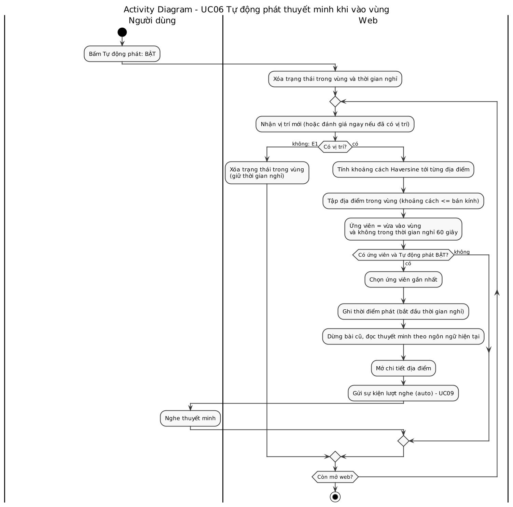

Hình 13. Activity Diagram UC06 Tự động phát thuyết minh khi vào vùng

## 7.7 UC07 Giả lập vị trí

| Trường | Nội dung |
| --- | --- |
| Use Case Number | UC07 |
| Use Case Name | Giả lập vị trí |
| Actor(s) | Người dùng |
| Maturity | Focused |
| Summary | Người dùng chọn một vị trí giả thay cho GPS để thử chức năng tự động phát mà không cần đi bộ. |
| Extension Points | {Tính vị trí giả lập}: “đứng tại” = tọa độ tâm địa điểm; “ngoài vùng” = (trung bình vĩ độ các địa điểm + 0,002°, trung bình kinh độ các địa điểm) (BR-D2). |
| Triggers | Người dùng muốn thử tính năng mà không đi bộ. |
| Assumptions | Không có. |
| Preconditions | Dữ liệu địa điểm đã có (UC02). |
| Post Conditions | Vị trí hiện hành là vị trí giả lập (hoặc GPS thật nếu đã thoát giả lập). |
| Reference: Business Rules | BR-D2, BR-D5, BR-C6 |
| Reference: API | Không có |
| Reference: bảng dữ liệu | Không có |
| Reference: màn hình | W-01 (khối Giả lập vị trí) |

Basic Course of Events

| # | Actor Action | System Response |
| --- | --- | --- |
| 1 | Người dùng mở danh sách “Giả lập vị trí (để thử khi không thể đi bộ)” ở cuối bảng điều khiển. | Hiển thị: “Dùng GPS thật”, “Giả lập: ngoài vùng” và, với mỗi địa điểm, “Giả lập: đứng tại <tên>”. |
| 2 | Người dùng chọn “Giả lập: đứng tại …” hoặc “Giả lập: ngoài vùng”. A1 | Chuyển sang chế độ giả lập: dừng theo dõi GPS thật, đặt vị trí theo lựa chọn {Tính vị trí giả lập}, trạng thái hiển thị “Giả lập vị trí”, hiển thị dòng “Đang giả lập. Chạm vào bản đồ để đặt vị trí khác.”; vị trí mới được dùng như vị trí thật (UC03, UC06). |
| 3 | Người dùng chạm vào chỗ trống trên bản đồ. | Đặt vị trí giả lập tại điểm chạm; danh sách giả lập hiển thị mục trống “…”. |
| 4 | Người dùng chọn “Dùng GPS thật”. | Thoát giả lập, bật lại theo dõi GPS thật; vị trí về rỗng cho đến khi có tọa độ GPS (xóa trạng thái “đang trong vùng”, giữ thời gian nghỉ). Use case kết thúc. |

Alternative Paths

A1. Khi đang giả lập, người dùng chạm vào chấm của một địa điểm: chỉ chọn địa điểm (UC04), không đổi vị trí giả lập (BR-D5).

Exception Paths

Không có.

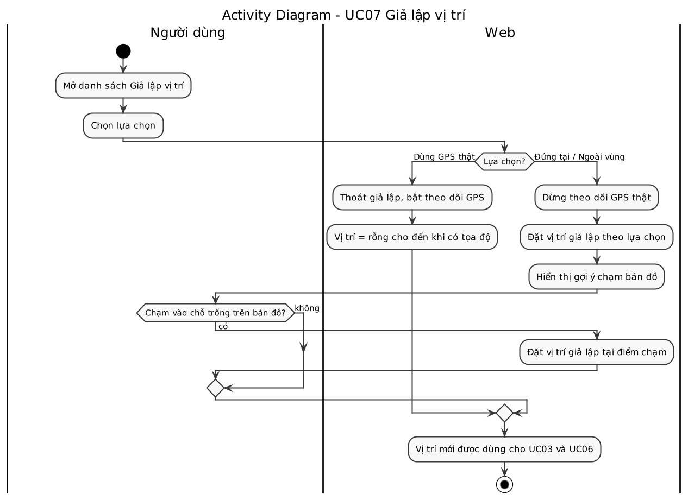

Hình 14. Activity Diagram UC07 Giả lập vị trí

## 7.8 UC08 Mở địa điểm bằng mã QR

| Trường | Nội dung |
| --- | --- |
| Use Case Number | UC08 |
| Use Case Name | Mở địa điểm bằng mã QR |
| Actor(s) | Người dùng |
| Maturity | Focused |
| Summary | Người dùng mở trang chi tiết của một địa điểm bằng cách quét mã QR bằng camera, nhập mã bằng tay, hoặc mở web qua đường link chứa mã. |
| Extension Points | {Tách mã QR}: nếu nội dung chứa tham số qr= hoặc poi= thì lấy giá trị đã giải mã; ngược lại dùng nguyên nội dung đã cắt khoảng trắng. Tìm địa điểm theo qrCode hoặc id, không phân biệt hoa thường (BR-F1). |
| Triggers | Người dùng muốn mở nhanh một địa điểm bằng mã QR. |
| Assumptions | Mã QR cho từng địa điểm do Dashboard tạo (UC19) hoặc ảnh mẫu trong thư mục qr-samples. |
| Preconditions | Dữ liệu địa điểm đã có (UC02). |
| Post Conditions | Chi tiết địa điểm tương ứng được hiển thị và một sự kiện quét QR được gửi. |
| Reference: Business Rules | BR-F1, BR-F2, BR-E3 |
| Reference: API | POST /api/events |
| Reference: bảng dữ liệu | events |
| Reference: màn hình | W-01 (tab Quét QR) |

Basic Course of Events

| # | Actor Action | System Response |
| --- | --- | --- |
| 1 | Người dùng chọn tab “Quét QR”. | Hiển thị tiêu đề “Quét mã QR để mở địa điểm”, khung camera (chưa bật), nút “Bật camera”, ô nhập (gợi ý DHSG-POI-001) và nút “Mở”. |
| 2 | Người dùng bấm “Bật camera”. E2 | Xin quyền camera, bật camera sau, quét mã QR (10 khung hình/giây, khung quét 220×220 px) và đổi nút thành “Tắt camera”. A3 |
| 3 | Người dùng đưa camera vào mã QR. | Khi đọc được mã: tắt camera và tách mã từ nội dung quét được {Tách mã QR}, rồi tìm địa điểm. A1 |
| 4 | — | Nếu tìm thấy địa điểm: xóa thông báo lỗi (nếu có), chọn địa điểm và hiển thị chi tiết ở tab “Địa điểm” (UC04), gửi sự kiện quét QR (UC09). E1 |

Alternative Paths

A1. Người dùng không dùng camera mà gõ mã (hoặc dán đường link) vào ô nhập rồi bấm “Mở”: hệ thống thực hiện bước 3 (tách mã, tìm địa điểm) rồi bước 4.

A2. Người dùng mở web bằng đường link có tham số ?poi=… hoặc ?qr=… (ví dụ quét mã QR dạng liên kết bằng camera điện thoại): khi tải xong dữ liệu, hệ thống tự mở địa điểm tương ứng đúng một lần, chuyển sang tab “Địa điểm” và gửi sự kiện quét QR (BR-F2). Nếu dữ liệu từ API còn đang tải mà chưa khớp thì chờ dữ liệu về rồi thử lại.

A3. Người dùng bấm “Tắt camera”: hệ thống dừng camera.

Exception Paths

E1. Không tìm thấy địa điểm cho mã: hiển thị “Không tìm thấy địa điểm cho mã này.”; không ghi sự kiện. Thông báo được xóa ở lần mở thành công kế tiếp.

E2. Không bật được camera (người dùng từ chối quyền, thiết bị không có camera, trang không chạy trên HTTPS hoặc localhost): hiển thị “Không mở được camera. Camera trên web cần HTTPS hoặc localhost và quyền truy cập.”; người dùng vẫn nhập mã bằng tay (A1).

E3. Với đường link ?poi=/?qr= không khớp địa điểm nào (kể cả sau khi dữ liệu API đã về): bỏ qua, người dùng ở màn hình danh sách.

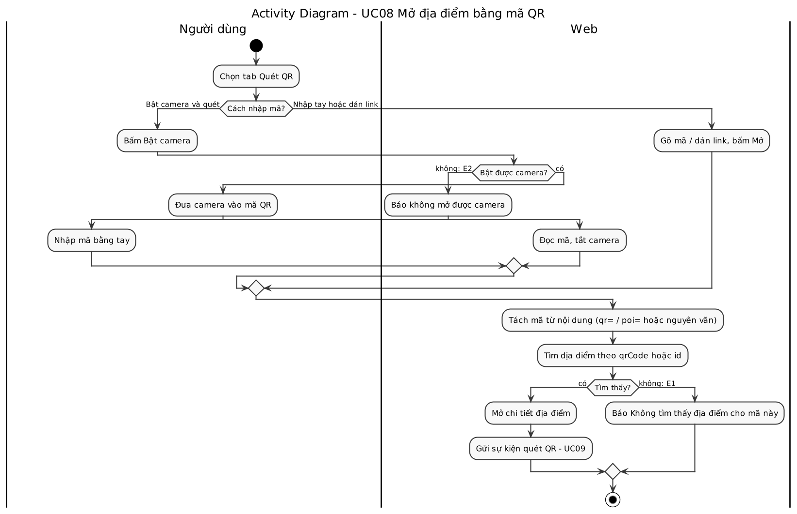

Hình 15. Activity Diagram UC08 Mở địa điểm bằng mã QR

## 7.9 UC09 Ghi nhận sự kiện thống kê

| Trường | Nội dung |
| --- | --- |
| Use Case Number | UC09 |
| Use Case Name | Ghi nhận sự kiện thống kê |
| Actor(s) | Web (hệ thống), Server API |
| Maturity | Focused |
| Summary | Mỗi lượt nghe và mỗi lượt mở địa điểm bằng QR được gửi lên server dưới dạng sự kiện ẩn danh để làm thống kê. |
| Extension Points | {Kiểm tra sự kiện}: type thuộc {listen, qr_scan}; lang thuộc {vi, en, zh}; type = listen thì source bắt buộc là auto hoặc manual; type = qr_scan thì source là qr hoặc để trống; client (nếu có) thuộc {web, mobile}; poiId 1–64 ký tự (BR-E4). |
| Triggers | Người dùng bắt đầu phát thuyết minh (UC05, UC06) hoặc mở địa điểm bằng QR (UC08). |
| Assumptions | Không gửi và không lưu vị trí hay định danh người dùng (BR-E3). |
| Preconditions | Không có. |
| Post Conditions | Bảng events tăng một dòng (nếu thành công). |
| Reference: Business Rules | BR-E3, BR-E4 |
| Reference: API | POST /api/events |
| Reference: bảng dữ liệu | events, pois, languages |
| Reference: màn hình | — |

Basic Course of Events

| # | Actor Action | System Response |
| --- | --- | --- |
| 1 | (Được kích hoạt bởi UC05, UC06 hoặc UC08.) | Nếu đã cấu hình NEXT_PUBLIC_API_URL: gửi POST /api/events với nội dung { poiId, type, lang, source (chỉ với lượt nghe), client: “web” } ở chế độ nền, không chặn giao diện. A1 |
| 2 | — | Server kiểm tra dữ liệu gửi lên {Kiểm tra sự kiện}. E1 |
| 3 | — | Server tìm địa điểm theo poiId (phải đang hoạt động) và ghi một dòng vào bảng events với thời điểm hiện tại. E2 |
| 4 | — | Server trả HTTP 201 { ok: true }. Use case kết thúc. |

Alternative Paths

A1. Chưa cấu hình NEXT_PUBLIC_API_URL: không gửi gì.

Exception Paths

E1. Dữ liệu không hợp lệ: server trả HTTP 400 kèm danh sách lỗi.

E2. Địa điểm không tồn tại hoặc đang tắt (active = false): server trả HTTP 404 “Không tìm thấy địa điểm”.

E3. Lỗi mạng hoặc server lỗi: web bỏ qua im lặng, không thử lại.

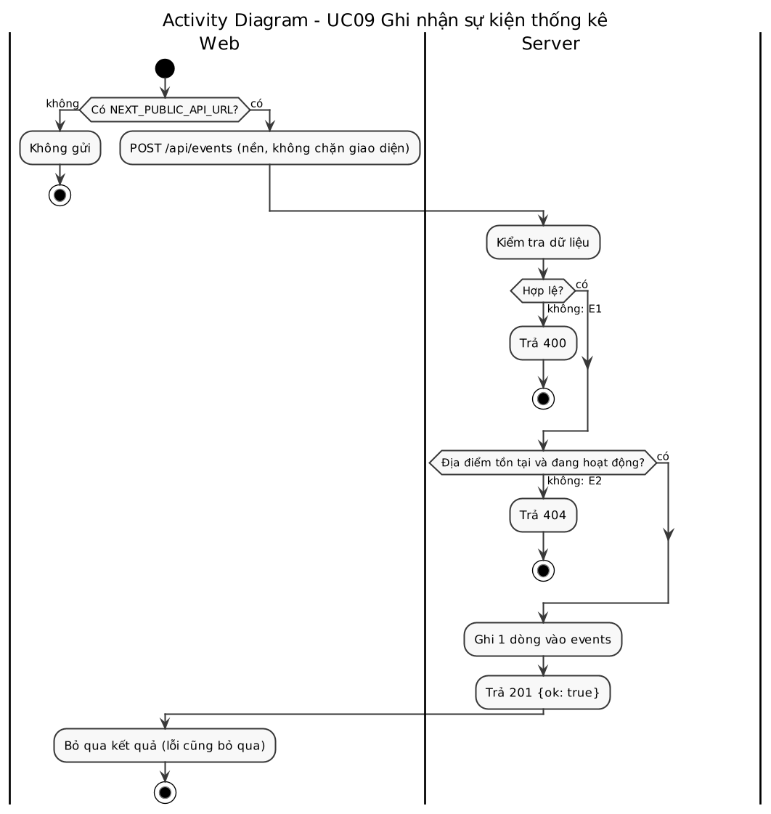

Hình 16. Activity Diagram UC09 Ghi nhận sự kiện thống kê

## 7.10 UC10 Hiển thị mã QR mở web

| Trường | Nội dung |
| --- | --- |
| Use Case Number | UC10 |
| Use Case Name | Hiển thị mã QR mở web |
| Actor(s) | Người dùng |
| Maturity | Focused |
| Summary | Web hiển thị một nút QR ở góc trên bên trái của bản đồ. Nút có nhãn trợ năng “Mở mã QR tải ứng dụng”; khi bấm, thẻ QR được tạo ở trình duyệt, chứa URL `https://se-2026-psi.vercel.app/`. Người dùng quét bằng điện thoại để mở web; việc cài PWA do trình duyệt quyết định. |
| Extension Points | Không có. |
| Triggers | Người dùng muốn mở web hoặc cài PWA trên điện thoại. |
| Assumptions | Thiết bị quét có thể truy cập URL được mã hóa. Việc cài PWA, nếu có, do trình duyệt và hệ điều hành quyết định. |
| Preconditions | Trang chủ web đã mở trên một màn hình mà người dùng có thể quét (ví dụ máy tính). |
| Post Conditions | Thẻ QR được hiển thị; nếu người dùng quét mã thì điện thoại mở URL web trong trình duyệt. |
| Reference: Business Rules | BR-I1, BR-I2 |
| Reference: API | Không có |
| Reference: bảng dữ liệu | Không có |
| Reference: màn hình | W-01 (nút QR và thẻ QR trên bản đồ) |

Basic Course of Events

| # | Actor Action | System Response |
| --- | --- | --- |
| 1 | Người dùng bấm nút QR trên bản đồ. | Web mở thẻ có tiêu đề “Quét mã để mở ứng dụng” (theo ngôn ngữ hiện chọn) và tạo ảnh QR cho URL cố định `https://se-2026-psi.vercel.app/`; trong lúc tạo hiển thị trạng thái đang tải. Thẻ cũng hiển thị URL đích. |
| 2 | Người dùng quét mã QR bằng điện thoại. | (Ngoài hệ thống) Điện thoại mở URL web trong trình duyệt. Trình duyệt có thể cung cấp tùy chọn cài web dưới dạng PWA (BR-I1); QR không cài ứng dụng trực tiếp. |
| 3 | Người dùng đóng thẻ QR khi không còn cần dùng. | Web đóng thẻ QR; use case kết thúc. |

Alternative Paths

Không có.

Exception Paths

E1. Không tạo được ảnh QR: web hiển thị thông báo lỗi đã bản địa hóa; người dùng có thể đóng thẻ và thử mở lại.

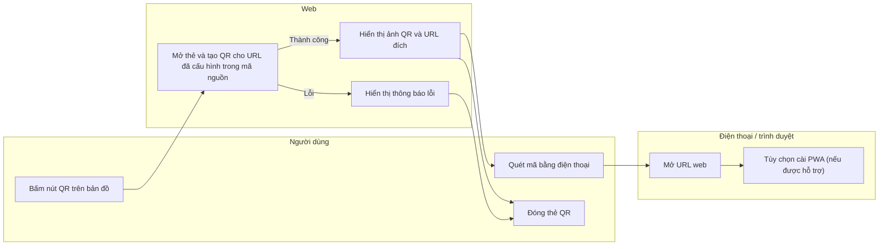

Hình 17. Luồng hoạt động UC10 Hiển thị mã QR mở web

## 7.11 UC11 Đăng nhập

| Trường | Nội dung |
| --- | --- |
| Use Case Number | UC11 |
| Use Case Name | Đăng nhập |
| Actor(s) | Quản trị, Biên tập |
| Maturity | Focused |
| Summary | Quản trị viên hoặc Biên tập viên đăng nhập dashboard bằng email và mật khẩu để nhận token làm việc 8 giờ. |
| Extension Points | {Xác thực}: tìm tài khoản theo email không phân biệt hoa thường; luôn so sánh mật khẩu bằng bcrypt (kể cả khi không có tài khoản); tài khoản phải đang hoạt động; đăng nhập đúng thì xóa bộ đếm sai; ký token JWT HS256 hạn 8 giờ (BR-G3, BR-G4). |
| Triggers | Người dùng cần vào dashboard khi chưa có phiên đăng nhập. |
| Assumptions | Tài khoản đã được tạo (admin đầu tiên bằng lệnh npm run admin:create, các tài khoản khác bằng UC20). |
| Preconditions | Chưa đăng nhập. |
| Post Conditions | Trình duyệt giữ token hợp lệ; người dùng ở trang Thống kê. |
| Reference: Business Rules | BR-G1, BR-G2, BR-G3, BR-G4, BR-G7 |
| Reference: API | POST /api/auth/login, GET /api/auth/me |
| Reference: bảng dữ liệu | admins |
| Reference: màn hình | D-01 |

Basic Course of Events

| # | Actor Action | System Response |
| --- | --- | --- |
| 1 | Mở trang /login (hoặc mở một trang cần đăng nhập, hệ thống tự chuyển về /login). A1 | Hiển thị biểu mẫu “Đăng nhập dashboard” gồm Email, Mật khẩu và nút “Đăng nhập”. |
| 2 | Nhập email, mật khẩu rồi bấm “Đăng nhập”. | Nút đổi thành “Đang đăng nhập…” và gửi POST /api/auth/login { email, password }. |
| 3 | — | Server kiểm tra {Xác thực}. E1 E2 |
| 4 | — | Server trả HTTP 200 { token, user: { id, email, fullName, role } }. |
| 5 | — | Dashboard lưu token vào localStorage (khóa tm_token), ghi nhận người dùng và chuyển về trang “/” (Thống kê). Menu hiển thị theo vai trò (BR-G1, BR-G7). Use case kết thúc. |

Alternative Paths

A1. Người dùng đã đăng nhập mà mở /login: chuyển thẳng về “/”.

A2. Mở lại trình duyệt khi localStorage còn token: dashboard gọi GET /api/auth/me để xác nhận; hợp lệ thì vào thẳng, không hợp lệ thì xóa token và về /login.

Exception Paths

E1. Email không tồn tại, mật khẩu sai hoặc tài khoản bị khóa: server trả HTTP 401 “Email hoặc mật khẩu không đúng” (cùng một thông báo cho cả ba trường hợp, BR-G3); form hiển thị thông báo.

E2. Sau khi đã đăng nhập sai 10 lần trong 15 phút với cùng (địa chỉ IP, email), các lần thử tiếp theo: server trả HTTP 429 “Đăng nhập sai quá nhiều lần, vui lòng thử lại sau”.

E3. Không kết nối được server: hiển thị “Không kết nối được máy chủ. Hãy kiểm tra backend đã chạy chưa và NEXT_PUBLIC_API_URL.”.

E4. Ở các lần dùng sau, token hết hạn hoặc tài khoản bị khóa/xóa: server trả HTTP 401; dashboard xóa token và chuyển về /login (BR-G7).

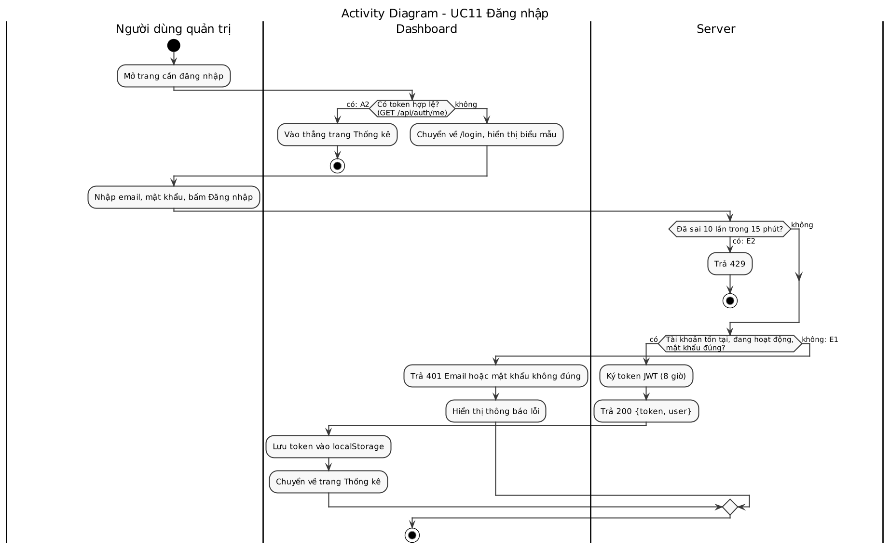

Hình 18. Activity Diagram UC11 Đăng nhập

## 7.12 UC12 Đăng xuất

| Trường | Nội dung |
| --- | --- |
| Use Case Number | UC12 |
| Use Case Name | Đăng xuất |
| Actor(s) | Quản trị, Biên tập |
| Maturity | Focused |
| Summary | Người dùng đăng xuất khỏi dashboard. |
| Extension Points | Không có. |
| Triggers | Người dùng muốn kết thúc phiên làm việc. |
| Assumptions | Không có thu hồi token phía server: token cũ vẫn hợp lệ về chữ ký đến khi hết hạn 8 giờ, nhưng trình duyệt không còn giữ nó. |
| Preconditions | Đã đăng nhập (UC11). |
| Post Conditions | Trình duyệt không còn token; mọi trang quản trị đều chuyển về /login. |
| Reference: Business Rules | BR-G7 |
| Reference: API | Không có |
| Reference: bảng dữ liệu | Không có |
| Reference: màn hình | Menu của mọi trang quản trị |

Basic Course of Events

| # | Actor Action | System Response |
| --- | --- | --- |
| 1 | Bấm nút “Đăng xuất” ở thanh menu. | Xóa token khỏi localStorage, đặt người dùng về rỗng và chuyển về /login. Use case kết thúc. |

Alternative Paths

Không có.

Exception Paths

Không có.

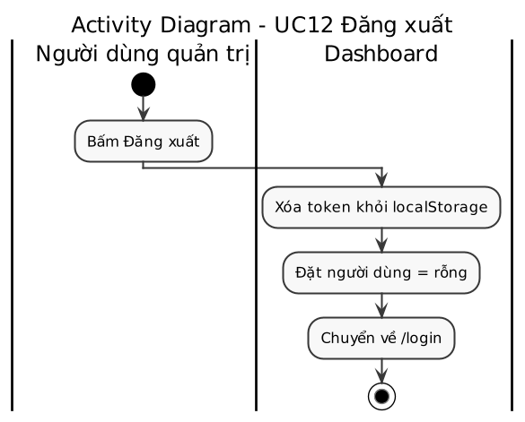

Hình 19. Activity Diagram UC12 Đăng xuất

## 7.13 UC13 Đổi mật khẩu

| Trường | Nội dung |
| --- | --- |
| Use Case Number | UC13 |
| Use Case Name | Đổi mật khẩu |
| Actor(s) | Quản trị, Biên tập |
| Maturity | Focused |
| Summary | Người dùng đổi mật khẩu của chính mình tại trang “Tài khoản của tôi”. |
| Extension Points | Không có. |
| Triggers | Người dùng muốn đổi mật khẩu. |
| Assumptions | Đổi mật khẩu không làm các token đã cấp mất hiệu lực. |
| Preconditions | Đã đăng nhập (UC11). |
| Post Conditions | Mật khẩu mới có hiệu lực cho lần đăng nhập sau. |
| Reference: Business Rules | BR-G2, BR-G6 |
| Reference: API | POST /api/auth/change-password |
| Reference: bảng dữ liệu | admins |
| Reference: màn hình | D-08 |

Basic Course of Events

| # | Actor Action | System Response |
| --- | --- | --- |
| 1 | Chọn menu “Tài khoản của tôi” (đường dẫn /account). | Hiển thị họ tên, email, vai trò và biểu mẫu “Đổi mật khẩu” gồm “Mật khẩu hiện tại” và “Mật khẩu mới (ít nhất 8 ký tự)”. |
| 2 | Nhập hai mật khẩu và bấm “Đổi mật khẩu”. | Gửi POST /api/auth/change-password { currentPassword, newPassword }. |
| 3 | — | Server so sánh mật khẩu hiện tại, kiểm tra mật khẩu mới (≥ 8 ký tự) rồi lưu mật khẩu mới đã băm bcrypt. E1 E2 |
| 4 | — | Dashboard xóa hai ô nhập và hiển thị “Đã đổi mật khẩu.”. Use case kết thúc. |

Alternative Paths

Không có.

Exception Paths

E1. Mật khẩu hiện tại sai: server trả HTTP 400 “Mật khẩu hiện tại không đúng”; hiển thị thông báo.

E2. Mật khẩu mới dưới 8 ký tự: server trả HTTP 400 “Dữ liệu không hợp lệ” (ô nhập cũng chặn từ phía trình duyệt).

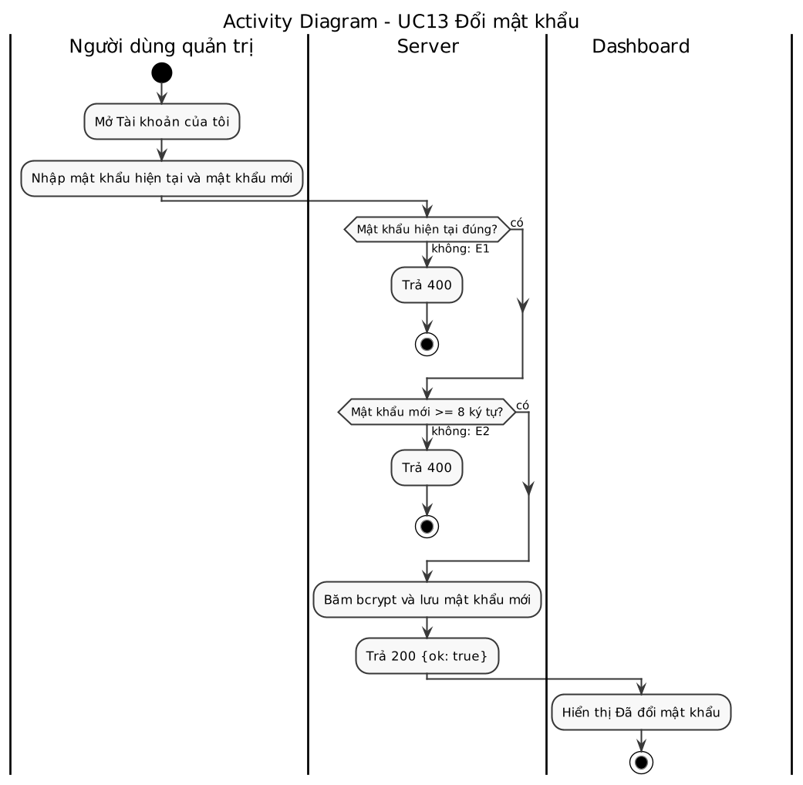

Hình 20. Activity Diagram UC13 Đổi mật khẩu

## 7.14 UC14 Xem thống kê

| Trường | Nội dung |
| --- | --- |
| Use Case Number | UC14 |
| Use Case Name | Xem thống kê |
| Actor(s) | Quản trị, Biên tập |
| Maturity | Focused |
| Summary | Người dùng xem số lượt nghe và lượt quét QR theo địa điểm, ngôn ngữ, cách phát và theo ngày trong một khoảng thời gian. |
| Extension Points | {Tổng hợp thống kê}: lọc sự kiện theo ngày UTC trong N ngày gần nhất (N từ 1 đến 365, mặc định 30, tính cả hôm nay); mọi địa điểm đều có dòng (0 nếu chưa có sự kiện); mọi ngôn ngữ đều có dòng; từng ngày đều có dòng (0 nếu không có) (BR-E5). |
| Triggers | Người dùng muốn xem hiệu quả sử dụng. |
| Assumptions | Không có. |
| Preconditions | Đã đăng nhập; vai trò có quyền stats:read (Quản trị, Biên tập). |
| Post Conditions | Thống kê của khoảng thời gian chọn được hiển thị. |
| Reference: Business Rules | BR-E3, BR-E5, BR-G1 |
| Reference: API | GET /api/admin/stats |
| Reference: bảng dữ liệu | events, pois, poi_translations, languages |
| Reference: màn hình | D-02 |

Basic Course of Events

| # | Actor Action | System Response |
| --- | --- | --- |
| 1 | Chọn menu “Thống kê” (trang “/”). A1 | Gửi GET /api/admin/stats?days=30. |
| 2 | — | Server tổng hợp dữ liệu {Tổng hợp thống kê} và trả về. E1 |
| 3 | — | Hiển thị: dòng “Từ <ngày> đến <ngày> (giờ UTC)…”; hai thẻ “Lượt nghe” và “Lượt quét QR”; bảng “Theo địa điểm”, “Theo ngôn ngữ”, “Theo địa điểm và ngôn ngữ” (ô dạng “nghe / quét”), “Cách phát (lượt nghe)” và “Theo ngày” kèm thanh biểu đồ. Use case kết thúc. |

Alternative Paths

A1. Người dùng đổi “Khoảng thời gian” sang 7, 30 hoặc 90 ngày qua: hệ thống gọi lại API với days tương ứng và hiển thị lại.

Exception Paths

E1. Lỗi khi gọi API (mất kết nối, 401, 403…): hiển thị thông báo lỗi thay cho nội dung thống kê.

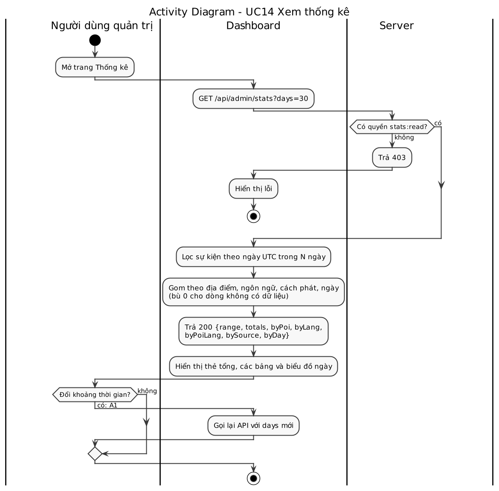

Hình 21. Activity Diagram UC14 Xem thống kê

## 7.15 UC15 Xem danh sách địa điểm

| Trường | Nội dung |
| --- | --- |
| Use Case Number | UC15 |
| Use Case Name | Xem danh sách địa điểm |
| Actor(s) | Quản trị, Biên tập |
| Maturity | Focused |
| Summary | Người dùng xem toàn bộ địa điểm, kể cả địa điểm đang tắt, trong bảng quản trị. |
| Extension Points | Không có. |
| Triggers | Người dùng muốn xem hoặc quản lý địa điểm. |
| Assumptions | Không có. |
| Preconditions | Đã đăng nhập; có quyền poi:read (Quản trị, Biên tập). |
| Post Conditions | Danh sách địa điểm quản trị được hiển thị. |
| Reference: Business Rules | BR-B3, BR-B5, BR-G1 |
| Reference: API | GET /api/admin/pois |
| Reference: bảng dữ liệu | pois, poi_translations |
| Reference: màn hình | D-03 |

Basic Course of Events

| # | Actor Action | System Response |
| --- | --- | --- |
| 1 | Chọn menu “Địa điểm” (đường dẫn /pois). | Gửi GET /api/admin/pois. |
| 2 | — | Server trả mọi địa điểm (kể cả active = false) kèm bản dịch, sắp xếp theo mã. E1 |
| 3 | — | Hiển thị bảng: Mã, Tên (Tiếng Việt), Tọa độ “vĩ độ, kinh độ”, Bán kính “N m”, Trạng thái (“Hoạt động” hoặc “Đã tắt”). Nút “+ Thêm địa điểm” (nếu có quyền poi:create); mỗi dòng có nút “Sửa” (nếu có quyền poi:update) và “Xóa” (nếu có quyền poi:delete). Use case kết thúc. |

Alternative Paths

Không có.

Exception Paths

E1. Lỗi khi gọi API: hiển thị thông báo lỗi.

E2. Danh sách rỗng: bảng hiển thị “Chưa có địa điểm nào”.

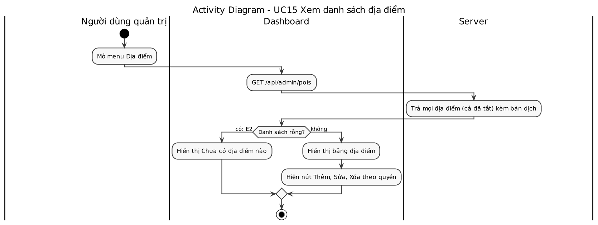

Hình 22. Activity Diagram UC15 Xem danh sách địa điểm

## 7.16 UC16 Thêm địa điểm

| Trường | Nội dung |
| --- | --- |
| Use Case Number | UC16 |
| Use Case Name | Thêm địa điểm |
| Actor(s) | Quản trị, Biên tập |
| Maturity | Focused |
| Summary | Người dùng thêm một địa điểm mới gồm tọa độ, bán kính vùng, trạng thái và tên, mô tả của cả ba ngôn ngữ. |
| Extension Points | {Kiểm tra địa điểm}: vĩ độ [-90, 90]; kinh độ [-180, 180]; bán kính số nguyên 1–1000; active là true/false (mặc định true); đủ ba bản dịch vi, en, zh; mỗi bản dịch có tên (1–200 ký tự sau khi cắt khoảng trắng), mô tả (1–5000 ký tự), audioUrl tùy chọn (URL hợp lệ ≤ 2000 ký tự, rỗng = không có) (BR-A2, BR-B2). |
| Triggers | Người dùng muốn thêm địa điểm. |
| Assumptions | Tọa độ có thể nhập trực tiếp hoặc chọn/kéo thả trực quan trên bản đồ tương tác MapPicker; có nút di chuyển nhanh về khuôn viên trường ĐHSG. |
| Preconditions | Đã đăng nhập; có quyền poi:create. |
| Post Conditions | Một địa điểm mới cùng 3 bản dịch được lưu; mã QR được cấp. |
| Reference: Business Rules | BR-A2, BR-B1, BR-B2, BR-B3, BR-G1 |
| Reference: API | POST /api/admin/pois |
| Reference: bảng dữ liệu | pois, poi_translations |
| Reference: màn hình | D-04 |

Basic Course of Events

| # | Actor Action | System Response |
| --- | --- | --- |
| 1 | Bấm “+ Thêm địa điểm” (đường dẫn /pois/new). | Hiển thị biểu mẫu: Bản đồ chọn vị trí MapPicker (với marker kéo thả và vòng tròn bán kính geofence xem trước), các ô nhập Vĩ độ, Kinh độ, Bán kính vùng (mét, mặc định 25), ô “Đang hoạt động” (mặc định chọn) và ba khối Tiếng Việt, English, 中文, mỗi khối gồm Tên, Nội dung thuyết minh, Đường dẫn audio (tùy chọn kèm trình nghe thử trực tiếp). Có dòng “Mã địa điểm và mã QR được tạo tự động sau khi lưu.”. |
| 2 | Nhập dữ liệu và bấm “Lưu địa điểm”. E1 | Kiểm tra vĩ độ, kinh độ, bán kính là số rồi gửi POST /api/admin/pois. |
| 3 | — | Server kiểm tra dữ liệu {Kiểm tra địa điểm}. E2 |
| 4 | — | Server sinh mã poi-NNN và mã QR DHSG-POI-NNN, ghi địa điểm và ba bản dịch trong một giao dịch (BR-B1), trả HTTP 201 kèm địa điểm vừa tạo. |
| 5 | — | Dashboard chuyển về /pois, địa điểm mới xuất hiện trong bảng. Use case kết thúc. |

Alternative Paths

Không có.

Exception Paths

E1. Vĩ độ, kinh độ hoặc bán kính không phải số: hiển thị “Vĩ độ, kinh độ và bán kính phải là số.”; không gửi lên server.

E2. Dữ liệu vi phạm quy tắc: server trả HTTP 400 “Dữ liệu không hợp lệ” kèm danh sách lỗi theo trường; biểu mẫu hiển thị thông báo và danh sách “<trường>: <lỗi>”; không ghi gì.

E3. Vai trò không có quyền poi:create: server trả HTTP 403; (cả hai vai trò hiện có đều có quyền này).

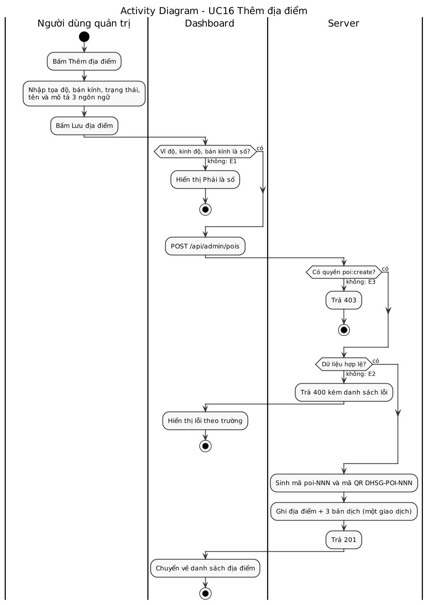

Hình 23. Activity Diagram UC16 Thêm địa điểm

## 7.17 UC17 Sửa địa điểm

| Trường | Nội dung |
| --- | --- |
| Use Case Number | UC17 |
| Use Case Name | Sửa địa điểm |
| Actor(s) | Quản trị, Biên tập |
| Maturity | Focused |
| Summary | Người dùng sửa tọa độ, bán kính, trạng thái, tên, mô tả và đường dẫn audio của một địa điểm. Mã địa điểm và mã QR không đổi. |
| Extension Points | Không có. |
| Triggers | Người dùng muốn thay đổi thông tin địa điểm. |
| Assumptions | Nội dung biểu mẫu luôn là bản đầy đủ (cả 3 ngôn ngữ), không có sửa từng phần. |
| Preconditions | Đã đăng nhập; có quyền poi:update. |
| Post Conditions | Địa điểm và bản dịch được cập nhật; thay đổi hiển thị ngay ở web/app ở lần tải dữ liệu sau (kể cả địa điểm chuyển sang đã tắt thì biến mất khỏi web). |
| Reference: Business Rules | BR-A2, BR-B1, BR-B2, BR-B3, BR-G1 |
| Reference: API | GET /api/admin/pois/:id, PUT /api/admin/pois/:id |
| Reference: bảng dữ liệu | pois, poi_translations |
| Reference: màn hình | D-05 |

Basic Course of Events

| # | Actor Action | System Response |
| --- | --- | --- |
| 1 | Bấm “Sửa” ở một dòng địa điểm (đường dẫn /pois/<mã>). | Gửi GET /api/admin/pois/<mã>; hiển thị “Sửa địa điểm <mã>”, dòng “Mã QR: <mã QR> (không đổi khi sửa, để mã QR đã in vẫn dùng được).” và biểu mẫu điền sẵn dữ liệu hiện tại (bao gồm bản đồ định vị vị trí và vùng geofence hiện thời). E1 |
| 2 | Sửa dữ liệu và bấm “Lưu thay đổi”. E2 | Kiểm tra số rồi gửi PUT /api/admin/pois/<mã> với toàn bộ nội dung biểu mẫu. |
| 3 | — | Server kiểm tra {Kiểm tra địa điểm} (như UC16), cập nhật địa điểm (đổi thời điểm sửa) và ghi đè đủ ba bản dịch trong một giao dịch, trả HTTP 200 kèm địa điểm đã cập nhật. |
| 4 | — | Dashboard hiển thị “Đã lưu.” và giữ người dùng ở trang sửa. Use case kết thúc. |

Alternative Paths

Không có.

Exception Paths

E1. Địa điểm không tồn tại: server trả HTTP 404 “Không tìm thấy địa điểm”; hiển thị thông báo.

E2. Dữ liệu không hợp lệ: xử lý như UC16 (E1, E2).

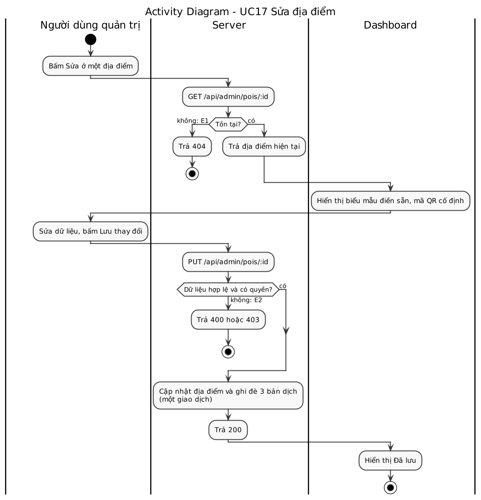

Hình 24. Activity Diagram UC17 Sửa địa điểm

## 7.18 UC18 Xóa địa điểm

| Trường | Nội dung |
| --- | --- |
| Use Case Number | UC18 |
| Use Case Name | Xóa địa điểm |
| Actor(s) | Quản trị |
| Maturity | Focused |
| Summary | Quản trị xóa vĩnh viễn một địa điểm cùng bản dịch và toàn bộ thống kê của nó. |
| Extension Points | Không có. |
| Triggers | Quản trị muốn loại bỏ một địa điểm. |
| Assumptions | Xóa là vĩnh viễn, không có thùng rác. Muốn ẩn tạm thời, dùng cờ “Đang hoạt động” (UC17). |
| Preconditions | Đã đăng nhập; vai trò Quản trị (quyền poi:delete). |
| Post Conditions | Địa điểm, bản dịch và sự kiện thống kê của nó không còn trong cơ sở dữ liệu; mã địa điểm không được dùng lại. |
| Reference: Business Rules | BR-B1, BR-B4, BR-G1 |
| Reference: API | DELETE /api/admin/pois/:id |
| Reference: bảng dữ liệu | pois, poi_translations, events |
| Reference: màn hình | D-03 |

Basic Course of Events

| # | Actor Action | System Response |
| --- | --- | --- |
| 1 | Ở danh sách địa điểm, bấm “Xóa” ở một dòng. A1 | Hiển thị hộp xác nhận: “Xóa địa điểm ‘<tên tiếng Việt>’? Toàn bộ thống kê của địa điểm này cũng bị xóa. Không thể hoàn tác.”. |
| 2 | Bấm đồng ý trong hộp xác nhận. | Gửi DELETE /api/admin/pois/<mã>. |
| 3 | — | Server xóa địa điểm; các bản dịch và sự kiện thống kê bị xóa theo (BR-B4); trả HTTP 204. E1 E2 |
| 4 | — | Dashboard tải lại danh sách; địa điểm đã biến mất. Use case kết thúc. |

Alternative Paths

A1. Người dùng bấm hủy ở hộp xác nhận: không có gì thay đổi.

Exception Paths

E1. Địa điểm không tồn tại (ví dụ đã bị xóa ở nơi khác): server trả HTTP 404; hiển thị thông báo.

E2. Biên tập không có quyền poi:delete: nút “Xóa” không hiển thị với Biên tập; nếu gọi trực tiếp API thì server trả HTTP 403 “Bạn không có quyền thực hiện thao tác này”.

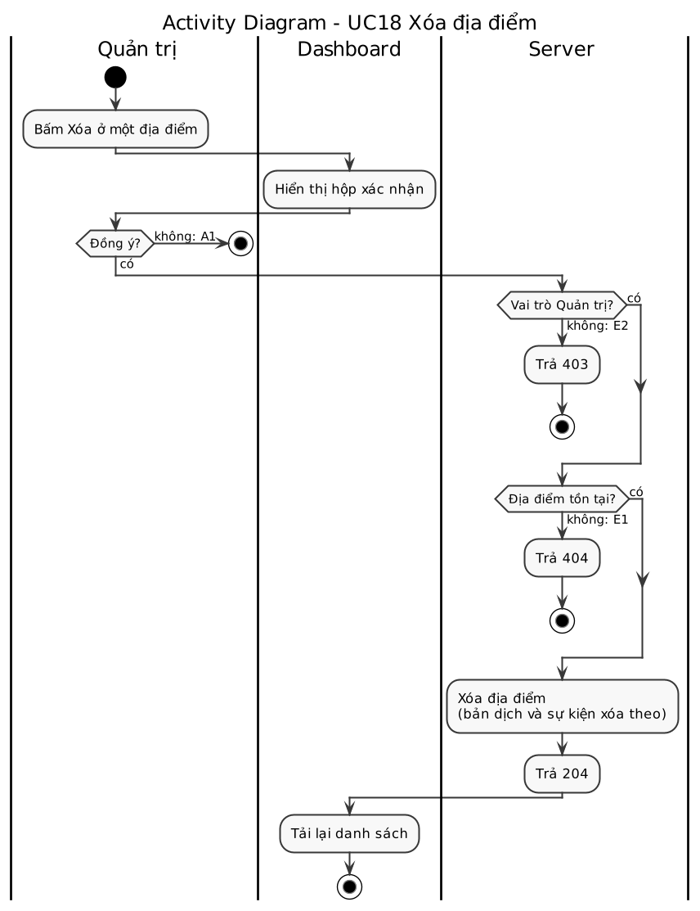

Hình 25. Activity Diagram UC18 Xóa địa điểm

## 7.19 UC19 Tạo và tải mã QR

| Trường | Nội dung |
| --- | --- |
| Use Case Number | UC19 |
| Use Case Name | Tạo và tải mã QR |
| Actor(s) | Quản trị, Biên tập |
| Maturity | Focused |
| Summary | Người dùng xem và tải ảnh mã QR của từng địa điểm, ở hai kiểu: “mã” và “liên kết”. |
| Extension Points | {Tạo QR}: kiểu “mã” chứa đúng chuỗi mã QR (ví dụ DHSG-POI-001), dùng cho ô “Quét QR” trong web; kiểu “liên kết” chứa <NEXT_PUBLIC_WEB_URL>/?qr=<mã QR đã mã hóa URL>, quét bằng camera điện thoại là mở thẳng địa điểm. Ảnh rộng 512 px, lề 2, mức sửa lỗi M (BR-F3). |
| Triggers | Người dùng cần mã QR để in hoặc chia sẻ. |
| Assumptions | Mã QR được tạo từ mã QR của địa điểm (BR-B1) nên không đổi khi sửa địa điểm. |
| Preconditions | Đã đăng nhập; có quyền poi:read. |
| Post Conditions | Người dùng có ảnh QR của địa điểm. |
| Reference: Business Rules | BR-B1, BR-F1, BR-F3 |
| Reference: API | GET /api/admin/pois |
| Reference: bảng dữ liệu | pois |
| Reference: màn hình | D-06 |

Basic Course of Events

| # | Actor Action | System Response |
| --- | --- | --- |
| 1 | Chọn menu “Mã QR” (đường dẫn /qr). | Gửi GET /api/admin/pois. |
| 2 | — | Với mỗi địa điểm tạo ảnh QR PNG ngay trên trình duyệt {Tạo QR}: kiểu “mã” và, nếu đã đặt NEXT_PUBLIC_WEB_URL, kiểu “liên kết”. Hiển thị thẻ gồm tên tiếng Việt, “<mã> · <mã QR>”, các ảnh QR, nút tải và đường link (nếu có). E1 |
| 3 | Bấm “Tải QR (mã)” hoặc “Tải QR (liên kết)”. | Tải về ảnh PNG; tên file <mã QR>.png hoặc <mã QR>-lien-ket.png. Use case kết thúc. |

Alternative Paths

A1. Chưa đặt NEXT_PUBLIC_WEB_URL: chỉ có kiểu “mã”; phần mô tả trang ghi “Chưa đặt NEXT_PUBLIC_WEB_URL nên chưa tạo được QR dạng liên kết.”.

Exception Paths

E1. Lỗi khi tải danh sách địa điểm: hiển thị thông báo lỗi.

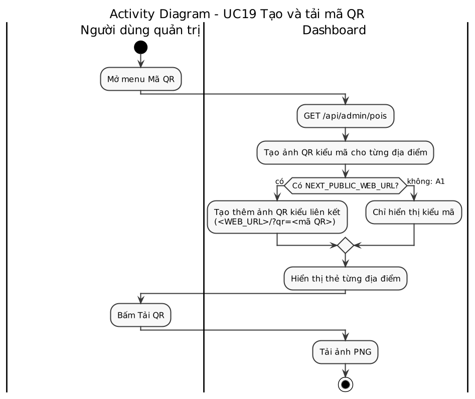

Hình 26. Activity Diagram UC19 Tạo và tải mã QR

## 7.20 UC20 Tạo tài khoản admin

| Trường | Nội dung |
| --- | --- |
| Use Case Number | UC20 |
| Use Case Name | Tạo tài khoản admin |
| Actor(s) | Quản trị |
| Maturity | Focused |
| Summary | Quản trị tạo tài khoản mới cho Quản trị viên hoặc Biên tập viên. |
| Extension Points | {Kiểm tra tài khoản}: email đúng định dạng ≤ 200 ký tự; họ tên 1–200 ký tự; vai trò admin hoặc editor; mật khẩu 8–200 ký tự (BR-G2). |
| Triggers | Quản trị cần cấp quyền truy cập cho thành viên mới. |
| Assumptions | Mật khẩu ban đầu do Quản trị đặt và thông báo cho người dùng ngoài hệ thống. |
| Preconditions | Đã đăng nhập; vai trò Quản trị (quyền user:manage). |
| Post Conditions | Một tài khoản mới đang hoạt động được tạo. |
| Reference: Business Rules | BR-G1, BR-G2, BR-G5 |
| Reference: API | GET /api/admin/users, POST /api/admin/users |
| Reference: bảng dữ liệu | admins |
| Reference: màn hình | D-07 |

Basic Course of Events

| # | Actor Action | System Response |
| --- | --- | --- |
| 1 | Chọn menu “Tài khoản admin” (đường dẫn /users). E3 | Hiển thị biểu mẫu “Thêm tài khoản” (Email, Họ tên, Vai trò mặc định “Biên tập”, Mật khẩu ít nhất 8 ký tự) và danh sách tài khoản (GET /api/admin/users). |
| 2 | Nhập thông tin và bấm “Tạo tài khoản”. | Gửi POST /api/admin/users { email, fullName, role, password }. |
| 3 | — | Server kiểm tra {Kiểm tra tài khoản}, băm mật khẩu bằng bcrypt và ghi tài khoản (đang hoạt động); trả HTTP 201. E1 E2 |
| 4 | — | Dashboard xóa biểu mẫu, hiển thị “Đã tạo tài khoản.” và tải lại danh sách. Use case kết thúc. |

Alternative Paths

Không có.

Exception Paths

E1. Email đã tồn tại (không phân biệt hoa thường): server trả HTTP 409 “Dữ liệu bị trùng (ví dụ email đã tồn tại)”.

E2. Dữ liệu không hợp lệ (email sai định dạng, họ tên rỗng, mật khẩu dưới 8 ký tự, vai trò không thuộc {admin, editor}): server trả HTTP 400 kèm danh sách lỗi; hiển thị thông báo ghép từ lỗi.

E3. Người dùng không phải Quản trị: menu không hiển thị; nếu vào /users thì thấy “Bạn không có quyền xem trang này.”; API trả HTTP 403.

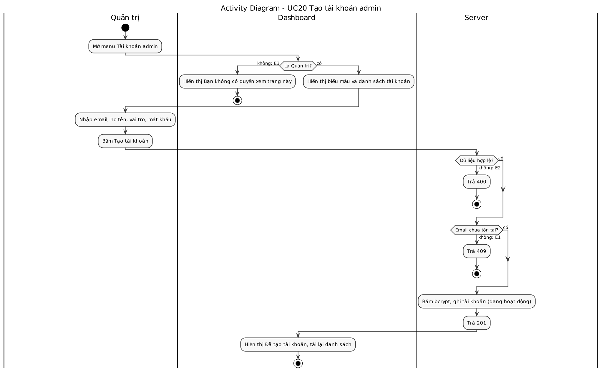

Hình 27. Activity Diagram UC20 Tạo tài khoản admin

## 7.21 UC21 Cập nhật tài khoản admin

| Trường | Nội dung |
| --- | --- |
| Use Case Number | UC21 |
| Use Case Name | Cập nhật tài khoản admin |
| Actor(s) | Quản trị |
| Maturity | Focused |
| Summary | Quản trị đổi vai trò, khóa hoặc mở khóa, hoặc đặt lại mật khẩu của một tài khoản. |
| Extension Points | {Kiểm tra cập nhật tài khoản}: mã tài khoản là số nguyên; chỉ chấp nhận fullName (1–200), role (admin\|editor), isActive (true\|false), password (8–200); trường không gửi thì giữ nguyên. |
| Triggers | Quản trị cần thay đổi quyền hoặc trạng thái của một tài khoản. |
| Assumptions | Hệ thống không có chức năng xóa tài khoản; thay vào đó là khóa. |
| Preconditions | Đã đăng nhập; vai trò Quản trị. |
| Post Conditions | Tài khoản được cập nhật; luôn còn ít nhất một Quản trị đang hoạt động (chính người thao tác). |
| Reference: Business Rules | BR-G1, BR-G4, BR-G5 |
| Reference: API | PATCH /api/admin/users/:id, GET /api/admin/users |
| Reference: bảng dữ liệu | admins |
| Reference: màn hình | D-07 |

Basic Course of Events

| # | Actor Action | System Response |
| --- | --- | --- |
| 1 | Ở trang /users, thực hiện một trong các thao tác: đổi vai trò (danh sách chọn), bấm “Khóa”/“Mở khóa”, hoặc bấm “Đặt lại mật khẩu” và nhập mật khẩu mới trong hộp thoại. A1 A2 | Gửi PATCH /api/admin/users/<mã> với phần thay đổi tương ứng ({ role } hoặc { isActive } hoặc { password }). |
| 2 | — | Server kiểm tra {Kiểm tra cập nhật tài khoản}, áp dụng thay đổi và trả HTTP 200 kèm tài khoản. E1 E2 |
| 3 | — | Dashboard hiển thị thông báo (“Đã đổi vai trò.”, “Đã khóa tài khoản.”, “Đã mở khóa tài khoản.” hoặc “Đã đặt lại mật khẩu.”) và tải lại danh sách. Từ yêu cầu kế tiếp, token của tài khoản bị khóa không còn dùng được (BR-G4). Use case kết thúc. |

Alternative Paths

A1. Với dòng của chính mình: danh sách vai trò bị vô hiệu và không có nút “Khóa”; chỉ có “Đặt lại mật khẩu”.

A2. Người dùng hủy hộp thoại nhập mật khẩu hoặc để trống: không gửi gì.

Exception Paths

E1. Tự hạ vai trò hoặc tự khóa chính mình (gọi trực tiếp API): server trả HTTP 400 “Không thể tự hạ vai trò hoặc tự khóa tài khoản của chính mình” (BR-G5).

E2. Tài khoản không tồn tại: HTTP 404 “Không tìm thấy tài khoản”; mật khẩu mới dưới 8 ký tự: HTTP 400 “Dữ liệu không hợp lệ”.

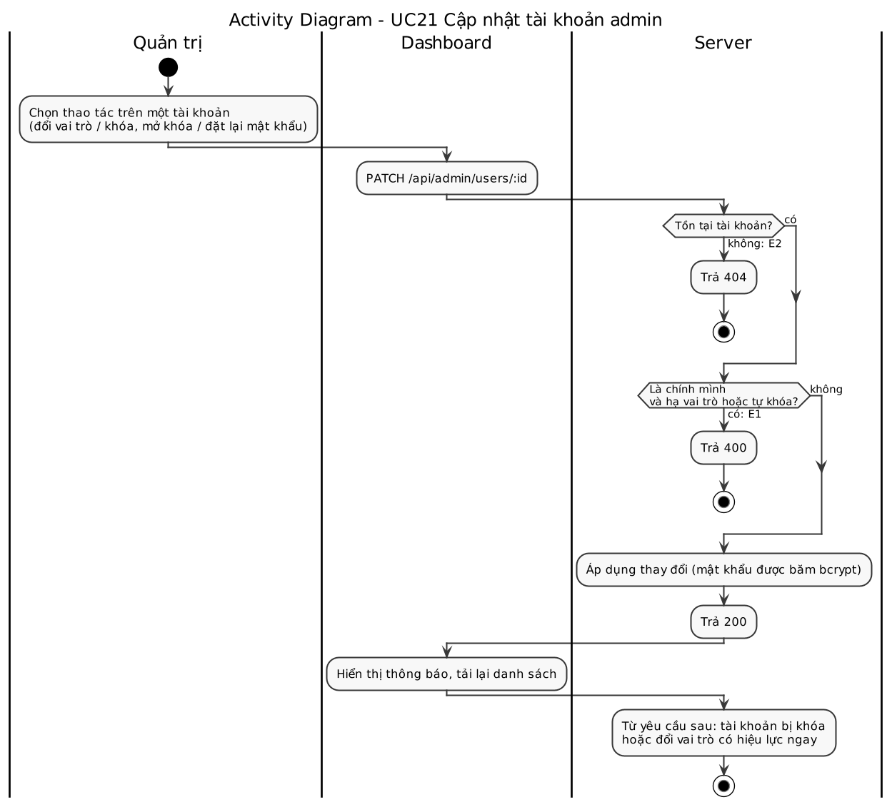

Hình 28. Activity Diagram UC21 Cập nhật tài khoản admin

# 8. Mô hình dữ liệu

## 8.1 ERD

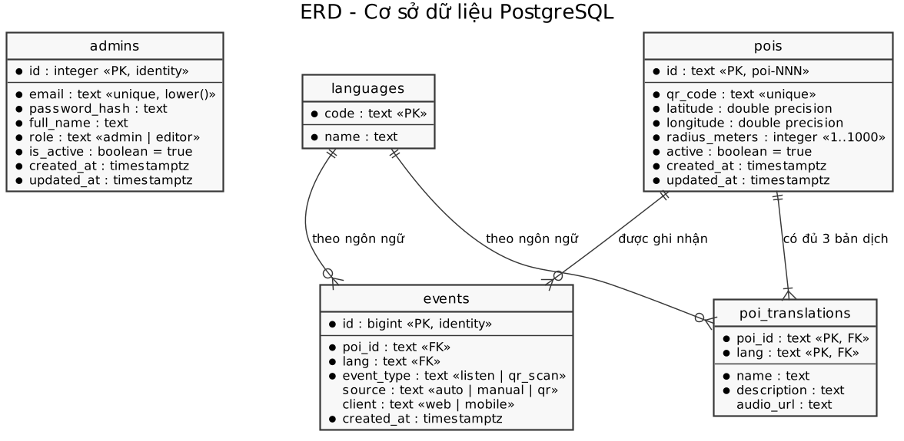

Hình 29. ERD của cơ sở dữ liệu PostgreSQL

## 8.2 Từ điển dữ liệu

Định nghĩa chính xác nằm ở Phụ lục A (schema.sql). Ký hiệu: PK khóa chính, FK khóa ngoại, NN không được rỗng.

### Bảng languages

| Cột | Kiểu | Ràng buộc | Mặc định | Ý nghĩa |
| --- | --- | --- | --- | --- |
| code | text | PK |  | Mã ngôn ngữ: vi, en, zh |
| name | text | NN |  | Tên hiển thị: Tiếng Việt, English, 中文 |

### Bảng admins

| Cột | Kiểu | Ràng buộc | Mặc định | Ý nghĩa |
| --- | --- | --- | --- | --- |
| id | integer | PK | identity | Mã tài khoản, tự tăng |
| email | text | NN |  | Duy nhất không phân biệt hoa thường (chỉ mục duy nhất trên lower(email)) |
| password_hash | text | NN |  | Mật khẩu băm bcrypt |
| full_name | text | NN |  | Họ tên |
| role | text | NN |  | admin hoặc editor |
| is_active | boolean | NN | true | false = tài khoản bị khóa |
| created_at, updated_at | timestamptz | NN | now() | Thời điểm tạo, cập nhật |

### Bảng pois

| Cột | Kiểu | Ràng buộc | Mặc định | Ý nghĩa |
| --- | --- | --- | --- | --- |
| id | text | PK |  | poi-001, poi-002, … (sinh từ poi_number_seq) |
| qr_code | text | NN, duy nhất |  | DHSG-POI-001, … (BR-B1) |
| latitude | double precision | NN |  | Từ -90 đến 90 |
| longitude | double precision | NN |  | Từ -180 đến 180 |
| radius_meters | integer | NN |  | Từ 1 đến 1000 (mét) |
| active | boolean | NN | true | false = ẩn khỏi API công khai và không nhận sự kiện |
| created_at, updated_at | timestamptz | NN | now() | Thời điểm tạo, cập nhật (updated_at được ghi lại khi sửa) |

### Bảng poi_translations

| Cột | Kiểu | Ràng buộc | Mặc định | Ý nghĩa |
| --- | --- | --- | --- | --- |
| poi_id | text | PK, FK → pois.id |  | Xóa địa điểm thì xóa dây chuyền |
| lang | text | PK, FK → languages.code |  | vi, en hoặc zh |
| name | text | NN |  | Tên; không rỗng sau khi cắt khoảng trắng |
| description | text | NN |  | Mô tả thuyết minh; không rỗng sau khi cắt khoảng trắng |
| audio_url | text |  | NULL | Đường dẫn audio (URL), tùy chọn; nếu có, web ưu tiên phát file này thay vì đọc văn bản |

### Bảng events

| Cột | Kiểu | Ràng buộc | Mặc định | Ý nghĩa |
| --- | --- | --- | --- | --- |
| id | bigint | PK | identity | Mã sự kiện, tự tăng |
| poi_id | text | NN, FK → pois.id |  | Xóa địa điểm thì xóa dây chuyền |
| lang | text | NN, FK → languages.code |  | Ngôn ngữ người dùng đang chọn lúc xảy ra sự kiện |
| event_type | text | NN |  | listen (lượt nghe) hoặc qr_scan (lượt mở bằng QR) |
| source | text |  | NULL | auto, manual hoặc qr. Ràng buộc: listen chỉ nhận auto\|manual; qr_scan chỉ nhận qr |
| client | text |  | NULL | web hoặc mobile |
| created_at | timestamptz | NN | now() | Thời điểm ghi nhận |

## 8.3 Chỉ mục, bộ đếm và ràng buộc kiểm tra

| Đối tượng | Định nghĩa |
| --- | --- |
| admins_email_lower_idx | Chỉ mục duy nhất trên lower(email) của admins |
| events_poi_time_idx | Chỉ mục trên events (poi_id, created_at) |
| events_type_time_idx | Chỉ mục trên events (event_type, created_at) |
| poi_number_seq | Bộ đếm để sinh mã địa điểm; dùng nextval, không lùi lại khi xóa |
| CHECK của events | (event_type = ‘listen’ AND source IN (‘auto’,‘manual’)) OR (event_type = ‘qr_scan’ AND source = ‘qr’) |
| Tính chất chạy lại | schema.sql dùng IF NOT EXISTS; seed.sql dùng ON CONFLICT DO NOTHING; chạy lại không lỗi và không mất dữ liệu |

## 8.4 Dữ liệu khởi tạo (seed.sql)

| Mã | Mã QR | Vĩ độ | Kinh độ | Bán kính | Tên vi / en / zh |
| --- | --- | --- | --- | --- | --- |
| poi-001 | DHSG-POI-001 | 10.76 | 106.682 | 25 | Giới Thiệu về Trường Đại học Sài Gòn / Introduction to Saigon University / 介绍西贡大学 |
| poi-002 | DHSG-POI-002 | 10.7604 | 106.682 | 25 | Cảnh quan sân trường / Campus Scenery / 校园风景 |
| poi-003 | DHSG-POI-003 | 10.76 | 106.6824 | 25 | Kiến trúc trăm tuổi phong cách Pháp lẫn Trung Hoa / Centennial Architecture with French and Chinese Styles / 百年历史的法中风格建筑 |
| poi-004 | DHSG-POI-004 | 10.7596600504704 | 106.68156140674834 | 25 | Sân bóng / Football Field / 足球场 |
| poi-005 | DHSG-POI-005 | 10.759058633501438 | 106.68186891198688 | 25 | Khu D / Building D / D区 |
| poi-006 | DHSG-POI-006 | 10.7598811277565 | 106.6825540799044 | 25 | Trung Tâm Học Liệu (KLF) / Learning Resource Center (KLF) / 学习资源中心（KLF） |

Seed có sáu địa điểm và ba ngôn ngữ (vi, en, zh), mã liên tục từ poi-001 đến poi-006. Khi nâng cấp cơ sở dữ liệu đã seed phiên bản cũ, poi-007 được chuyển sang poi-006 và các sự kiện thống kê được giữ lại; bộ đếm poi_number_seq được đặt lại theo mã lớn nhất hiện có nên địa điểm mới bắt đầu từ poi-007. Tọa độ và nội dung seed cần được xác nhận trước khi dùng làm dữ liệu tham quan chính thức.

## 8.5 Hình dạng JSON của địa điểm

| Trường | Kiểu | API công khai | API quản trị | Ghi chú |
| --- | --- | --- | --- | --- |
| id | chuỗi | có | có | poi-NNN |
| qrCode | chuỗi | có | có | DHSG-POI-NNN |
| latitude, longitude | số | có | có |  |
| radiusMeters | số nguyên | có | có | mét |
| name, description | đối tượng {vi, en, zh} | có | có | mỗi giá trị là chuỗi |
| audioUrl | đối tượng {vi, en, zh} | có | có | mỗi giá trị là chuỗi hoặc null |
| active | boolean | không | có |  |
| createdAt, updatedAt | thời điểm ISO 8601 | không | có |  |

File pois.json trong web có đúng các trường của API công khai (BR-E2).

# 9. Đặc tả API

## 9.1 Quy ước chung

| Mục | Quy ước |
| --- | --- |
| Định dạng | JSON (Content-Type: application/json); mã hóa UTF-8; kích thước nội dung tối đa 100 KB (lớn hơn: 413) |
| Tiền tố | Mọi đường dẫn bắt đầu bằng /api |
| Xác thực | Header Authorization: Bearer <token> cho /api/admin/* và /api/auth/me, /api/auth/change-password |
| Định dạng lỗi | { “error”: { “code”: “…”, “message”: “…”, “details”: [ { “path”: “…”, “message”: “…” } ] } } (details chỉ có khi VALIDATION) |
| CORS | Theo biến CORS_ORIGINS (BR-G8) |
| Đường dẫn không tồn tại | 404 với code NOT_FOUND “Không tìm thấy đường dẫn” |

### Bảng mã lỗi

| HTTP | code | Khi nào |
| --- | --- | --- |
| 400 | VALIDATION | Dữ liệu sai quy tắc; message “Dữ liệu không hợp lệ” kèm details |
| 400 | BAD_JSON | Nội dung không phải JSON hợp lệ |
| 400 | WRONG_PASSWORD | Mật khẩu hiện tại không đúng khi đổi mật khẩu |
| 400 | SELF_LOCKOUT | Tự hạ vai trò hoặc tự khóa chính mình |
| 401 | UNAUTHENTICATED | Thiếu, sai, hết hạn token; hoặc tài khoản không tồn tại hay bị khóa |
| 401 | INVALID_CREDENTIALS | Email hoặc mật khẩu không đúng (gồm cả tài khoản bị khóa) |
| 403 | FORBIDDEN | Không có quyền thực hiện thao tác |
| 404 | NOT_FOUND | Không có địa điểm, tài khoản hoặc đường dẫn |
| 409 | DUPLICATE | Vi phạm tính duy nhất (ví dụ email đã tồn tại) |
| 413 | TOO_LARGE | Nội dung gửi lên quá lớn |
| 429 | TOO_MANY_ATTEMPTS | Đăng nhập sai quá nhiều lần |
| 500 | INTERNAL | Lỗi máy chủ (thông tin chi tiết không trả về cho người dùng) |

## 9.2 Tổng hợp các API

| Phương thức | Đường dẫn | Xác thực | Quyền | Use case |
| --- | --- | --- | --- | --- |
| GET | /api/health | Không | — | — |
| GET | /api/pois | Không | — | UC02 |
| POST | /api/events | Không | — | UC09 |
| POST | /api/auth/login | Không | — | UC11 |
| GET | /api/auth/me | Có | Mọi vai trò | UC11 |
| POST | /api/auth/change-password | Có | Mọi vai trò | UC13 |
| GET | /api/admin/pois | Có | poi:read | UC15, UC19 |
| GET | /api/admin/pois/:id | Có | poi:read | UC17 |
| POST | /api/admin/pois | Có | poi:create | UC16 |
| PUT | /api/admin/pois/:id | Có | poi:update | UC17 |
| DELETE | /api/admin/pois/:id | Có | poi:delete (Quản trị) | UC18 |
| GET | /api/admin/stats?days=N | Có | stats:read | UC14 |
| GET | /api/admin/users | Có | user:manage (Quản trị) | UC20, UC21 |
| POST | /api/admin/users | Có | user:manage (Quản trị) | UC20 |
| PATCH | /api/admin/users/:id | Có | user:manage (Quản trị) | UC21 |

## 9.3 Chi tiết từng API

### GET /api/health

Kiểm tra server và kết nối cơ sở dữ liệu.

Phản hồi thành công: 200 { “ok”: true }.

| HTTP | Điều kiện |
| --- | --- |
| 500 | Không truy vấn được cơ sở dữ liệu |

Ví dụ chạy thật:

GET /api/health  
Phản hồi HTTP 200  
{  
  "ok": true  
}

### GET /api/pois

Danh sách địa điểm đang hoạt động (active = true), sắp xếp theo mã, cùng hình dạng với pois.json. Có header Cache-Control: public, max-age=30.

Phản hồi thành công: 200, mảng địa điểm với các trường: id, qrCode, latitude, longitude, radiusMeters, name, description, audioUrl.

Ví dụ chạy thật:

GET /api/pois  
Phản hồi HTTP 200  // rút gọn: chỉ hiển thị phần tử đầu tiên  
[  
  {  
    "id": "poi-001",  
    "qrCode": "DHSG-POI-001",  
    "latitude": 10.76,  
    "longitude": 106.682,  
    "radiusMeters": 25,  
    "name": {  
      "vi": "Điểm mẫu 1",  
      "en": "Sample point 1",  
      "zh": "示例地点 1"  
    },  
    "description": {  
      "vi": "Đây là nội dung thuyết minh mẫu của điểm số một.",  
      "en": "This is the sample narration for point number one.",  
      "zh": "这是第一个地点的示例讲解内容。"  
    },  
    "audioUrl": {  
      "vi": null,  
      "en": null,  
      "zh": null  
    }  
  }  
]

### POST /api/events

Ghi một sự kiện thống kê ẩn danh (BR-E3, BR-E4).

| Trường | Kiểu | Bắt buộc | Quy tắc |
| --- | --- | --- | --- |
| poiId | chuỗi | Có | 1–64 ký tự; địa điểm phải tồn tại và active |
| type | chuỗi | Có | listen hoặc qr_scan |
| lang | chuỗi | Có | vi, en hoặc zh |
| source | chuỗi | Với listen | listen: auto hoặc manual; qr_scan: qr hoặc bỏ trống (mặc định qr) |
| client | chuỗi | Không | web hoặc mobile |

Phản hồi thành công: 201 { “ok”: true }.

| HTTP | Điều kiện |
| --- | --- |
| 400 | Sai quy tắc (ví dụ listen với source qr) |
| 404 | Địa điểm không tồn tại hoặc đang tắt |

Ví dụ chạy thật:

POST /api/events  
Yêu cầu:  
{  
  "poiId": "poi-001",  
  "type": "listen",  
  "lang": "vi",  
  "source": "auto",  
  "client": "web"  
}  
Phản hồi HTTP 201  
{  
  "ok": true  
}

Ví dụ chạy thật:

POST /api/events  
Yêu cầu:  
{  
  "poiId": "poi-002",  
  "type": "qr_scan",  
  "lang": "en",  
  "client": "web"  
}  
Phản hồi HTTP 201  
{  
  "ok": true  
}

Ví dụ chạy thật:

POST /api/events  
Yêu cầu:  
{  
  "poiId": "poi-001",  
  "type": "listen",  
  "lang": "vi",  
  "source": "qr"  
}  
Phản hồi HTTP 400  
{  
  "error": {  
    "code": "VALIDATION",  
    "message": "Dữ liệu không hợp lệ",  
    "details": [  
      {  
        "path": "",  
        "message": "source không khớp với type (listen: auto|manual, qr_scan: qr)"  
      }  
    ]  
  }  
}

Ví dụ chạy thật:

POST /api/events  
Yêu cầu:  
{  
  "poiId": "khong-co",  
  "type": "listen",  
  "lang": "vi",  
  "source": "auto"  
}  
Phản hồi HTTP 404  
{  
  "error": {  
    "code": "NOT_FOUND",  
    "message": "Không tìm thấy địa điểm"  
  }  
}

### POST /api/auth/login

Đăng nhập (BR-G3, BR-G4).

| Trường | Kiểu | Bắt buộc | Quy tắc |
| --- | --- | --- | --- |
| email | chuỗi | Có | 3–200 ký tự |
| password | chuỗi | Có | 1–200 ký tự |

Phản hồi thành công: 200 { token, user: { id, email, fullName, role } }.

| HTTP | Điều kiện |
| --- | --- |
| 401 | Sai thông tin hoặc tài khoản bị khóa: “Email hoặc mật khẩu không đúng” |
| 429 | Đã sai 10 lần trong 15 phút với cùng (IP, email) |

Ví dụ chạy thật:

POST /api/auth/login  
Yêu cầu:  
{  
  "email": "admin@example.com",  
  "password": "MatKhau-Demo-1"  
}  
Phản hồi HTTP 200  
{  
  "token": "<JWT>",  
  "user": {  
    "id": 1,  
    "email": "admin@example.com",  
    "fullName": "Quản trị viên",  
    "role": "admin"  
  }  
}

Ví dụ chạy thật:

POST /api/auth/login  
Yêu cầu:  
{  
  "email": "admin@example.com",  
  "password": "sai"  
}  
Phản hồi HTTP 401  
{  
  "error": {  
    "code": "INVALID_CREDENTIALS",  
    "message": "Email hoặc mật khẩu không đúng"  
  }  
}

### GET /api/auth/me

Thông tin tài khoản đang đăng nhập.

Phản hồi thành công: 200 { user: { id, email, fullName, role } }.

| HTTP | Điều kiện |
| --- | --- |
| 401 | Token không hợp lệ |

Ví dụ chạy thật:

GET /api/auth/me  
Phản hồi HTTP 200  
{  
  "user": {  
    "id": 1,  
    "email": "admin@example.com",  
    "fullName": "Quản trị viên",  
    "role": "admin"  
  }  
}

### POST /api/auth/change-password

Đổi mật khẩu của chính mình (BR-G6).

| Trường | Kiểu | Bắt buộc | Quy tắc |
| --- | --- | --- | --- |
| currentPassword | chuỗi | Có | Phải đúng mật khẩu hiện tại |
| newPassword | chuỗi | Có | 8–200 ký tự |

Phản hồi thành công: 200 { “ok”: true }.

| HTTP | Điều kiện |
| --- | --- |
| 400 | WRONG_PASSWORD hoặc VALIDATION |
| 401 | Chưa đăng nhập |

### GET /api/admin/pois và GET /api/admin/pois/:id

Mọi địa điểm kể cả đã tắt (hoặc một địa điểm), kèm active, createdAt, updatedAt.

Phản hồi thành công: 200 mảng địa điểm, hoặc một địa điểm.

| HTTP | Điều kiện |
| --- | --- |
| 401 | Chưa đăng nhập |
| 404 | Không có địa điểm (chỉ với :id) |

Ví dụ chạy thật:

GET /api/admin/pois  
Phản hồi HTTP 401  
{  
  "error": {  
    "code": "UNAUTHENTICATED",  
    "message": "Bạn chưa đăng nhập"  
  }  
}

### POST /api/admin/pois

Thêm địa điểm. Server sinh id và qrCode (BR-B1).

| Trường | Kiểu | Bắt buộc | Quy tắc |
| --- | --- | --- | --- |
| latitude | số | Có | −90 đến 90 |
| longitude | số | Có | −180 đến 180 |
| radiusMeters | số nguyên | Có | 1 đến 1000 |
| active | boolean | Không | Mặc định true |
| translations | đối tượng | Có | Gồm đủ vi, en, zh; mỗi giá trị { name (1–200), description (1–5000), audioUrl (URL ≤ 2000 hoặc null/rỗng, tùy chọn) } |

Phản hồi thành công: 201 địa điểm vừa tạo (hình dạng quản trị).

| HTTP | Điều kiện |
| --- | --- |
| 400 | VALIDATION |
| 403 | Không có quyền poi:create |

Ví dụ chạy thật:

POST /api/admin/pois  
Yêu cầu:  
{  
  "latitude": 10.7605,  
  "longitude": 106.6825,  
  "radiusMeters": 30,  
  "active": true,  
  "translations": {  
    "vi": {  
      "name": "Cổng chính",  
      "description": "Mô tả tiếng Việt",  
      "audioUrl": null  
    },  
    "en": {  
      "name": "Main gate",  
      "description": "English description",  
      "audioUrl": null  
    },  
    "zh": {  
      "name": "正门",  
      "description": "中文描述",  
      "audioUrl": null  
    }  
  }  
}  
Phản hồi HTTP 201  
{  
  "id": "poi-004",  
  "qrCode": "DHSG-POI-004",  
  "latitude": 10.7605,  
  "longitude": 106.6825,  
  "radiusMeters": 30,  
  "active": true,  
  "createdAt": "2026-10-27T03:37:14.103Z",  
  "updatedAt": "2026-10-27T03:37:14.103Z",  
  "name": {  
    "vi": "Cổng chính",  
    "en": "Main gate",  
    "zh": "正门"  
  },  
  "description": {  
    "vi": "Mô tả tiếng Việt",  
    "en": "English description",  
    "zh": "中文描述"  
  },  
  "audioUrl": {  
    "vi": null,  
    "en": null,  
    "zh": null  
  }  
}

Ví dụ chạy thật:

POST /api/admin/pois  
Yêu cầu:  
{  
  "latitude": 200,  
  "longitude": 106.6825,  
  "radiusMeters": 30,  
  "active": true,  
  "translations": {  
    "vi": {  
      "name": "Cổng chính",  
      "description": "Mô tả tiếng Việt",  
      "audioUrl": null  
    },  
    "en": {  
      "name": "Main gate",  
      "description": "English description",  
      "audioUrl": null  
    }  
  }  
}  
Phản hồi HTTP 400  
{  
  "error": {  
    "code": "VALIDATION",  
    "message": "Dữ liệu không hợp lệ",  
    "details": [  
      {  
        "path": "latitude",  
        "message": "Too big: expected number to be <=90"  
      },  
      {  
        "path": "translations.zh",  
        "message": "Invalid input: expected object, received undefined"  
      }  
    ]  
  }  
}

### PUT /api/admin/pois/:id

Sửa địa điểm. Nội dung giống POST và phải đầy đủ; ghi đè cả ba bản dịch; id và qrCode không đổi.

| Trường | Kiểu | Bắt buộc | Quy tắc |
| --- | --- | --- | --- |
| latitude | số | Có | −90 đến 90 |
| longitude | số | Có | −180 đến 180 |
| radiusMeters | số nguyên | Có | 1 đến 1000 |
| active | boolean | Không | Mặc định true |
| translations | đối tượng | Có | Gồm đủ vi, en, zh; mỗi giá trị { name (1–200), description (1–5000), audioUrl (URL ≤ 2000 hoặc null/rỗng, tùy chọn) } |

Phản hồi thành công: 200 địa điểm đã cập nhật.

| HTTP | Điều kiện |
| --- | --- |
| 400 | VALIDATION |
| 403 | Không có quyền poi:update |
| 404 | Không có địa điểm |

### DELETE /api/admin/pois/:id

Xóa địa điểm cùng bản dịch và sự kiện (BR-B4).

Phản hồi thành công: 204, không có nội dung.

| HTTP | Điều kiện |
| --- | --- |
| 403 | Không phải Quản trị |
| 404 | Không có địa điểm |

Ví dụ chạy thật:

DELETE /api/admin/pois/poi-004  
Phản hồi HTTP 403  
{  
  "error": {  
    "code": "FORBIDDEN",  
    "message": "Bạn không có quyền thực hiện thao tác này"  
  }  
}

Ví dụ chạy thật:

DELETE /api/admin/pois/poi-004  
Phản hồi HTTP 204

### GET /api/admin/stats

Thống kê trong N ngày gần nhất (tham số days, 1–365, mặc định 30) theo BR-E5.

| Trường | Kiểu | Bắt buộc | Quy tắc |
| --- | --- | --- | --- |
| days | số (query) | Không | 1–365; lớn hơn 365 thì lấy 365, nhỏ hơn 1 thì lấy 1; không phải số hoặc bằng 0 thì dùng 30 |

Phản hồi thành công: 200 { range: { days, from, to, timezone }, totals: { listen, qrScan }, byPoi[], byLang[], byPoiLang[], bySource[], byDay[] }.

| HTTP | Điều kiện |
| --- | --- |
| 403 | Không có quyền stats:read |

Ví dụ chạy thật:

GET /api/admin/stats?days=3  
Phản hồi HTTP 200  
{  
  "range": {  
    "days": 3,  
    "from": "2026-10-25",  
    "to": "2026-10-27",  
    "timezone": "UTC"  
  },  
  "totals": {  
    "listen": 1,  
    "qrScan": 1  
  },  
  "byPoi": [  
    {  
      "poiId": "poi-001",  
      "name": "Điểm mẫu 1",  
      "listen": 1,  
      "qrScan": 0  
    },  
    {  
      "poiId": "poi-002",  
      "name": "Điểm mẫu 2",  
      "listen": 0,  
      "qrScan": 1  
    },  
    {  
      "poiId": "poi-003",  
      "name": "Điểm mẫu 3",  
      "listen": 0,  
      "qrScan": 0  
    },  
    {  
      "poiId": "poi-004",  
      "name": "Cổng chính",  
      "listen": 0,  
      "qrScan": 0  
    }  
  ],  
  "byLang": [  
    {  
      "lang": "en",  
      "listen": 0,  
      "qrScan": 1  
    },  
    {  
      "lang": "vi",  
      "listen": 1,  
      "qrScan": 0  
    },  
    {  
      "lang": "zh",  
      "listen": 0,  
      "qrScan": 0  
    }  
  ],  
  "byPoiLang": [  
    {  
      "poiId": "poi-001",  
      "lang": "vi",  
      "listen": 1,  
      "qrScan": 0  
    },  
    {  
      "poiId": "poi-002",  
      "lang": "en",  
      "listen": 0,  
      "qrScan": 1  
    }  
  ],  
  "bySource": [  
    {  
      "source": "auto",  
      "count": 1  
    }  
  ],  
  "byDay": [  
    {  
      "day": "2026-10-25",  
      "listen": 0,  
      "qrScan": 0  
    },  
    {  
      "day": "2026-10-26",  
      "listen": 0,  
      "qrScan": 0  
    },  
    {  
      "day": "2026-10-27",  
      "listen": 1,  
      "qrScan": 1  
    }  
  ]  
}

### GET /api/admin/users

Danh sách tài khoản admin, sắp xếp theo id.

Phản hồi thành công: 200 mảng { id, email, fullName, role, isActive, createdAt }.

| HTTP | Điều kiện |
| --- | --- |
| 403 | Không phải Quản trị |

Ví dụ chạy thật:

GET /api/admin/users  
Phản hồi HTTP 200  
[  
  {  
    "id": 1,  
    "email": "admin@example.com",  
    "fullName": "Quản trị viên",  
    "role": "admin",  
    "isActive": true,  
    "createdAt": "2026-10-27T03:37:10.676Z"  
  },  
  {  
    "id": 2,  
    "email": "bientap@example.com",  
    "fullName": "Biên tập viên",  
    "role": "editor",  
    "isActive": true,  
    "createdAt": "2026-10-27T03:37:14.251Z"  
  }  
]

### POST /api/admin/users

Tạo tài khoản (UC20).

| Trường | Kiểu | Bắt buộc | Quy tắc |
| --- | --- | --- | --- |
| email | chuỗi | Có | Email hợp lệ ≤ 200 ký tự; duy nhất không phân biệt hoa thường |
| fullName | chuỗi | Có | 1–200 ký tự |
| role | chuỗi | Có | admin hoặc editor |
| password | chuỗi | Có | 8–200 ký tự |

Phản hồi thành công: 201 tài khoản vừa tạo (không có mật khẩu).

| HTTP | Điều kiện |
| --- | --- |
| 400 | VALIDATION |
| 403 | Không phải Quản trị |
| 409 | Email đã tồn tại |

Ví dụ chạy thật:

POST /api/admin/users  
Yêu cầu:  
{  
  "email": "bientap@example.com",  
  "fullName": "Biên tập viên",  
  "role": "editor",  
  "password": "MatKhau-BT-1"  
}  
Phản hồi HTTP 201  
{  
  "id": 2,  
  "email": "bientap@example.com",  
  "fullName": "Biên tập viên",  
  "role": "editor",  
  "isActive": true,  
  "createdAt": "2026-10-27T03:37:14.251Z"  
}

### PATCH /api/admin/users/:id

Cập nhật tài khoản (UC21). Trường không gửi thì giữ nguyên. Không được tự hạ vai trò hoặc tự khóa chính mình (BR-G5).

| Trường | Kiểu | Bắt buộc | Quy tắc |
| --- | --- | --- | --- |
| fullName | chuỗi | Không | 1–200 ký tự |
| role | chuỗi | Không | admin hoặc editor |
| isActive | boolean | Không | false = khóa |
| password | chuỗi | Không | 8–200 ký tự (đặt lại mật khẩu) |

Phản hồi thành công: 200 tài khoản đã cập nhật.

| HTTP | Điều kiện |
| --- | --- |
| 400 | VALIDATION hoặc SELF_LOCKOUT |
| 403 | Không phải Quản trị |
| 404 | Không có tài khoản |

# 10. Đặc tả giao diện

## 10.1 Web – màn hình W-01 (trang chính, đường dẫn “/”)

Web chỉ có một trang. Bố cục gồm thanh tiêu đề và hai vùng: bản đồ (co giãn) và bảng điều khiển (rộng 380 px). Trên màn hình rộng tối đa 800 px, bố cục chuyển thành một cột: bản đồ cao 45% chiều cao màn hình rồi đến bảng điều khiển.

| Vùng | Thành phần và hành vi |
| --- | --- |
| Thanh tiêu đề | Nền #1d4ed8, chữ trắng. Bên trái: tiêu đề ứng dụng (chuỗi appTitle). Bên phải: nhãn “Ngôn ngữ” và danh sách chọn gồm Tiếng Việt, English, 中文 (UC01). |
| Bản đồ | Phủ toàn bộ vùng bên trái. Vùng tròn và chấm địa điểm, chấm đỏ vị trí, nút +/− (UC03, BR-D4, BR-D5). Nút QR hình tròn 48×48 px ở góc trên bên trái, nhãn trợ năng “Mở mã QR tải ứng dụng” (theo ngôn ngữ hiện chọn), mở thẻ nổi; thẻ có nút đóng, tiêu đề “Quét mã để mở ứng dụng”, ảnh QR (hoặc trạng thái đang tạo/lỗi) và URL đích (UC10, BR-I2). QR mở trang web; không cài ứng dụng trực tiếp. |
| Khối trạng thái | Dòng 1: trạng thái vị trí (bảng bên dưới). Dòng 2: nguồn dữ liệu (“Dữ liệu: từ máy chủ / đang tải… / dự phòng / file pois.json”). Dòng 3 (nếu có vị trí): “vĩ độ, kinh độ” với 5 chữ số thập phân, phông đơn cách. |
| Nút Tự động phát | Nút rộng hết bảng điều khiển. TẮT: viền xám, nền trắng, nhãn “Tự động phát: TẮT”. BẬT: nền xanh lá #16a34a, chữ trắng, nhãn “Tự động phát: BẬT”. Khi TẮT có thêm dòng gợi ý nhỏ (autoHint) (UC06). |
| Tab | Hai tab “Địa điểm” và “Quét QR”; tab đang chọn có gạch chân xanh #1d4ed8 và chữ đậm. Mặc định tab “Địa điểm”. |
| Tab Địa điểm | Danh sách (UC04) hoặc trang chi tiết (UC04, UC05) tùy có địa điểm được chọn hay không. |
| Tab Quét QR | Tiêu đề; vùng camera; nút “Bật camera”/“Tắt camera”; cảnh báo lỗi camera; nhãn “Hoặc nhập mã QR” với ô nhập (gợi ý DHSG-POI-001) và nút “Mở”; cảnh báo “Không tìm thấy…” (UC08). |
| Khối giả lập vị trí | Có đường kẻ nét đứt phía trên. Tiêu đề; danh sách chọn; dòng gợi ý khi đang giả lập (UC07). |
| Ghi chú cuối | Dòng nhỏ sampleNote: “Dữ liệu địa điểm hiện là dữ liệu mẫu (tọa độ tạm).”. |

### Quy tắc hiển thị dòng trạng thái vị trí

| Điều kiện (xét theo thứ tự) | Nội dung hiển thị |
| --- | --- |
| Đang giả lập | Chuỗi simTitle cắt tại ký tự “ (” đầu tiên: tiếng Việt “Giả lập vị trí”, tiếng Anh “Simulate location”. Tiếng Trung không chứa “ (” (dùng dấu ngoặc toàn chiều rộng) nên hiển thị nguyên chuỗi simTitle. |
| GPS: ok | gpsReal |
| GPS: waiting | gpsWaiting |
| GPS: denied | gpsDenied |
| GPS: unsupported | gpsUnsupported |
| Còn lại (ví dụ trước khi bắt đầu theo dõi) | noPosition (“Chưa có vị trí”) |

### Danh sách (UC04)

Mỗi mục là một nút chiếm hết chiều rộng, viền xám nhạt, bo góc: dòng 1 tên (đậm), dòng 2 nhỏ màu xám “Cách bạn: N m” hoặc “Chưa có vị trí”. Mục đang trong vùng: viền xanh lá và nền #f0fdf4.

### Trang chi tiết (UC04, UC05)

| Thành phần | Mô tả |
| --- | --- |
| Liên kết quay lại | “← Quay lại danh sách”, màu #1d4ed8, bỏ chọn địa điểm |
| Tên | Tiêu đề h2 |
| Mô tả | Đoạn văn |
| Thông tin | “Bán kính vùng: R m · Mã QR: <mã>” (mã trong thẻ code) |
| Cảnh báo | Hiện nếu trình duyệt không hỗ trợ giọng đọc, hoặc không có giọng khớp ngôn ngữ (màu cam #b45309) |
| Nút điều khiển | Theo BR-H4: Phát (nền #1d4ed8, chữ trắng; vô hiệu nếu không hỗ trợ giọng đọc), Tạm dừng, Tiếp tục, Dừng |
| Dòng đang phát | “Đang phát…” nếu địa điểm này đang là bài hiện tại |

### Trạng thái giao diện web

| Trạng thái | Giá trị ban đầu | Thay đổi bởi |
| --- | --- | --- |
| lang | vi | UC01 |
| tab | list (Địa điểm) | Bấm tab; chọn địa điểm; UC06; UC08 |
| selectedId | không có | Chọn địa điểm; UC06; UC08; “Quay lại” |
| auto | false | Nút Tự động phát (UC06) |
| sim { mode, pos, key } | mode = gps, pos = rỗng, key = gps | UC07 |
| insideIds | tập rỗng | Đánh giá vùng (UC06) |
| qrNotFound | false | UC08 |
| pois, source | pois.json, loading hoặc local | UC02 |
| narration { status, currentId, voiceWarning, supported } | idle, rỗng, false, true | UC05, UC06 |
| gps { position, status } | rỗng, idle | UC03 |

## 10.2 Dashboard – các màn hình

| Mã | Đường dẫn | Truy cập | Nội dung |
| --- | --- | --- | --- |
| D-01 | /login | Mọi người; đã đăng nhập thì chuyển về / | Tiêu đề “Đăng nhập dashboard”, dòng “Thuyết minh tự động – ĐHSG”, ô Email, ô Mật khẩu, thông báo lỗi (màu đỏ), nút “Đăng nhập”/“Đang đăng nhập…” (UC11) |
| D-02 | / | Quản trị, Biên tập | Tiêu đề “Thống kê”; chọn khoảng thời gian (7, 30 mặc định, 90 ngày qua); dòng chú thích; thẻ “Lượt nghe” và “Lượt quét QR”; bảng “Theo địa điểm”, “Theo ngôn ngữ”, “Theo địa điểm và ngôn ngữ”, “Cách phát (lượt nghe)” (nhãn “Tự động (vào vùng)”, “Bấm phát tay”; nếu rỗng ghi “Chưa có dữ liệu”), “Theo ngày” có thanh biểu đồ tỉ lệ so với ngày cao nhất (UC14) |
| D-03 | /pois | Quản trị, Biên tập | Tiêu đề “Địa điểm”; nút “+ Thêm địa điểm”; bảng Mã, Tên (Tiếng Việt), Tọa độ, Bán kính, Trạng thái, nút Sửa và Xóa theo quyền (UC15, UC18) |
| D-04 | /pois/new | Quản trị, Biên tập | Liên kết “← Danh sách địa điểm”; tiêu đề “Thêm địa điểm”; biểu mẫu (UC16) |
| D-05 | /pois/<mã> | Quản trị, Biên tập | Tiêu đề “Sửa địa điểm <mã>”; dòng mã QR cố định; thông báo “Đã lưu.”; biểu mẫu điền sẵn (UC17) |
| D-06 | /qr | Quản trị, Biên tập | Tiêu đề “Mã QR”; đoạn giải thích hai kiểu QR; lưới thẻ mỗi địa điểm (UC19) |
| D-07 | /users | Chỉ Quản trị (người khác thấy “Bạn không có quyền xem trang này.”) | Tiêu đề “Tài khoản admin”; thông báo thành công/lỗi; biểu mẫu “Thêm tài khoản”; bảng tài khoản (UC20, UC21) |
| D-08 | /account | Mọi người đã đăng nhập | Họ tên, email và vai trò; biểu mẫu “Đổi mật khẩu” (UC13) |

### Khung giao diện chung của dashboard

Mọi trang quản trị (D-02 đến D-08) nằm trong khung gồm thanh bên trái rộng 230 px nền #111827 (tiêu đề “Thuyết minh ĐHSG”, các mục menu: Thống kê, Địa điểm, Mã QR, Tài khoản admin (chỉ Quản trị), Tài khoản của tôi; cuối thanh: họ tên, vai trò “Quản trị”/“Biên tập”, nút “Đăng xuất”) và vùng nội dung bên phải. Mục menu của trang hiện tại được tô nổi. Khi chưa biết trạng thái đăng nhập, hiển thị “Đang tải…”. Màn hình hẹp (≤ 800 px): thanh bên chuyển lên trên và các lưới thu về một cột.

### Biểu mẫu địa điểm (D-04, D-05)

| Trường | Điều khiển | Mặc định | Ghi chú |
| --- | --- | --- | --- |
| Bản đồ chọn vị trí (MapPicker) | Bản đồ tương tác (MapLibre OSM) | Tâm ĐHSG | Chạm/click hoặc kéo marker đỏ để cập nhật Vĩ độ và Kinh độ; hiển thị vòng tròn bán kính geofence màu xanh dương theo Bán kính vùng; có nút "Về khuôn viên ĐHSG" |
| Vĩ độ (latitude) | Ô nhập (gợi ý 10.7600) | Rỗng | Bắt buộc, số (tự đồng bộ khi chọn trên bản đồ) |
| Kinh độ (longitude) | Ô nhập (gợi ý 106.6820) | Rỗng | Bắt buộc, số (tự đồng bộ khi chọn trên bản đồ, kèm nút tra cứu nhanh Google Maps) |
| Bán kính vùng (mét) | Ô nhập | 25 | Bắt buộc, số (vòng tròn trên bản đồ tự co giãn theo giá trị này) |
| Đang hoạt động | Hộp chọn | Chọn | “Đang hoạt động (hiện trong web và app)” |
| Tên (vi, en, zh) | Ô nhập, mỗi ngôn ngữ một khối | Rỗng | Bắt buộc |
| Nội dung thuyết minh (vi, en, zh) | Vùng nhập 4 dòng | Rỗng | Bắt buộc |
| Đường dẫn audio (vi, en, zh) | Ô nhập (gợi ý https://…) | Rỗng | Tùy chọn; nếu có URL hợp lệ hiển thị trình nghe thử audio trực tiếp; rỗng được gửi thành null |

Nút gửi: “Lưu địa điểm” (thêm) hoặc “Lưu thay đổi” (sửa); khi đang gửi hiển thị “Đang lưu…” và vô hiệu. Lỗi hiển thị màu đỏ, kèm danh sách “<trường>: <lỗi>” nếu server trả chi tiết.

### Trang Tài khoản admin (D-07)

Biểu mẫu “Thêm tài khoản” gồm Email, Họ tên, Vai trò (Biên tập mặc định, hoặc Quản trị), Mật khẩu (ít nhất 8 ký tự), nút “Tạo tài khoản”. Bảng gồm Email (thêm “(bạn)” cho chính mình), Họ tên, Vai trò (danh sách chọn, vô hiệu với chính mình), Trạng thái (“Hoạt động”/“Đã khóa”), nút “Khóa”/“Mở khóa” (không có cho chính mình) và “Đặt lại mật khẩu” (hộp thoại nhập mật khẩu mới).

## 10.3 Hệ thống thiết kế

| Thành phần | Giá trị |
| --- | --- |
| Phông chữ | system-ui, -apple-system, “Segoe UI”, Roboto, “Noto Sans” (web thêm “Noto Sans SC”), sans-serif |
| Màu chủ đạo | #1d4ed8 (thanh tiêu đề web, nút chính, liên kết, tab chọn) |
| Màu “đang trong vùng” và bật | #16a34a (nền nhạt #f0fdf4) |
| Màu chữ, nền | Chữ #111827; nền trang #f3f4f6; chữ phụ #6b7280; viền #e5e7eb; cảnh báo #b45309; lỗi #b91c1c |
| Vị trí người dùng trên bản đồ | #dc2626 |
| Thanh bên dashboard | Nền #111827, chữ #d1d5db, mục chọn nền #1f2937 |
| Bo góc, khoảng cách | Nút 8 px; thẻ 10 px; khoảng cách thường 8–16 px |

CSS đầy đủ của web và dashboard: Phụ lục D và E. Toàn bộ chuỗi giao diện ba ngôn ngữ của web: Phụ lục C. Dashboard chỉ có tiếng Việt.

# 11. Thuật toán và máy trạng thái

## 11.1 Khoảng cách Haversine (BR-C1)

R = 6371000  (mét)  
dLat = rad(lat2 - lat1);  dLng = rad(lng2 - lng1)  
h = sin(dLat/2)^2 + cos(rad(lat1)) * cos(rad(lat2)) * sin(dLng/2)^2  
khoảng_cách = 2 * R * asin( sqrt(h) )  
trong_vùng  = khoảng_cách <= bán_kính_vùng

## 11.2 Bộ theo dõi vùng (BR-C2 đến BR-C6)

Trạng thái: inside = tập mã địa điểm đang trong vùng ở lần cập nhật trước  
            lastPlayed = bản đồ { mã địa điểm -> thời điểm tự phát gần nhất }  
  
update(vị_trí, danh_sách_địa_điểm, now):  
    zones = các địa điểm có khoảng_cách <= bán_kính, sắp xếp theo khoảng_cách tăng dần  
    ids   = tập mã của zones  
    ứng_viên = các phần tử của zones thỏa:  
                 mã KHÔNG thuộc inside                     (vừa vào vùng)  
                 và (chưa có lastPlayed[mã] hoặc now - lastPlayed[mã] >= COOLDOWN_MS)  
    inside = ids  
    trả về { insideIds = ids, ứng_viên = ứng_viên[0] hoặc rỗng }   (phần tử gần nhất)  
  
markPlayed(mã, now): lastPlayed[mã] = now          (chỉ gọi khi thực sự tự phát)  
clearInside():       inside = rỗng                  (giữ lastPlayed)  
reset():             inside = rỗng; lastPlayed = rỗng   (khi bật Tự động phát)

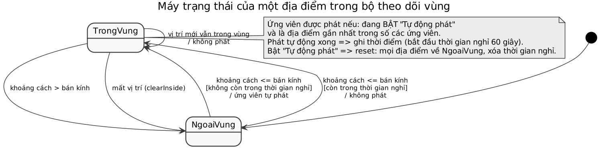

Hình 30. Máy trạng thái của một địa điểm trong bộ theo dõi vùng

## 11.3 Luồng xử lý mỗi lần có vị trí (UC06)

khi vị_trí thay đổi:  
    nếu vị_trí rỗng:    tracker.clearInside(); insideIds = rỗng  
    ngược lại:  
        kq = tracker.update(vị_trí, địa_điểm)  
        insideIds = kq.insideIds  
        nếu kq.ứng_viên tồn tại VÀ auto == BẬT:  
            tracker.markPlayed(kq.ứng_viên.mã)  
            phát(kq.ứng_viên, 'auto')          # dừng bài cũ, đọc, gửi sự kiện listen  
            chọn địa điểm; tab = Địa điểm  
  
khi bấm bật Tự động phát:  
    auto = BẬT; tracker.reset()  
    nếu đã có vị_trí: làm như trên với auto = BẬT

## 11.4 Trạng thái phát thuyết minh

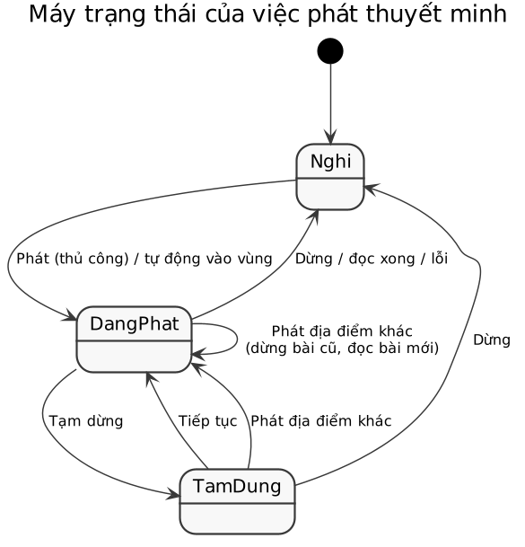

Hình 31. Máy trạng thái của việc phát thuyết minh

## 11.5 Vẽ vùng tròn trên bản đồ

Mỗi vùng là đa giác 48 cạnh (49 đỉnh, đỉnh cuối trùng đỉnh đầu). Đỉnh thứ i (i = 0..48), góc θ = 2π·i/48, d = bán_kính / 6371008,8:

phi2    = asin( sin(phi1)*cos(d) + cos(phi1)*sin(d)*cos(θ) )  
lambda2 = lambda1 + atan2( sin(θ)*sin(d)*cos(phi1), cos(d) - sin(phi1)*sin(phi2) )  
(phi1, lambda1 là vĩ độ, kinh độ của tâm, tính bằng radian; đổi kết quả về độ, tọa độ GeoJSON dạng [kinh độ, vĩ độ])

## 11.6 Tách mã từ nội dung QR (BR-F1)

chuỗi = cắt khoảng trắng đầu cuối của nội dung  
nếu chuỗi khớp biểu thức  /[?&](?:qr|poi)=([^&#\s]+)/i :  
    mã = giải mã URL của nhóm bắt được (nếu giải mã lỗi thì dùng nguyên văn), rồi cắt khoảng trắng  
ngược lại: mã = chuỗi  
tìm địa điểm: qrCode hoặc id bằng mã (không phân biệt hoa thường); mã rỗng thì không tìm thấy

## 11.7 Tổng hợp thống kê (BR-E5)

Cho N ngày: since = ngày UTC của (hôm nay − (N − 1)); today = ngày UTC hôm nay. Điều kiện sự kiện nằm trong khoảng: (created_at theo UTC, lấy phần ngày) ≥ since. Các truy vấn:

-- tổng: đếm có điều kiện  
count(e.id) FILTER (WHERE e.event_type='listen')   AS listen  
count(e.id) FILTER (WHERE e.event_type='qr_scan')  AS qr_scan  
  
-- theo địa điểm: pois LEFT JOIN poi_translations (lang='vi') LEFT JOIN events (trong khoảng)  
--                GROUP BY p.id, t.name  ORDER BY listen DESC, qr_scan DESC, p.id  
-- theo ngôn ngữ: languages LEFT JOIN events (trong khoảng) GROUP BY code ORDER BY code  
-- theo địa điểm và ngôn ngữ: events (trong khoảng) GROUP BY poi_id, lang  
-- theo cách phát: events listen (trong khoảng) GROUP BY source ORDER BY source  
-- theo ngày: generate_series(since, today, '1 day') LEFT JOIN events theo ngày UTC GROUP BY ngày

# 12. Yêu cầu phi chức năng, cấu hình và vận hành

## 12.1 Yêu cầu phi chức năng

| Nhóm | Yêu cầu | Quy tắc liên quan |
| --- | --- | --- |
| Bảo mật | Mật khẩu băm bcrypt; token JWT HS256 hạn 8 giờ; kiểm tra lại tài khoản mỗi yêu cầu; truy vấn SQL dùng tham số; dữ liệu đầu vào kiểm tra bằng zod; JWT_SECRET tối thiểu 32 ký tự (thiếu thì server không khởi động); giới hạn đăng nhập sai; CORS theo danh sách; giới hạn kích thước nội dung 100 KB | BR-G2–BR-G4, BR-G8 |
| Quyền riêng tư | Không lưu và không gửi vị trí hay định danh người dùng cuối; sự kiện thống kê chỉ gồm mã địa điểm, ngôn ngữ, loại, nguồn, client, thời điểm | BR-E3 |
| Hiệu năng | API nạp địa điểm chờ tối đa 6 giây; /api/pois có cache 30 giây; pool kết nối tối đa 5; bản đồ chờ style tối đa 8 giây; GPS tuổi dữ liệu 2 giây, chờ 20 giây | BR-E1, BR-D1, BR-D3 |
| Độ tin cậy | Dữ liệu dự phòng khi API lỗi; gửi sự kiện thống kê ở chế độ nền và bỏ qua lỗi để không ảnh hưởng trải nghiệm | BR-E1, BR-E3 |
| Tương thích | Trình duyệt có WebGL (bản đồ), Web Speech (giọng đọc); GPS và camera chỉ hoạt động trên HTTPS hoặc localhost; Node.js ≥ 20 cho server | UC03, UC05, UC08 |
| Ngoại tuyến | Service worker ưu tiên mạng, mất mạng dùng bản đã lưu của tệp cùng nguồn gốc; không lưu dữ liệu bản đồ nên bản đồ cần mạng | BR-I1 |
| Quốc tế hóa | Web ba ngôn ngữ vi, en, zh; dashboard chỉ tiếng Việt; thông báo lỗi của API bằng tiếng Việt | BR-A1 |
| Bảo trì | Bảng quyền ở một chỗ; cấu hình qua biến môi trường; hai bản sao cần giữ đồng bộ: web/lib/geofence.js với bản của app di động, và web/data/pois.json với dữ liệu thật | BR-G1, BR-E2 |

### Hạn chế đã biết của phiên bản hiện tại

Giới hạn đăng nhập sai lưu trong bộ nhớ của tiến trình server nên khi chạy serverless chỉ làm chậm, không chặn tuyệt đối.

API POST /api/events công khai, chưa có giới hạn tốc độ nên có thể bị gửi dữ liệu rác.

Token lưu trong localStorage của dashboard; không thu hồi token phía server; đổi mật khẩu không làm token cũ mất hiệu lực.

Thống kê tính theo giờ UTC.

Khi trình duyệt không hỗ trợ giọng đọc, chế độ tự động phát vẫn ghi sự kiện lượt nghe dù không có âm thanh (UC06, E2).

Xóa địa điểm xóa luôn thống kê của nó và mã địa điểm không được dùng lại.

Danh sách địa điểm sắp xếp theo mã dạng chuỗi nên chỉ đúng thứ tự số khi mã có 3 chữ số (đến poi-999).

## 12.2 Biến môi trường

| Phần | Biến | Bắt buộc | Mặc định | Ý nghĩa |
| --- | --- | --- | --- | --- |
| server | DATABASE_URL | Có | — | Chuỗi kết nối PostgreSQL |
| server | JWT_SECRET | Có | — | Chuỗi bí mật ký token, ≥ 32 ký tự |
| server | CORS_ORIGINS | Không | rỗng (cho phép tất cả) | Danh sách Origin được phép, cách nhau dấu phẩy, không có “/” ở cuối |
| server | PORT | Không | 4000 | Cổng khi chạy trên máy (không dùng trên Vercel) |
| server | ADMIN_EMAIL, ADMIN_PASSWORD, ADMIN_NAME | Với admin:create | ADMIN_NAME = “Quản trị viên” | Tài khoản Quản trị đầu tiên (mật khẩu ≥ 8 ký tự) |
| server | TEST_DATABASE_URL | Không | — | Chạy kiểm thử trên PostgreSQL thật (database bị xóa sạch); mặc định dùng PGlite trong bộ nhớ |
| web | NEXT_PUBLIC_API_URL | Không | rỗng (chỉ dùng pois.json) | Địa chỉ server, không có “/” ở cuối |
| web | NEXT_PUBLIC_MAP_PROVIDER | Không | openfreemap | openfreemap hoặc osm |
| web | NEXT_PUBLIC_MAP_STYLE_URL | Không | rỗng | Đường dẫn style MapLibre tự chọn, ưu tiên cao nhất |
| web | NEXT_PUBLIC_EXPOSE_MAP | Không | rỗng | Đặt 1 chỉ khi kiểm thử tự động (gắn bản đồ vào window.__map) |
| dashboard | NEXT_PUBLIC_API_URL | Nên đặt | http://localhost:4000 | Địa chỉ server |
| dashboard | NEXT_PUBLIC_WEB_URL | Không | rỗng | Địa chỉ web người dùng, để tạo QR dạng liên kết |

## 12.3 Lệnh và quy trình khởi tạo lần đầu

| Phần | Lệnh | Tác dụng |
| --- | --- | --- |
| server | npm install | Cài thư viện |
| server | npm run db:schema | Chạy sql/schema.sql (tạo bảng, chạy lại không lỗi) |
| server | npm run db:seed | Chạy sql/seed.sql (3 ngôn ngữ, 6 địa điểm mẫu; mã 001–006) |
| server | npm run admin:create | Tạo tài khoản Quản trị đầu tiên từ biến môi trường |
| server | npm run dev / npm start | Chạy server trên máy (cổng PORT) |
| server | npm test | 10 kiểm thử API (PGlite) |
| web | npm run dev / npm run build / npm test | Chạy thử; build xuất tĩnh vào thư mục out; 8 kiểm thử đơn vị |
| dashboard | npm run dev – -p 3001 / npm run build | Chạy thử cổng 3001; build |

Thứ tự khởi tạo: (1) tạo database PostgreSQL và điền .env của server; (2) db:schema, db:seed, admin:create từ máy quản trị; (3) chạy server; (4) đặt NEXT_PUBLIC_API_URL cho web và dashboard; (5) chạy web và dashboard; (6) triển khai lại web/dashboard sau khi đổi biến NEXT_PUBLIC_*.

# 13. Tiêu chí chấp nhận và kiểm thử

## 13.1 Tiêu chí chấp nhận theo use case

| Mã | Use case | Tiêu chí | Kiểm thử | Mức đã kiểm tra |
| --- | --- | --- | --- | --- |
| AC-01 | UC01 | Khi chọn English thì toàn bộ chuỗi giao diện và tên, mô tả địa điểm đổi sang tiếng Anh; chọn 中文 thì sang tiếng Trung; mở lại web thì về Tiếng Việt. | T-B06 | Một phần (đã thử đổi sang tiếng Trung) |
| AC-02 | UC02 | Có API: dòng nguồn ghi “từ máy chủ”. API lỗi hoặc chặn: ghi “dự phòng” và vẫn hiện đủ địa điểm. Không có NEXT_PUBLIC_API_URL: ghi “pois.json”. | T-B02, T-B13, T-S01 | Có |
| AC-03 | UC03 | Mở web thì thấy bản đồ phủ kín khung, vùng tròn và chấm của mọi địa điểm; có chấm đỏ khi có vị trí; style chính lỗi thì chuyển sang OpenStreetMap; không có WebGL thì báo lỗi. | T-B04, T-B05, T-W06, T-B15 | Một phần (chưa thử GPS thật, từ chối quyền, vector OpenFreeMap) |
| AC-04 | UC04 | Danh sách theo thứ tự mã, mỗi mục có khoảng cách làm tròn mét hoặc “Chưa có vị trí”; chọn mục thì thấy tên, mô tả, bán kính, mã QR và nút điều khiển; “Quay lại” về danh sách. | T-B03, T-B07 | Một phần |
| AC-05 | UC05 | Bấm Phát thì đọc “<tên>. <mô tả>” đúng ngôn ngữ, hiện Tạm dừng và Dừng; Tạm dừng rồi Tiếp tục; Dừng về Phát; mỗi lần Phát ghi một lượt nghe. | T-B10, T-B08 | Một phần (giọng đọc thật chưa thử) |
| AC-06 | UC06 | Bật Tự động phát rồi vào vùng thì phát đúng 1 lần và mở chi tiết; ở lại không phát lại; ra vào lại trong 60 giây không phát; sau 60 giây phát; vùng chồng nhau chỉ phát điểm gần nhất. | T-W03, T-W04, T-W05, T-B07, T-B08, T-B09 | Có |
| AC-07 | UC07 | Chọn “ngoài vùng” rồi “đứng tại Điểm mẫu 1” thì kích hoạt vào vùng; chạm bản đồ đặt vị trí; “Dùng GPS thật” thoát giả lập. | T-B07, T-B09 | Một phần (chạm bản đồ chưa thử trên trình duyệt) |
| AC-08 | UC08 | Nhập mã hoặc link chứa ?qr= thì mở đúng địa điểm và ghi lượt quét; mã sai báo “Không tìm thấy…”; mở web bằng ?qr= thì vào thẳng địa điểm. | T-W07, T-W08, T-B11, T-B14 | Một phần (camera thật chưa thử) |
| AC-09 | UC09 | POST /api/events hợp lệ trả 201 và thêm một dòng events; sai nguồn trả 400; địa điểm không có hoặc đã tắt trả 404. | T-S06, T-S07 | Có |
| AC-10 | UC10 | Nút QR mở thẻ tạo mã QR cho URL cố định `https://se-2026-psi.vercel.app/`; thẻ hiển thị ảnh QR, URL đích và trạng thái lỗi nếu tạo thất bại; nút đóng ẩn thẻ. | — | Đã đối chiếu mã nguồn; chưa quét trên thiết bị thật |
| AC-11 | UC11 | Đúng thông tin thì vào trang Thống kê với menu theo vai trò; sai thì thấy “Email hoặc mật khẩu không đúng”; chưa đăng nhập thì chuyển về /login; sai 10 lần thì lần sau bị 429. | T-S02, T-S10, T-D01, T-D02, T-D03 | Có |
| AC-12 | UC12 | Bấm Đăng xuất thì token bị xóa và về /login. | T-D13 | Một phần (được dùng trong luồng kiểm thử Biên tập) |
| AC-13 | UC13 | Mật khẩu hiện tại sai thì 400; đúng thì đổi và đăng nhập được bằng mật khẩu mới, mật khẩu cũ bị từ chối. | T-S09 | Một phần (kiểm thử API, chưa thử giao diện) |
| AC-14 | UC14 | Thống kê trả đúng tổng, theo địa điểm, ngôn ngữ, cách phát, ngày (có dòng 0); đổi 7/30/90 ngày thì gọi lại. | T-S06, T-D04 | Một phần (đổi khoảng ngày chưa thử trên giao diện) |
| AC-15 | UC15 | Bảng hiện mọi địa điểm kể cả đã tắt; nút Thêm, Sửa, Xóa hiện theo quyền. | T-D05, T-D14, T-S07 | Có |
| AC-16 | UC16 | Thêm địa điểm hợp lệ thì có mã poi-NNN và QR tương ứng; thiếu bản dịch, tọa độ hoặc bán kính sai thì bị từ chối kèm lỗi theo trường. | T-S03, T-S05, T-D06, T-D07 | Có |
| AC-17 | UC17 | Sửa và lưu thì dữ liệu mới có hiệu lực, mã QR không đổi. | T-S03, T-D08, T-D09 | Có |
| AC-18 | UC18 | Quản trị xóa được; Biên tập không thấy nút Xóa và API trả 403; xóa xong địa điểm và thống kê của nó biến mất. | T-S03, T-S04, T-D12, T-D14 | Có |
| AC-19 | UC19 | Mỗi địa điểm trong dữ liệu quản trị có ảnh QR kiểu mã và (nếu có NEXT_PUBLIC_WEB_URL) kiểu liên kết; tải được PNG. Với seed hiện tại, trang tạo QR cho đủ 6 địa điểm (mã 001–006). | T-D10 | Một phần (việc tải file chưa thử) |
| AC-20 | UC20 | Quản trị tạo được tài khoản; email trùng bị 409; mật khẩu ngắn bị 400; Biên tập không vào được trang này. | T-S08, T-D11, T-D13, T-D15 | Có |
| AC-21 | UC21 | Đổi vai trò, khóa, mở khóa, đặt lại mật khẩu có hiệu lực; không tự hạ vai trò hoặc tự khóa; tài khoản bị khóa mất quyền ngay. | T-S08 | Một phần (kiểm thử API, chưa thử giao diện) |

## 13.2 Các kiểm thử đã chạy

Các kiểm thử dưới đây đã được chạy và đạt: server 10/10 (PGlite và PostgreSQL 16 thật); web đơn vị 8/8; web trong trình duyệt headless có WebGL phần mềm 15/15 (backend và PostgreSQL thật); dashboard trong trình duyệt headless 16/16. Trong môi trường kiểm thử không có mạng ra ngoài nên dữ liệu bản đồ không tải được; kiểm thử bản đồ đi qua đường dự phòng của style.

| Mã | Bộ kiểm thử | Nội dung kiểm tra | Use case | Quy tắc |
| --- | --- | --- | --- | --- |
| T-S01 | Server | health và danh sách địa điểm công khai giống hệt file pois.json của web | UC02 | BR-E2 |
| T-S02 | Server | đăng nhập: sai mật khẩu bị từ chối, đúng thì có token; không token thì 401 | UC11 | BR-G3, BR-G4 |
| T-S03 | Server | Biên tập: thêm và sửa được địa điểm, không xóa được, không quản lý tài khoản | UC16, UC17, UC18, UC20 | BR-G1, BR-B1 |
| T-S04 | Server | Quản trị xóa được địa điểm; địa điểm không còn tồn tại | UC18 | BR-B4 |
| T-S05 | Server | kiểm tra dữ liệu địa điểm: thiếu bản dịch, tọa độ sai, bán kính sai đều bị 400 | UC16, UC17 | BR-A2, BR-B2 |
| T-S06 | Server | thống kê: ghi sự kiện hợp lệ, từ chối sự kiện sai, tổng hợp đúng | UC09, UC14 | BR-E3, BR-E4, BR-E5 |
| T-S07 | Server | địa điểm bị tắt không hiện công khai và không nhận sự kiện | UC02, UC09 | BR-B3 |
| T-S08 | Server | quản lý tài khoản: tạo, trùng email, không tự khóa mình, khóa người khác thì token hết tác dụng | UC20, UC21 | BR-G4, BR-G5 |
| T-S09 | Server | đổi mật khẩu | UC13 | BR-G6 |
| T-S10 | Server | đăng nhập sai quá nhiều lần thì bị giới hạn (429) | UC11 | BR-G3 |
| T-W01 | Web (đơn vị) | khoảng cách 1 độ vĩ độ xấp xỉ 111 km | UC06 | BR-C1 |
| T-W02 | Web (đơn vị) | đứng đúng tại điểm thì nằm trong vùng, ở xa thì không | UC06 | BR-C1 |
| T-W03 | Web (đơn vị) | đi vào vùng thì báo đúng 1 lần, đứng yên không báo lại | UC06 | BR-C2 |
| T-W04 | Web (đơn vị) | ra rồi vào lại trong thời gian nghỉ thì không báo; sau thời gian nghỉ thì báo | UC06 | BR-C3 |
| T-W05 | Web (đơn vị) | nhiều vùng chồng nhau thì chọn điểm gần nhất | UC06 | BR-C4 |
| T-W06 | Web (đơn vị) | mọi đỉnh của hình tròn cách tâm đúng bán kính (sai số dưới 0,5 m) | UC03 | BR-D4 |
| T-W07 | Web (đơn vị) | tách mã từ mã thuần và từ đường link | UC08 | BR-F1 |
| T-W08 | Web (đơn vị) | tìm địa điểm theo mã QR hoặc theo id, không phân biệt hoa thường | UC08 | BR-F1 |
| T-B01 | Web (trình duyệt) | trang tải được, có tiêu đề | UC03 | — |
| T-B02 | Web (trình duyệt) | dữ liệu lấy từ máy chủ (API) | UC02 | BR-E1 |
| T-B03 | Web (trình duyệt) | hiện đủ 6 địa điểm | UC04 | BR-B5 |
| T-B04 | Web (trình duyệt) | có canvas bản đồ MapLibre (WebGL chạy) | UC03 | BR-D3 |
| T-B05 | Web (trình duyệt) | không hiện thông báo lỗi bản đồ | UC03 | BR-D3 |
| T-B06 | Web (trình duyệt) | đổi sang tiếng Trung | UC01 | BR-A3 |
| T-B07 | Web (trình duyệt) | đi vào vùng Điểm mẫu 1 thì mở chi tiết | UC06 | BR-C7 |
| T-B08 | Web (trình duyệt) | tự động phát giọng đọc 1 lần đúng ngôn ngữ | UC06 | BR-A4, BR-C5 |
| T-B09 | Web (trình duyệt) | vào lại ngay thì không phát lại (thời gian nghỉ) | UC06 | BR-C3 |
| T-B10 | Web (trình duyệt) | bấm Phát thủ công thì đọc lần 2 | UC05 | BR-C8 |
| T-B11 | Web (trình duyệt) | nhập link QR thì mở Điểm mẫu 3 | UC08 | BR-F1 |
| T-B12 | Web (trình duyệt) | không có lỗi JavaScript trong trình duyệt | Tất cả UC web | — |
| T-B13 | Web (trình duyệt) | API lỗi thì dùng dữ liệu dự phòng và vẫn hiện đủ 6 địa điểm | UC02 | BR-E1 |
| T-B14 | Web (trình duyệt) | mở link ?qr=DHSG-POI-002 thì vào thẳng Điểm mẫu 2 | UC08 | BR-F2 |
| T-B15 | Web (trình duyệt) | khổ điện thoại không bị tràn ngang | UC03, UC04 | — |
| T-D01 | Dashboard (trình duyệt) | chưa đăng nhập thì chuyển về trang đăng nhập | UC11 | BR-G7 |
| T-D02 | Dashboard (trình duyệt) | đăng nhập sai hiện thông báo lỗi | UC11 | BR-G3 |
| T-D03 | Dashboard (trình duyệt) | đăng nhập đúng vào trang Thống kê (Quản trị thấy menu Tài khoản admin) | UC11 | BR-G1, BR-G7 |
| T-D04 | Dashboard (trình duyệt) | thống kê có bảng theo địa điểm | UC14 | BR-E5 |
| T-D05 | Dashboard (trình duyệt) | danh sách địa điểm hiện đủ 6 địa điểm seed | UC15 | BR-B5 |
| T-D06 | Dashboard (trình duyệt) | thêm địa điểm mới thì quay về danh sách và thấy địa điểm | UC16 | BR-B1 |
| T-D07 | Dashboard (trình duyệt) | mã địa điểm mới được sinh tự động | UC16 | BR-B1 |
| T-D08 | Dashboard (trình duyệt) | trang sửa hiện mã QR cố định | UC17 | BR-B1 |
| T-D09 | Dashboard (trình duyệt) | sửa bán kính và lưu thành công | UC17 | BR-B2 |
| T-D10 | Dashboard (trình duyệt) | trang QR tạo ảnh QR dạng mã và dạng liên kết cho từng địa điểm; với seed hiện tại có 6 địa điểm | UC19 | BR-F3 |
| T-D11 | Dashboard (trình duyệt) | tạo tài khoản Biên tập | UC20 | BR-G2 |
| T-D12 | Dashboard (trình duyệt) | Quản trị xóa được địa điểm thử | UC18 | BR-B4 |
| T-D13 | Dashboard (trình duyệt) | Biên tập không thấy menu “Tài khoản admin” | UC11, UC20 | BR-G1 |
| T-D14 | Dashboard (trình duyệt) | Biên tập thấy nút Thêm và Sửa nhưng không thấy nút Xóa | UC15, UC18 | BR-G1 |
| T-D15 | Dashboard (trình duyệt) | Biên tập vào /users bị báo không có quyền | UC20 | BR-G1 |
| T-D16 | Dashboard (trình duyệt) | không có lỗi JavaScript trong trình duyệt | Tất cả UC dashboard | — |

## 13.3 Chưa được kiểm tra

GPS thật và việc từ chối quyền vị trí; camera quét QR thật; giọng đọc thật (đặc biệt giọng tiếng Việt và tiếng Trung); cài PWA và service worker (chỉ có ở bản production).

Bản đồ vector OpenFreeMap có hiển thị được hay không (chỉ kiểm thử được đường dự phòng sang OpenStreetMap).

Giao diện của UC12, UC13, UC21, việc tải file ảnh QR, và đổi khoảng ngày của thống kê (chỉ có kiểm thử ở mức API hoặc một phần).

Triển khai thật server và dashboard lên Vercel, kết nối Neon.

Quét QR mở web trên điện thoại thật (phần tạo và hiển thị QR đã đối chiếu mã nguồn tại UC10).

# 14. Ma trận truy vết

Mỗi dòng nối một use case với quy tắc nghiệp vụ, API, bảng dữ liệu, màn hình và kiểm thử. Nhờ vậy khi đổi một quy tắc có thể biết chính xác phần nào phải sửa và phải kiểm thử lại.

| Use case | Quy tắc | API | Bảng | Màn hình | Kiểm thử |
| --- | --- | --- | --- | --- | --- |
| UC01 Chọn ngôn ngữ | BR-A1, BR-A3, BR-A4 | — | — | W-01 | T-B06 |
| UC02 Tải dữ liệu địa điểm | BR-E1, BR-E2 | GET /api/pois | pois, poi_translations | W-01 | T-S01, T-S07, T-B02, T-B13 |
| UC03 Xem bản đồ và vị trí hiện tại | BR-D1, BR-D3, BR-D4, BR-D5 | — | — | W-01 | T-W06, T-B01, T-B04, T-B05, T-B15 |
| UC04 Xem danh sách và chi tiết địa điểm | BR-B5, BR-C7 | — | — | W-01 (tab Địa điểm) | T-B03, T-B15 |
| UC05 Nghe thuyết minh thủ công | BR-A4, BR-C8, BR-E3, BR-H1, BR-H2, BR-H3, BR-H4 | POST /api/events | events | W-01 (trang chi tiết) | T-B10 |
| UC06 Tự động phát thuyết minh khi vào vùng | BR-C1, BR-C2, BR-C3, BR-C4, BR-C5, BR-C6, BR-C7, BR-C8, BR-A4, BR-E3 | POST /api/events | events | W-01 | T-W01, T-W02, T-W03, T-W04, T-W05, T-B07, T-B08, T-B09 |
| UC07 Giả lập vị trí | BR-D2, BR-D5, BR-C6 | — | — | W-01 (khối Giả lập vị trí) | — |
| UC08 Mở địa điểm bằng mã QR | BR-F1, BR-F2, BR-E3 | POST /api/events | events | W-01 (tab Quét QR) | T-W07, T-W08, T-B11, T-B14 |
| UC09 Ghi nhận sự kiện thống kê | BR-E3, BR-E4 | POST /api/events | events, pois, languages | — | T-S06, T-S07 |
| UC10 Hiển thị mã QR mở web | BR-I1, BR-I2 | — | — | W-01 (nút QR và thẻ QR trên bản đồ) | — |
| UC11 Đăng nhập | BR-G1, BR-G2, BR-G3, BR-G4, BR-G7 | POST /api/auth/login; GET /api/auth/me | admins | D-01 | T-S02, T-S10, T-D01, T-D02, T-D03, T-D13 |
| UC12 Đăng xuất | BR-G7 | — | — | Menu của mọi trang quản trị | — |
| UC13 Đổi mật khẩu | BR-G2, BR-G6 | POST /api/auth/change-password | admins | D-08 | T-S09 |
| UC14 Xem thống kê | BR-E3, BR-E5, BR-G1 | GET /api/admin/stats | events, pois, poi_translations, languages | D-02 | T-S06, T-D04 |
| UC15 Xem danh sách địa điểm | BR-B3, BR-B5, BR-G1 | GET /api/admin/pois | pois, poi_translations | D-03 | T-D05, T-D14 |
| UC16 Thêm địa điểm | BR-A2, BR-B1, BR-B2, BR-B3, BR-G1 | POST /api/admin/pois | pois, poi_translations | D-04 | T-S03, T-S05, T-D06, T-D07 |
| UC17 Sửa địa điểm | BR-A2, BR-B1, BR-B2, BR-B3, BR-G1 | GET /api/admin/pois/:id; PUT /api/admin/pois/:id | pois, poi_translations | D-05 | T-S03, T-S05, T-D08, T-D09 |
| UC18 Xóa địa điểm | BR-B1, BR-B4, BR-G1 | DELETE /api/admin/pois/:id | pois, poi_translations, events | D-03 | T-S03, T-S04, T-D12, T-D14 |
| UC19 Tạo và tải mã QR | BR-B1, BR-F1, BR-F3 | GET /api/admin/pois | pois | D-06 | T-D10 |
| UC20 Tạo tài khoản admin | BR-G1, BR-G2, BR-G5 | GET /api/admin/users; POST /api/admin/users | admins | D-07 | T-S03, T-S08, T-D11, T-D13, T-D15 |
| UC21 Cập nhật tài khoản admin | BR-G1, BR-G4, BR-G5 | PATCH /api/admin/users/:id; GET /api/admin/users | admins | D-07 | T-S08 |

# 15. Giới hạn kiểm chứng và việc còn lại

Chương này phân biệt phần đã đối chiếu mã nguồn với các hành vi chưa thể xác nhận bằng kiểm thử. Tài liệu mô tả phiên bản đang có trong repository; chưa có bằng chứng để khẳng định mọi bản triển khai hoặc thiết kế ngoài repository giống hệt phiên bản này.

Giao diện web và dashboard trong chương 10 cùng Phụ lục D, E đã được đối chiếu với mã nguồn hiện có. UC10 cũng đã được đối chiếu: nút QR nằm trên bản đồ và tạo mã cho URL cố định `https://se-2026-psi.vercel.app/`. URL này đang được ghi trực tiếp trong `web/components/AppQrBubble.js`, không lấy từ biến môi trường; cần cập nhật mã nguồn nếu địa chỉ triển khai thay đổi. Việc quét mã bằng điện thoại thật chưa được thử.

Các kiểm tra còn lại:

- Thiết bị thật: GPS và từ chối quyền vị trí; camera quét địa điểm; giọng đọc (đặc biệt tiếng Việt và tiếng Trung); quét QR mở web; cài PWA và service worker.
- Bản đồ vector OpenFreeMap: chưa xác nhận hiển thị được; kiểm thử hiện tại chỉ xác nhận đường dự phòng sang OpenStreetMap.
- Giao diện UC12, UC13, UC21; tải file ảnh QR; đổi khoảng ngày thống kê: chưa kiểm thử đầy đủ trên giao diện.
- Triển khai server và dashboard lên Vercel, kết nối PostgreSQL Neon: chưa triển khai kiểm chứng.

Các quyết định hiện được mã hóa nhưng có thể cần nhóm xác nhận theo nghiệp vụ thực tế: Biên tập được thêm và sửa địa điểm nhưng không được xóa (BR-G1); bán kính mặc định 25 m của biểu mẫu và thời gian nghỉ 60 giây (BR-C3).

# Phụ lục A. schema.sql (cơ sở dữ liệu)

-- Lược đồ cơ sở dữ liệu (PostgreSQL). Chạy lại nhiều lần không lỗi (IF NOT EXISTS).  
-- Chạy bằng:  npm run db:schema  
  
-- Ngôn ngữ hỗ trợ  
CREATE TABLE IF NOT EXISTS languages (  
  code text PRIMARY KEY,  
  name text NOT NULL  
);  
  
-- Tài khoản dashboard. Vai trò: 'admin' (Quản trị) hoặc 'editor' (Biên tập)  
CREATE TABLE IF NOT EXISTS admins (  
  id integer GENERATED ALWAYS AS IDENTITY PRIMARY KEY,  
  email text NOT NULL,  
  password_hash text NOT NULL,  
  full_name text NOT NULL,  
  role text NOT NULL CHECK (role IN ('admin', 'editor')),  
  is_active boolean NOT NULL DEFAULT true,  
  created_at timestamptz NOT NULL DEFAULT now(),  
  updated_at timestamptz NOT NULL DEFAULT now()  
);  
CREATE UNIQUE INDEX IF NOT EXISTS admins_email_lower_idx ON admins (lower(email));  
  
-- Bộ đếm để sinh mã địa điểm poi-001, poi-002, ...  
CREATE SEQUENCE IF NOT EXISTS poi_number_seq;  
  
-- Địa điểm  
CREATE TABLE IF NOT EXISTS pois (  
  id text PRIMARY KEY,  
  qr_code text NOT NULL UNIQUE,  
  latitude double precision NOT NULL CHECK (latitude BETWEEN -90 AND 90),  
  longitude double precision NOT NULL CHECK (longitude BETWEEN -180 AND 180),  
  radius_meters integer NOT NULL CHECK (radius_meters BETWEEN 1 AND 1000),  
  active boolean NOT NULL DEFAULT true,  
  created_at timestamptz NOT NULL DEFAULT now(),  
  updated_at timestamptz NOT NULL DEFAULT now()  
);  
  
-- Bản dịch (tên, mô tả, đường dẫn audio) của từng địa điểm theo từng ngôn ngữ  
CREATE TABLE IF NOT EXISTS poi_translations (  
  poi_id text NOT NULL REFERENCES pois (id) ON DELETE CASCADE,  
  lang text NOT NULL REFERENCES languages (code),  
  name text NOT NULL CHECK (length(trim(name)) > 0),  
  description text NOT NULL CHECK (length(trim(description)) > 0),  
  audio_url text,  
  PRIMARY KEY (poi_id, lang)  
);  
  
-- Sự kiện thống kê (ẩn danh): lượt nghe và lượt quét QR. Không lưu vị trí hay thông tin cá nhân.  
CREATE TABLE IF NOT EXISTS events (  
  id bigint GENERATED ALWAYS AS IDENTITY PRIMARY KEY,  
  poi_id text NOT NULL REFERENCES pois (id) ON DELETE CASCADE,  
  lang text NOT NULL REFERENCES languages (code),  
  event_type text NOT NULL CHECK (event_type IN ('listen', 'qr_scan')),  
  source text CHECK (source IN ('auto', 'manual', 'qr')),  
  client text CHECK (client IN ('web', 'mobile')),  
  created_at timestamptz NOT NULL DEFAULT now(),  
  CHECK (  
    (event_type = 'listen' AND source IN ('auto', 'manual'))  
    OR (event_type = 'qr_scan' AND source = 'qr')  
  )  
);  
CREATE INDEX IF NOT EXISTS events_poi_time_idx ON events (poi_id, created_at);  
CREATE INDEX IF NOT EXISTS events_type_time_idx ON events (event_type, created_at);

# Phụ lục B. pois.json (dữ liệu dự phòng và dữ liệu mẫu)

[
  {
    "id": "poi-001",
    "qrCode": "DHSG-POI-001",
    "latitude": 10.76,
    "longitude": 106.682,
    "radiusMeters": 25,
    "name": {
      "vi": "Giới Thiệu về Trường Đại học Sài Gòn",
      "en": "Introduction to Saigon University",
      "zh": "介绍西贡大学"
    },
    "description": {
      "vi": "Trường Đại học Sài Gòn là một trong những ngôi trường có bề dày lịch sử lâu đời và cảnh quan độc đáo bậc nhất tại Thành phố Hồ Chí Minh",
      "en": "Saigon University is one of the universities with a long history and unique scenery in Ho Chi Minh City.",
      "zh": "西贡大学是胡志明市历史悠久、风景独特的知名学府之一。"
    },
    "audioUrl": {
      "vi": null,
      "en": null,
      "zh": null
    }
  },
  {
    "id": "poi-002",
    "qrCode": "DHSG-POI-002",
    "latitude": 10.7604,
    "longitude": 106.682,
    "radiusMeters": 25,
    "name": {
      "vi": "Cảnh quan sân trường",
      "en": "Campus Scenery",
      "zh": "校园风景"
    },
    "description": {
      "vi": "nổi bật với vẻ đẹp cổ kính, trầm mặc mang đậm dấu ấn lịch sử hơn một thế kỷ giữa lòng Thành phố Hồ Chí Minh",
      "en": "It stands out with its ancient and quiet beauty, bearing the historical mark of over a century in the heart of Ho Chi Minh City.",
      "zh": "它以古老而宁静的美丽脱颖而出，承载着胡志明市百年历史的印记。"
    },
    "audioUrl": {
      "vi": null,
      "en": null,
      "zh": null
    }
  },
  {
    "id": "poi-003",
    "qrCode": "DHSG-POI-003",
    "latitude": 10.76,
    "longitude": 106.6824,
    "radiusMeters": 25,
    "name": {
      "vi": "Kiến trúc trăm tuổi phong cách Pháp lẫn Trung Hoa",
      "en": "Centennial Architecture with French and Chinese Styles",
      "zh": "百年历史的法中风格建筑"
    },
    "description": {
      "vi": "Cổng mặt tiền tòa nhà B mang đặc trưng kiến trúc thấp tầng với mái đón, cửa sổ dạng vòm, đắp nổi những viên gạch gốm men xanh. Hình tượng rồng mây được khảm nổi.Đây là dãy phòng học đầu tiên được xây dựng, khánh thành và đưa vào sử dụng từ năm 1910.",
      "en": "The front gate of Building B features low-rise architecture with a welcoming roof, arched windows, and embossed green ceramic tiles. The dragon and cloud motifs are inlaid in relief. This was the first row of classrooms built, inaugurated, and put into use in 1910.",
      "zh": "B楼的正门采用低层建筑风格，设有迎宾屋顶、拱形窗户，并镶嵌绿色陶瓷砖。龙云图案以浮雕形式镶嵌。这是第一排教室，于1910年建成、启用。"
    },
    "audioUrl": {
      "vi": null,
      "en": null,
      "zh": null
    }
  },
  {
    "id": "poi-004",
    "qrCode": "DHSG-POI-004",
    "latitude": 10.7596600504704,
    "longitude": 106.68156140674834,
    "radiusMeters": 25,
    "name": {
      "vi": "Sân bóng",
      "en": "Football Field",
      "zh": "足球场"
    },
    "description": {
      "vi": "Và đây là khu sân bóng của Trường Đại học Sài Gòn, nơi nhịp sống sinh viên trở nên sôi động nhất.\n\nSau những giờ học căng thẳng, các bạn sinh viên đến đây để chạy, để chơi bóng và để nạp lại năng lượng. Sân cũng là nơi diễn ra các giờ giáo dục thể chất của nhà trường.\n\nNhưng sân bóng này không chỉ để rèn luyện sức khỏe. Đây còn là nơi diễn ra những cuộc tranh tài giữa các khoa. Mỗi trận đấu là một câu chuyện về tinh thần đồng đội, về sự cố gắng và những tiếng cổ vũ vang lên từ bạn bè.\n\nGiữa trung tâm Quận 5 đông đúc, khoảng sân này như một nhịp thở nhẹ nhàng của trường. Ở đây, sinh viên giải tỏa áp lực, kết nối với nhau và tạo nên những kỷ niệm khó quên.\n\nXin mời quý khách cùng tiếp tục hành trình khám phá khuôn viên Trường Đại học Sài Gòn.",
      "en": "And this is the football field of Saigon University, where student life becomes most vibrant.\n\nAfter demanding classes, students come here to run, play football, and recharge. The field is also used for the university's physical education classes.\n\nBut this field is not only for exercise. It also hosts competitions between faculties. Every match tells a story of teamwork and perseverance, accompanied by friends cheering from the sidelines.\n\nAmid the bustle of District 5, this open space is like a gentle breath for the university. Here, students relieve stress, connect with one another, and create unforgettable memories.\n\nPlease continue your journey exploring the Saigon University campus.",
      "zh": "这里是西贡大学的足球场，也是校园生活最热闹的地方。\n\n紧张的课程结束后，学生们来到这里跑步、踢球、恢复活力。这里也是学校开展体育课的场地。\n\n但这个足球场不仅用于锻炼身体，这里还举办各学院之间的比赛。每一场比赛都讲述着团队合作与努力拼搏的故事，也伴随着朋友们热情的加油声。\n\n在繁忙的第五郡中心，这片场地仿佛是校园的一次轻柔呼吸。在这里，学生们释放压力、彼此交流，并留下难忘的回忆。\n\n欢迎各位继续探索西贡大学校园。"
    },
    "audioUrl": {
      "vi": null,
      "en": null,
      "zh": null
    }
  },
  {
    "id": "poi-005",
    "qrCode": "DHSG-POI-005",
    "latitude": 10.759058633501438,
    "longitude": 106.68186891198688,
    "radiusMeters": 25,
    "name": {
      "vi": "Khu D",
      "en": "Building D",
      "zh": "D区"
    },
    "description": {
      "vi": "Khu D là một trong những khu vực trong khuôn viên Trường Đại học Sài Gòn.",
      "en": "Building D is one of the areas on the Saigon University campus.",
      "zh": "D区是西贡大学校园内的区域之一。"
    },
    "audioUrl": {
      "vi": null,
      "en": null,
      "zh": null
    }
  },
  {
    "id": "poi-006",
    "qrCode": "DHSG-POI-006",
    "latitude": 10.7598811277565,
    "longitude": 106.6825540799044,
    "radiusMeters": 25,
    "name": {
      "vi": "Trung Tâm Học Liệu (KLF)",
      "en": "Learning Resource Center (KLF)",
      "zh": "学习资源中心（KLF）"
    },
    "description": {
      "vi": "Và bây giờ, chúng ta đến với Trung tâm Học liệu của Trường Đại học Sài Gòn, hay còn gọi là KLF.\n\nĐây là địa chỉ quen thuộc của sinh viên khi cần tài liệu cho việc học. Ví dụ, các bạn sinh viên đến đây để nhận giáo trình cho các học phần tiếng Anh, cùng tài khoản học trực tuyến đi kèm.\n\nMọi thông tin về thời gian nhận tài liệu đều được cập nhật trên trang thông tin của thư viện nhà trường, giúp sinh viên chủ động sắp xếp thời gian.\n\nCó thể nói, Trung tâm Học liệu là nơi đồng hành cùng sinh viên trên hành trình học tập, từ những cuốn sách đầu tiên cho đến việc học trực tuyến.\n\nXin mời quý khách cùng tiếp tục hành trình khám phá khuôn viên Trường Đại học Sài Gòn.",
      "en": "And now, we arrive at Saigon University's Learning Resource Center, also known as KLF.\n\nThis is a familiar place for students looking for learning materials. For example, students come here to receive textbooks for their English courses, along with the accompanying online learning account.\n\nInformation about collection times is updated on the university library's information page, helping students plan their visits.\n\nThe Learning Resource Center accompanies students throughout their studies, from their first books to online learning.\n\nPlease continue your journey exploring the Saigon University campus.",
      "zh": "现在，我们来到西贡大学的学习资源中心，也就是大家熟知的KLF。\n\n学生需要学习资料时，常常会来到这里。例如，学生可以在这里领取英语课程的教材，以及配套的在线学习账号。\n\n领取资料的时间信息会在学校图书馆的信息页面上更新，方便学生提前安排时间。\n\n可以说，学习资源中心陪伴学生走过求学之路，从最初的书本学习到在线学习。\n\n欢迎各位继续探索西贡大学校园。"
    },
    "audioUrl": {
      "vi": null,
      "en": null,
      "zh": null
    }
  }
]

# Phụ lục C. Chuỗi giao diện của web (ba ngôn ngữ)

| Khóa | Tiếng Việt (vi) | English (en) | 中文 (zh) |
| --- | --- | --- | --- |
| appTitle | Thuyết minh tự động – ĐHSG | Auto Narration – SGU | 自动讲解 – 西贡大学 |
| language | Ngôn ngữ | Language | 语言 |
| tabList | Địa điểm | Places | 地点 |
| tabQr | Quét QR | Scan QR | 扫码 |
| autoOn | Tự động phát: BẬT | Auto-play: ON | 自动播放：开 |
| autoOff | Tự động phát: TẮT | Auto-play: OFF | 自动播放：关 |
| autoHint | Bấm để bật. Khi đi vào vùng của một địa điểm, ứng dụng sẽ tự phát thuyết minh. | Tap to turn on. Narration starts automatically when you enter a place’s zone. | 点击开启。进入某个地点的范围时，将自动播放讲解。 |
| play | Phát | Play | 播放 |
| pause | Tạm dừng | Pause | 暂停 |
| resume | Tiếp tục | Resume | 继续 |
| stop | Dừng | Stop | 停止 |
| back | ← Quay lại danh sách | ← Back to list | ← 返回列表 |
| nowPlaying | Đang phát | Now playing | 正在播放 |
| distance | Cách bạn | Distance | 距离 |
| meters | m | m | 米 |
| radius | Bán kính vùng | Zone radius | 范围半径 |
| noPosition | Chưa có vị trí | No position yet | 暂无位置 |
| gpsReal | Đang dùng GPS thật | Using real GPS | 正在使用真实 GPS |
| gpsWaiting | Đang chờ GPS… | Waiting for GPS… | 正在等待 GPS… |
| gpsDenied | Chưa được cấp quyền vị trí. Hãy cho phép trong trình duyệt hoặc dùng giả lập vị trí. | Location permission was not granted. Allow it in the browser or use location simulation. | 未授予定位权限。请在浏览器中允许，或使用位置模拟。 |
| gpsUnsupported | Thiết bị không hỗ trợ định vị. Hãy dùng giả lập vị trí. | This device does not support positioning. Use location simulation. | 此设备不支持定位。请使用位置模拟。 |
| simTitle | Giả lập vị trí (để thử khi không thể đi bộ) | Simulate location (for testing without walking) | 模拟位置（无法步行时用于测试） |
| simUseGps | Dùng GPS thật | Use real GPS | 使用真实 GPS |
| simAt | Giả lập: đứng tại | Simulate: standing at | 模拟：站在 |
| simFar | Giả lập: ngoài vùng | Simulate: outside zones | 模拟：在范围之外 |
| simTapMap | Đang giả lập. Chạm vào bản đồ để đặt vị trí khác. | Simulating. Tap the map to set another position. | 正在模拟。点击地图可设置其他位置。 |
| ttsUnsupported | Trình duyệt không hỗ trợ đọc giọng nói. | This browser does not support speech synthesis. | 此浏览器不支持语音合成。 |
| ttsNoVoice | Thiết bị có thể chưa có giọng đọc cho ngôn ngữ này. | This device may not have a voice for this language. | 此设备可能没有该语言的语音。 |
| qrTitle | Quét mã QR để mở địa điểm | Scan a QR code to open a place | 扫描二维码打开地点 |
| qrStart | Bật camera | Start camera | 打开摄像头 |
| qrStop | Tắt camera | Stop camera | 关闭摄像头 |
| qrManual | Hoặc nhập mã QR | Or enter the QR code | 或输入二维码内容 |
| qrOpen | Mở | Open | 打开 |
| qrNotFound | Không tìm thấy địa điểm cho mã này. | No place found for this code. | 未找到对应此码的地点。 |
| qrCameraError | Không mở được camera. Camera trên web cần HTTPS hoặc localhost và quyền truy cập. | Cannot open the camera. Web camera needs HTTPS or localhost and permission. | 无法打开摄像头。网页摄像头需要 HTTPS 或 localhost 以及权限。 |
| qrCodeLabel | Mã QR | QR code | 二维码 |
| sampleNote | Dữ liệu địa điểm hiện là dữ liệu mẫu (tọa độ tạm). | Place data is sample data for now (temporary coordinates). | 地点数据目前为示例数据（临时坐标）。 |
| mapError | Không hiển thị được bản đồ. Trình duyệt cần hỗ trợ WebGL. | Cannot display the map. The browser needs WebGL support. | 无法显示地图。浏览器需要支持 WebGL。 |
| dataApi | Dữ liệu: từ máy chủ | Data: from server | 数据：来自服务器 |
| dataFallback | Dữ liệu: dự phòng (không kết nối được máy chủ) | Data: fallback (cannot reach the server) | 数据：备用数据（无法连接服务器） |
| dataLoading | Dữ liệu: đang tải… | Data: loading… | 数据：加载中… |
| dataLocal | Dữ liệu: file pois.json (chưa cấu hình máy chủ) | Data: pois.json file (server not configured) | 数据：pois.json 文件（未配置服务器） |

# Phụ lục D. globals.css của web

* { box-sizing: border-box; }  
html, body { margin: 0; height: 100%; }  
body {  
  font-family: system-ui, -apple-system, "Segoe UI", Roboto, "Noto Sans", "Noto Sans SC", sans-serif;  
  color: #111827;  
  background: #f3f4f6;  
}  
.app { display: flex; flex-direction: column; min-height: 100dvh; }  
.header {  
  display: flex; align-items: center; justify-content: space-between; gap: 12px;  
  padding: 10px 16px; background: #1d4ed8; color: #fff;  
}  
.header h1 { font-size: 1.05rem; margin: 0; }  
.lang { display: flex; align-items: center; gap: 8px; font-size: 0.85rem; }  
.lang select { padding: 4px 6px; border-radius: 6px; border: 0; }  
  
.layout { flex: 1; display: grid; grid-template-columns: 1fr 380px; min-height: 0; }  
.map-wrap { position: relative; min-height: 320px; }  
.map { position: absolute; inset: 0; z-index: 0; }  
/* CSS của MapLibre đặt position: relative cho .maplibregl-map; viết chọn lọc hơn để bản đồ luôn phủ kín khung */  
.map-wrap .map { position: absolute; inset: 0; }  
.map-loading { display: grid; place-items: center; background: #e5e7eb; }  
.panel {  
  background: #fff; padding: 12px 14px; overflow-y: auto;  
  display: flex; flex-direction: column; gap: 10px; border-left: 1px solid #e5e7eb;  
}  
@media (max-width: 800px) {  
  .layout { grid-template-columns: 1fr; grid-template-rows: 45vh auto; }  
  .panel { border-left: 0; border-top: 1px solid #e5e7eb; }  
}  
  
.status { display: flex; flex-direction: column; gap: 2px; font-size: 0.85rem; color: #374151; }  
.coords { font-family: ui-monospace, Menlo, Consolas, monospace; color: #6b7280; }  
.meta { margin: 0; font-size: 0.8rem; color: #6b7280; }  
.warn { margin: 0; font-size: 0.85rem; color: #b45309; }  
code { background: #f3f4f6; padding: 1px 4px; border-radius: 4px; }  
  
.btn {  
  padding: 9px 14px; border-radius: 8px; border: 1px solid #d1d5db;  
  background: #fff; font-size: 0.95rem; cursor: pointer;  
}  
.btn.primary { background: #1d4ed8; border-color: #1d4ed8; color: #fff; }  
.btn:disabled { opacity: 0.5; cursor: not-allowed; }  
.btn.auto.on { background: #16a34a; border-color: #16a34a; color: #fff; }  
.link { background: none; border: 0; color: #1d4ed8; cursor: pointer; padding: 0; font-size: 0.9rem; text-align: left; }  
  
.tabs { display: flex; gap: 6px; border-bottom: 1px solid #e5e7eb; }  
.tabs button {  
  flex: 1; padding: 8px; border: 0; background: none; cursor: pointer;  
  border-bottom: 3px solid transparent; font-size: 0.95rem;  
}  
.tabs button.active { border-bottom-color: #1d4ed8; font-weight: 600; }  
  
.poi-list { list-style: none; margin: 0; padding: 0; display: flex; flex-direction: column; gap: 8px; }  
.poi-item {  
  width: 100%; text-align: left; padding: 10px 12px; border-radius: 8px;  
  border: 1px solid #e5e7eb; background: #fff; cursor: pointer;  
  display: flex; flex-direction: column; gap: 2px;  
}  
.poi-item.inside { border-color: #16a34a; background: #f0fdf4; }  
.poi-name { font-weight: 600; }  
.poi-meta { font-size: 0.8rem; color: #6b7280; }  
  
.detail h2 { margin: 6px 0; font-size: 1.15rem; }  
.desc { line-height: 1.5; margin: 6px 0; }  
.controls { display: flex; gap: 8px; margin-top: 10px; flex-wrap: wrap; }  
  
.sim { border-top: 1px dashed #d1d5db; padding-top: 10px; }  
.sim h3, .qr h3 { margin: 0 0 6px; font-size: 0.9rem; }  
.sim select, .qr input { width: 100%; padding: 8px; border-radius: 6px; border: 1px solid #d1d5db; }  
.qr { display: flex; flex-direction: column; gap: 8px; }  
.qr-reader { width: 100%; }  
.manual { display: flex; flex-direction: column; gap: 4px; font-size: 0.85rem; }  
.row { display: flex; gap: 6px; }

# Phụ lục E. globals.css của dashboard

* { box-sizing: border-box; }  
html, body { margin: 0; }  
body {  
  font-family: system-ui, -apple-system, "Segoe UI", Roboto, "Noto Sans", sans-serif;  
  color: #111827; background: #f3f4f6; line-height: 1.45;  
}  
h1 { font-size: 1.5rem; margin: 0 0 8px; }  
h2 { font-size: 1.1rem; margin: 22px 0 8px; }  
h3 { margin: 0 0 4px; font-size: 1rem; }  
code { background: #eef2ff; padding: 1px 5px; border-radius: 4px; }  
.muted { color: #6b7280; }  
.small { font-size: 0.85rem; }  
.break { word-break: break-all; }  
.center { text-align: center; padding: 40px; }  
.error { color: #b91c1c; }  
ul.error { padding-left: 20px; }  
.ok { color: #15803d; }  
.link { color: #1d4ed8; text-decoration: none; }  
  
.btn {  
  display: inline-block; padding: 9px 14px; border-radius: 8px; border: 1px solid #d1d5db;  
  background: #fff; color: #111827; font-size: 0.95rem; cursor: pointer; text-decoration: none;  
}  
.btn.primary { background: #1d4ed8; border-color: #1d4ed8; color: #fff; }  
.btn.danger { color: #b91c1c; border-color: #fca5a5; }  
.btn.small { padding: 5px 10px; font-size: 0.85rem; }  
.btn:disabled { opacity: 0.5; cursor: not-allowed; }  
  
input, select, textarea {  
  width: 100%; padding: 8px 10px; border: 1px solid #d1d5db; border-radius: 6px;  
  font: inherit; background: #fff;  
}  
label { display: flex; flex-direction: column; gap: 4px; font-size: 0.9rem; margin-bottom: 10px; }  
label.inline { flex-direction: row; align-items: center; gap: 8px; margin: 0; }  
label.inline select { width: auto; }  
label.check { flex-direction: row; align-items: center; gap: 8px; }  
label.check input { width: auto; }  
fieldset { border: 1px solid #e5e7eb; border-radius: 8px; margin: 12px 0; padding: 12px; }  
legend { padding: 0 6px; font-weight: 600; }  
  
.card { background: #fff; border: 1px solid #e5e7eb; border-radius: 10px; padding: 16px; margin-bottom: 16px; }  
.form { max-width: 760px; }  
.grid2 { display: grid; grid-template-columns: 1fr 1fr; gap: 0 12px; }  
.grid3 { display: grid; grid-template-columns: repeat(3, 1fr); gap: 0 12px; }  
  
.shell { display: grid; grid-template-columns: 230px 1fr; min-height: 100vh; }  
.sidebar { background: #111827; color: #e5e7eb; padding: 16px; display: flex; flex-direction: column; gap: 16px; }  
.brand { font-weight: 700; font-size: 1.05rem; }  
.sidebar nav { display: flex; flex-direction: column; gap: 4px; }  
.sidebar nav a { color: #d1d5db; text-decoration: none; padding: 8px 10px; border-radius: 6px; }  
.sidebar nav a.active, .sidebar nav a:hover { background: #1f2937; color: #fff; }  
.who { margin-top: auto; display: flex; flex-direction: column; gap: 6px; align-items: flex-start; }  
.content { padding: 20px 24px; min-width: 0; }  
.page-head { display: flex; justify-content: space-between; align-items: center; gap: 12px; flex-wrap: wrap; margin-bottom: 8px; }  
  
.table-wrap { overflow-x: auto; background: #fff; border: 1px solid #e5e7eb; border-radius: 10px; }  
table { width: 100%; border-collapse: collapse; }  
th, td { text-align: left; padding: 9px 12px; border-bottom: 1px solid #f1f5f9; white-space: nowrap; }  
th { background: #f9fafb; font-size: 0.85rem; color: #374151; }  
td.actions { display: flex; gap: 6px; }  
.grow { width: 40%; }  
  
.cards { display: flex; gap: 12px; flex-wrap: wrap; }  
.stat { min-width: 160px; margin: 0; }  
.num { font-size: 2rem; font-weight: 700; color: #1d4ed8; }  
.bar { background: #e5e7eb; border-radius: 4px; height: 10px; min-width: 120px; }  
.bar-fill { background: #1d4ed8; height: 10px; border-radius: 4px; }  
  
.qr-grid { display: grid; grid-template-columns: repeat(auto-fill, minmax(320px, 1fr)); gap: 16px; }  
.qr-card { margin: 0; }  
.qr-pair { display: flex; gap: 12px; flex-wrap: wrap; }  
.qr-pair > div { display: flex; flex-direction: column; gap: 6px; align-items: flex-start; }  
.qr-pair img, .qr-ph { width: 150px; height: 150px; background: #f3f4f6; }  
  
.login-wrap { min-height: 100vh; display: grid; place-items: center; padding: 16px; }  
.login { width: 100%; max-width: 380px; margin: 0; }  
  
@media (max-width: 800px) {  
  .shell { grid-template-columns: 1fr; }  
  .sidebar { flex-direction: row; flex-wrap: wrap; align-items: center; }  
  .sidebar nav { flex-direction: row; flex-wrap: wrap; }  
  .who { margin-top: 0; flex-direction: row; align-items: center; }  
  .grid2, .grid3 { grid-template-columns: 1fr; }  
  .content { padding: 14px; }  
}