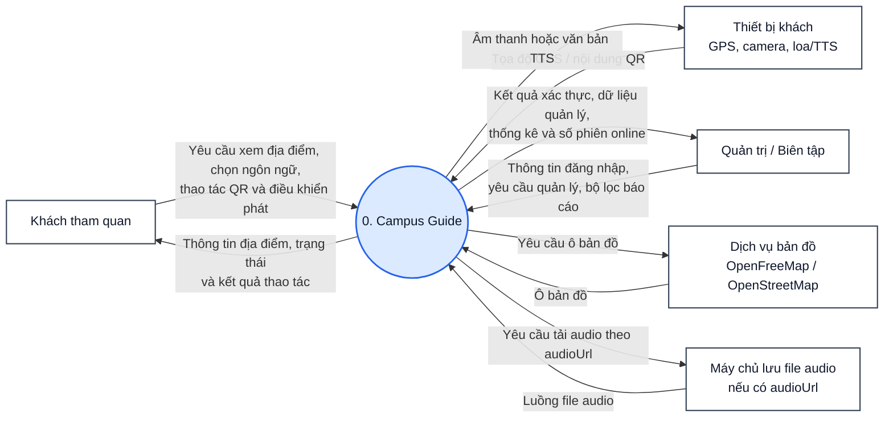
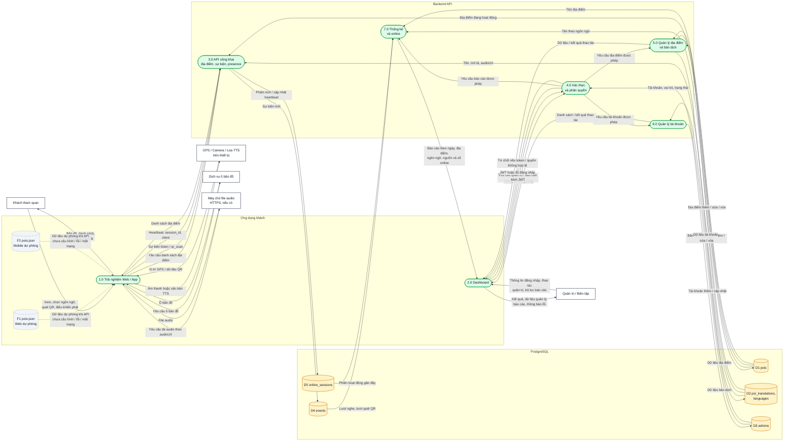
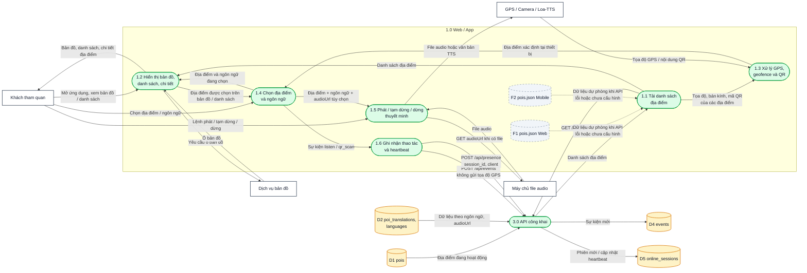
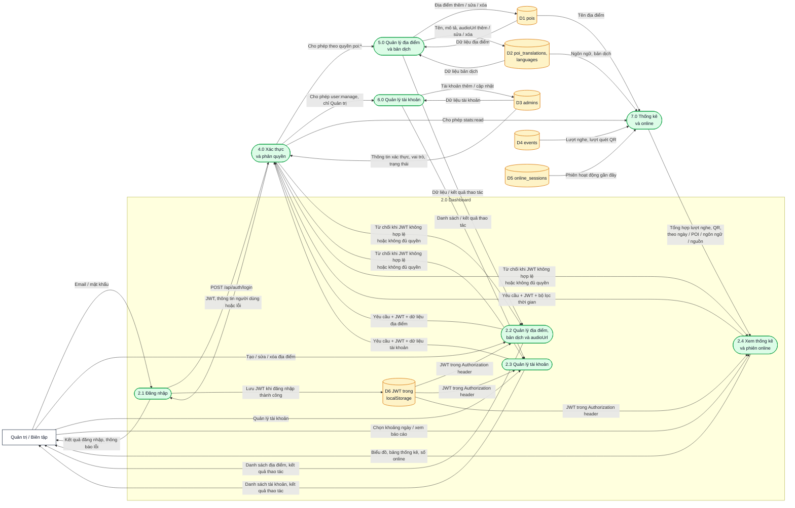

# Sơ đồ luồng dữ liệu (DFD): Campus Guide

Campus Guide gồm Web PWA và app di động cho khách tham quan, Dashboard cho Quản trị/Biên tập, Backend API và PostgreSQL. Web/app tải địa điểm từ API (hoặc dùng `pois.json` dự phòng), xử lý vị trí và QR trên thiết bị, rồi phát thuyết minh bằng file audio nếu có `audioUrl`, ngược lại dùng TTS của thiết bị.

> Cách xem sơ đồ: mở file trong VS Code rồi nhấn Ctrl+Shift+V, hoặc xem trên GitHub để render các khối Mermaid.

## Quy ước vẽ

- Hình tròn/bầu dục là tiến trình, hình trụ là kho dữ liệu, hình chữ nhật là tác nhân ngoài.
- Mũi tên là hướng di chuyển của dữ liệu. Đọc từ kho thì mũi tên đi từ kho ra tiến trình, ghi vào kho thì đi từ tiến trình vào kho.
- Nét đứt là luồng có điều kiện (chỉ xảy ra khi API lỗi, mất mạng hoặc chưa cấu hình).
- Luồng dữ liệu không đi trực tiếp giữa hai tác nhân ngoài, và không đi trực tiếp giữa hai kho. Mọi luồng đều đi qua một tiến trình.
- Mỗi tác nhân ngoài đều có luồng vào và luồng ra. Tên tiến trình và kho giữ nguyên ở mọi mức.

## DFD mức 0: Sơ đồ ngữ cảnh

Toàn bộ Campus Guide được biểu diễn thành một tiến trình. GPS, camera và loa/TTS là năng lực trên thiết bị khách. Dịch vụ bản đồ và nơi lưu file audio (nếu được cấu hình) nằm ngoài hệ thống.

## DFD mức 1: Phân rã các tiến trình chính

## DFD mức 2: Phân rã tiến trình 1.0 (Trải nghiệm khách tham quan)

Vị trí, QR, geofence và chọn ngôn ngữ được xử lý ở Web/App. Tọa độ không gửi lên Backend, chỉ sự kiện nghe/quét QR và heartbeat được gửi để thống kê. Web đọc dữ liệu dự phòng từ F1, app di động đọc từ F2.

## DFD mức 2: Phân rã tiến trình 2.0 (Dashboard quản trị)

## Danh mục tiến trình và kho dữ liệu

| Mã | Tên | Nội dung |
|---|---|---|
| 1.0 | Trải nghiệm Web / App | Tải địa điểm, hiển thị bản đồ, GPS/geofence, QR, phát audio/TTS, gửi sự kiện và heartbeat. |
| 2.0 | Dashboard | Đăng nhập, quản lý địa điểm/tài khoản và xem thống kê. |
| 3.0 | API công khai | `GET /api/pois`, `POST /api/events`, `POST /api/presence`. |
| 4.0 | Xác thực và phân quyền | Đăng nhập, xác thực JWT, kiểm tra trạng thái tài khoản và quyền. |
| 5.0 | Quản lý địa điểm và bản dịch | Đọc/thêm/sửa/xóa địa điểm và bản dịch; `audioUrl` là tùy chọn. |
| 6.0 | Quản lý tài khoản | Quản trị tạo/cập nhật tài khoản; mật khẩu được băm trước khi lưu. |
| 7.0 | Thống kê và online | Tổng hợp sự kiện theo thời gian/địa điểm/ngôn ngữ/nguồn và đếm phiên hoạt động gần đây. |
| F1 / F2 | `pois.json` Web / Mobile | Dữ liệu cục bộ dự phòng khi API chưa cấu hình hoặc không truy cập được. Web đọc F1, app di động đọc F2. |
| D1 | `pois` | ID, QR, tọa độ, bán kính, trạng thái hoạt động. |
| D2 | `poi_translations`, `languages` | Tên, mô tả, `audio_url` và mã ngôn ngữ. |
| D3 | `admins` | Email, mật khẩu đã băm, vai trò, trạng thái tài khoản. |
| D4 | `events` | `listen` / `qr_scan`, ngôn ngữ, nguồn, client, thời điểm; không lưu tọa độ hoặc danh tính khách. |
| D5 | `online_sessions` | Session ID ngẫu nhiên, client, thời điểm heartbeat gần nhất. |
| D6 | `localStorage` Dashboard | JWT được lưu phía trình duyệt sau khi đăng nhập. Kho này chỉ xuất hiện ở DFD mức 2 của tiến trình 2.0. |

## Quy tắc và ranh giới dữ liệu

- GPS, geofence và nội dung QR được xử lý ở thiết bị. Backend không nhận tọa độ GPS.
- Web/App chỉ gửi sự kiện `listen` / `qr_scan` và heartbeat ẩn danh để thống kê.
- File audio được tải trực tiếp từ URL trong `audio_url`; backend lưu URL nhưng không làm proxy lưu trữ/phát audio. Không có URL hoặc phát lỗi thì client dùng TTS của thiết bị nếu được hỗ trợ.
- Dữ liệu cục bộ F1/F2 chỉ là nguồn đọc dự phòng. Khi API lỗi, các thao tác ghi thống kê không được lưu lên máy chủ.
- Dịch vụ bản đồ và máy chủ audio là hệ thống ngoài; Web/App gọi trực tiếp các dịch vụ này.
- Dashboard gọi API quản trị bằng JWT. API là nơi kiểm tra quyền cuối cùng. Quản trị có toàn quyền, Biên tập không có quyền quản lý tài khoản hoặc xóa địa điểm.
