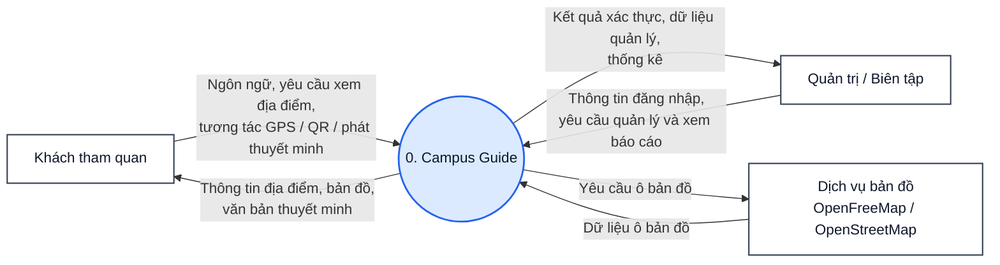
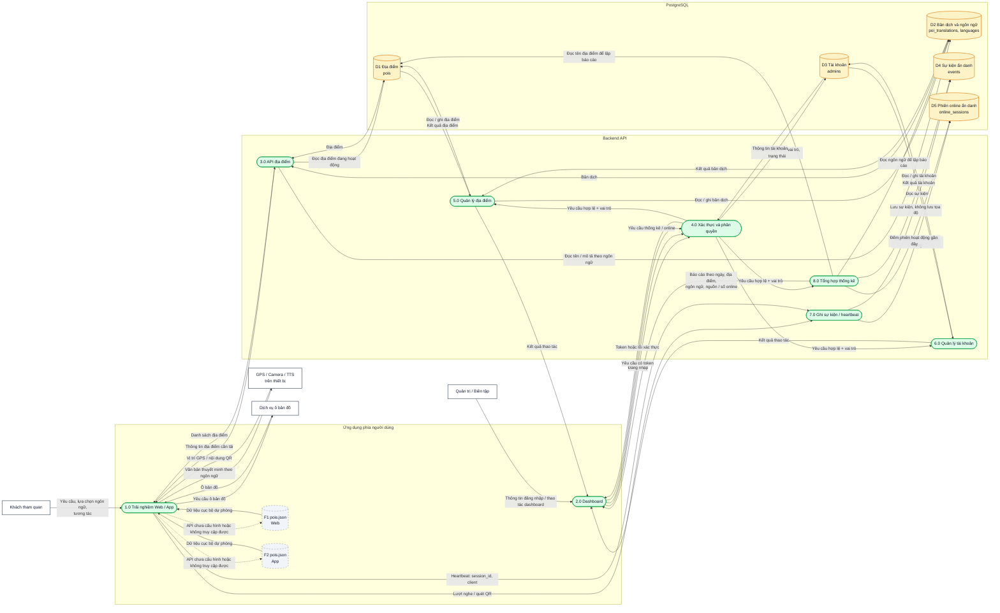
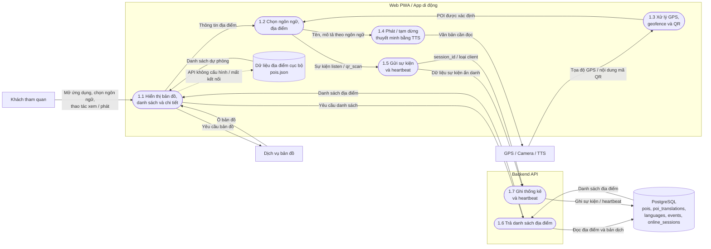
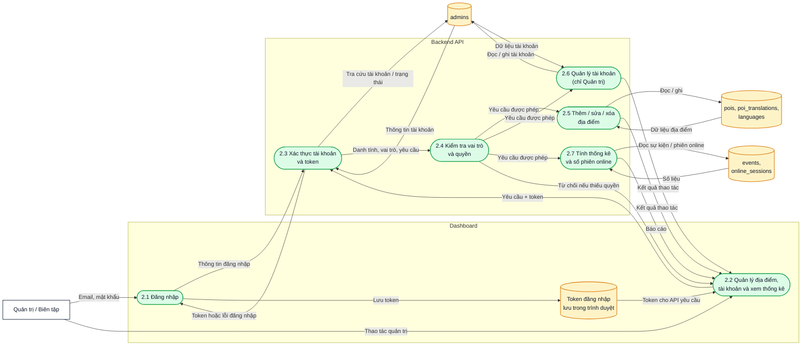

# Sơ đồ luồng dữ liệu (DFD) — Campus Guide

Campus Guide là hệ thống hướng dẫn tham quan khuôn viên ĐH Sài Gòn. Web PWA và app di động cung cấp thông tin địa điểm, bản đồ, quét QR và thuyết minh theo vị trí; dashboard cho phép Quản trị/Biên tập quản lý dữ liệu và xem thống kê.

> **Cách xem sơ đồ:** mở file này trên GitHub hoặc trong VS Code, nhấn **Ctrl+Shift+V** để mở Markdown Preview. Các khối Mermaid bên dưới sẽ được hiển thị thành hình.

## DFD mức 0 — Sơ đồ ngữ cảnh

Toàn bộ ứng dụng Web, App, Dashboard, backend API và cơ sở dữ liệu được xem là một hệ thống duy nhất. Thiết bị (GPS, camera, loa/TTS) thuộc phía khách tham quan; dịch vụ bản đồ là hệ thống ngoài.

## DFD mức 1 — Các tiến trình và kho dữ liệu

## DFD mức 2 — Trải nghiệm khách tham quan

GPS, QR, chọn ngôn ngữ, geofence và phát văn bản bằng TTS được xử lý trong Web/App. Backend chỉ nhận yêu cầu danh sách địa điểm, sự kiện thống kê và heartbeat; tọa độ GPS không được gửi lên API.

## DFD mức 2 — Dashboard quản trị

## Mô tả kho dữ liệu và quy tắc

| Mã | Kho dữ liệu | Nội dung |
|---|---|---|
| F1 / F2 | `pois.json` trong Web / App | Dữ liệu địa điểm dự phòng khi API chưa cấu hình hoặc không truy cập được; không ghi được thống kê trong chế độ dự phòng. |
| D1 | `pois` | Mã địa điểm, mã QR, tọa độ, bán kính, trạng thái hoạt động. |
| D2 | `poi_translations`, `languages` | Tên, mô tả và tùy chọn `audio_url` theo tiếng Việt, Anh, Trung. Web ưu tiên phát file audio nếu có `audio_url`, tự động chuyển sang TTS nếu không có hoặc phát lỗi. |
| D3 | `admins` | Email, mật khẩu đã băm, vai trò (`admin` / `editor`) và trạng thái tài khoản. |
| D4 | `events` | Sự kiện `listen` / `qr_scan`, ngôn ngữ, nguồn, loại client và thời điểm; không lưu tọa độ GPS hay danh tính khách. |
| D5 | `online_sessions` | Mã phiên ngẫu nhiên, loại client và thời điểm heartbeat; dùng ước tính số phiên online gần đây. |

- Quản trị có thể quản lý tài khoản và xóa địa điểm; Biên tập có thể thêm/sửa địa điểm và xem thống kê. API là nơi kiểm tra quyền cuối cùng.
- Quét QR và vào vùng địa điểm không tự gửi vị trí lên server; ứng dụng xử lý QR/GPS tại máy rồi chỉ gửi sự kiện cần thống kê.
- Dashboard gọi API quản trị bằng token; token được lưu ở trình duyệt. Mật khẩu tài khoản được băm trước khi ghi database.
- Web/App gọi trực tiếp dịch vụ bản đồ để tải ô bản đồ. API/backend không làm proxy cho dữ liệu bản đồ.
- Đường nét đứt trong sơ đồ chỉ luồng dự phòng đọc `pois.json`; dữ liệu cục bộ không thay thế dữ liệu ghi nhận trên server.
