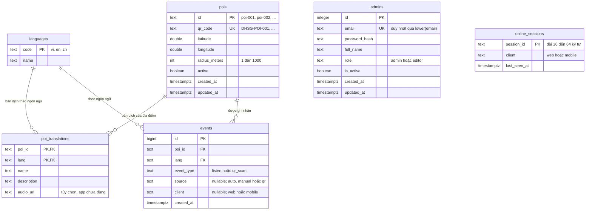

# Sơ đồ cơ sở dữ liệu (ERD)

Sơ đồ bên dưới viết bằng Mermaid, GitHub tự vẽ thành hình khi xem file này. Định nghĩa đầy đủ nằm ở `../sql/schema.sql`.

`poi_number_seq` là sequence PostgreSQL, không phải bảng nên không thể hiện như entity trong sơ đồ. Backend dùng sequence này để cấp ID `poi-NNN`; seed đồng bộ sequence theo ID lớn nhất hiện có. Bảng `admins` và `online_sessions` không có khóa ngoại trong schema nên là các entity độc lập trong ERD.

## Giải thích từng bảng

| Bảng | Dùng để | Ghi chú |
|---|---|---|
| `languages` | Danh sách ngôn ngữ hỗ trợ (vi, en, zh) | Seed nạp ba ngôn ngữ; ứng dụng hiện giới hạn mã ngôn ngữ bằng `src/validation.js` và giao diện nên thêm dòng vào bảng chưa đủ để hỗ trợ ngôn ngữ mới |
| `admins` | Tài khoản đăng nhập dashboard | Vai trò `admin` (Quản trị) hoặc `editor` (Biên tập). Không xóa tài khoản, chỉ khóa (`is_active = false`) |
| `pois` | Địa điểm: tọa độ, bán kính vùng tự động phát | `id` lấy từ `poi_number_seq`; `qr_code` được ghép từ tiền tố và ID. Mã không đổi khi sửa để QR đã in vẫn dùng được |
| `poi_translations` | Tên, mô tả và đường dẫn audio của từng địa điểm theo từng ngôn ngữ | Khóa chính gồm `(poi_id, lang)`. Xóa địa điểm thì bản dịch xóa theo. Schema không bắt buộc mỗi POI có đủ ba bản dịch; seed và kiểm tra đầu vào của ứng dụng cung cấp quy ước này |
| `events` | Sự kiện thống kê ẩn danh | **Không có vị trí hay thông tin người dùng.** `source` và `client` cho phép NULL theo schema. Xóa địa điểm thì sự kiện của nó cũng xóa theo |
| `online_sessions` | Heartbeat phiên web/app để ước tính số phiên đang hoạt động | `session_id` ẩn danh, không liên kết với tài khoản; phiên cũ được dọn sau một ngày. Dữ liệu này phục vụ thống kê hiện diện, không phải lượt nghe/quét QR |

## Quy tắc ràng buộc quan trọng (do database bảo đảm)

- Vĩ độ trong [-90, 90], kinh độ trong [-180, 180], bán kính từ 1 đến 1000 mét.
- Tên và mô tả không được rỗng.
- `events`: `listen` chỉ có nguồn `auto` hoặc `manual`; `qr_scan` chỉ có nguồn `qr`.
- Vai trò admin chỉ nhận `admin` hoặc `editor`; email tài khoản duy nhất không phân biệt hoa thường (unique index trên `lower(email)`).
- `online_sessions.session_id` dài 16–64 ký tự; `client` nhận `web` hoặc `mobile`.
- Các quan hệ khóa ngoại tới POI và ngôn ngữ được schema khai báo; xóa POI xóa theo bản dịch và sự kiện (`ON DELETE CASCADE`).

Database **không** bảo đảm mỗi POI có đúng ba bản dịch, mỗi sự kiện có `client`/`source` khác NULL, hoặc ID POI luôn theo mẫu `poi-NNN`; các quy tắc này được seed/ứng dụng áp dụng một phần.

## Cách thống kê được tính (`GET /api/admin/stats`)

- **Lượt nghe**: số sự kiện `listen` (mỗi lần bắt đầu phát, tự động hoặc bấm Phát tay). Bấm Tiếp tục sau khi tạm dừng không tính thêm.
- **Lượt quét QR**: số sự kiện `qr_scan` (quét trong app, nhập mã, hoặc mở web bằng liên kết `?qr=` / `?poi=`).
- Gom theo ngày UTC, có bù các ngày không có dữ liệu bằng 0.
