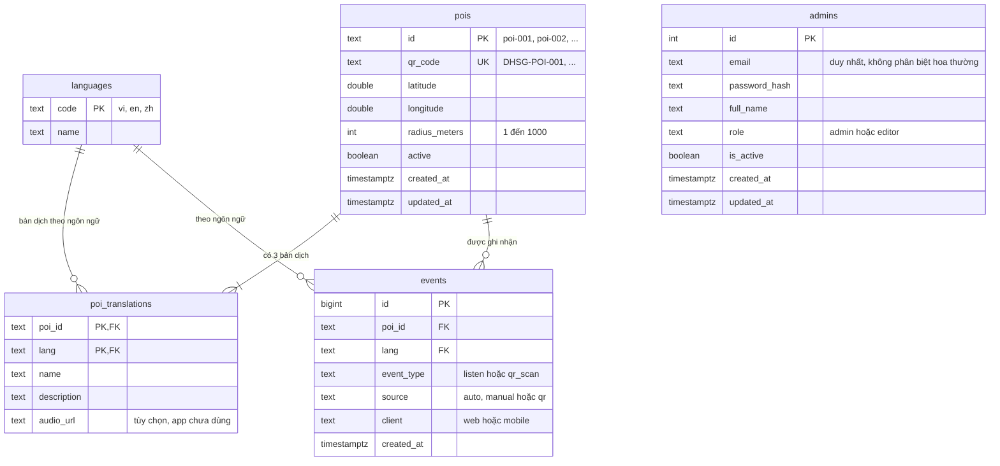

# Sơ đồ cơ sở dữ liệu (ERD)

Sơ đồ bên dưới viết bằng Mermaid, GitHub tự vẽ thành hình khi xem file này. Định nghĩa đầy đủ nằm ở `../sql/schema.sql`.

## Giải thích từng bảng

| Bảng | Dùng để | Ghi chú |
|---|---|---|
| `languages` | Danh sách ngôn ngữ hỗ trợ (vi, en, zh) | Thêm ngôn ngữ mới = thêm một dòng ở đây, rồi sửa kiểm tra dữ liệu ở `src/validation.js` và giao diện |
| `admins` | Tài khoản đăng nhập dashboard | Vai trò `admin` (Quản trị) hoặc `editor` (Biên tập). Không xóa tài khoản, chỉ khóa (`is_active = false`) |
| `pois` | Địa điểm: tọa độ, bán kính vùng tự động phát | `id` và `qr_code` được sinh tự động khi tạo, không đổi khi sửa để mã QR đã in vẫn dùng được |
| `poi_translations` | Tên, mô tả và đường dẫn audio của từng địa điểm theo từng ngôn ngữ | Khóa chính gồm `(poi_id, lang)`. Xóa địa điểm thì bản dịch xóa theo |
| `events` | Sự kiện thống kê ẩn danh | **Không có vị trí hay thông tin người dùng.** Xóa địa điểm thì sự kiện của nó cũng xóa theo |

## Quy tắc ràng buộc quan trọng (do database bảo đảm)

- Vĩ độ trong [-90, 90], kinh độ trong [-180, 180], bán kính từ 1 đến 1000 mét.
- Tên và mô tả không được rỗng.
- `events`: `listen` chỉ có nguồn `auto` hoặc `manual`; `qr_scan` chỉ có nguồn `qr`.
- Email tài khoản là duy nhất, không phân biệt hoa thường.

## Cách thống kê được tính (`GET /api/admin/stats`)

- **Lượt nghe**: số sự kiện `listen` (mỗi lần bắt đầu phát, tự động hoặc bấm Phát tay). Bấm Tiếp tục sau khi tạm dừng không tính thêm.
- **Lượt quét QR**: số sự kiện `qr_scan` (quét trong app, nhập mã, hoặc mở web bằng liên kết `?qr=` / `?poi=`).
- Gom theo ngày UTC, có bù các ngày không có dữ liệu bằng 0.
